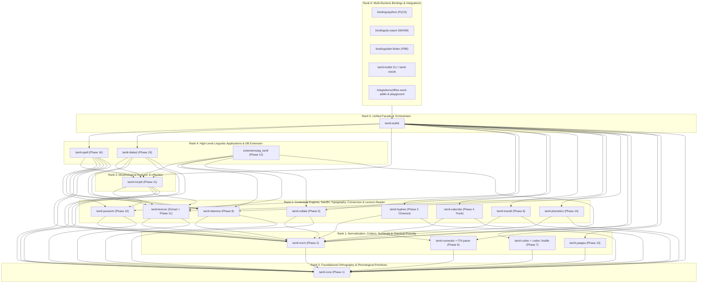
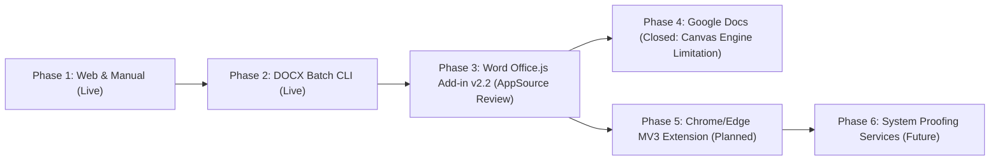

# Project Roadmap: tamil-toolkit

This document tracks current capabilities, architectural dependency ranks (`Rank 0`–`Rank 6`), capability difficulty tiers (`Tier 1`–`Tier 5`), identified gaps inside existing crates, planned/missing NLP crates, and the sequenced 18-phase execution roadmap across all `tamil-toolkit` domains.

See also the [canonical architecture contract](docs/specs/architecture-roadmap.md) and its [lifecycle evidence requirements](docs/specs/architecture-roadmap.md#lifecycle-and-acceptance).

For the full normative specification of crate boundaries, prerequisite rules, and acceptance gates, see [Feature Specification 016: Crate Dependency DAG, Capability Boundaries & Difficulty-Tiered Roadmap](specs/016-crate-dependency-roadmap/spec.md).

---

## 1. Overview of Modules & Status

| Domain / Crate | Rank | Difficulty Tier | Current Status | Key Deliverables & Documentation |
|---|---:|---|---|---|
| **`tamil-core`** | Rank 0 | Tier 1 | **Published** (`v0.1.0-alpha.10`); Phase 1 `completed` | Scalar segmentation, UAX #29 tailored `Letters` (`க்ஷ`, `ஸ்ரீ`), `split_uyirmei`/`compose_uyirmei`, NFC/NFD, `is_kuril`, `is_nedil`, `is_mei`/`is_otru`, `is_aytham`, `baseline_maathirai`, `ina_ezhuthu`, and narrow `Olippasai` syllable nucleus spans. |
| **`tamil-norm`** | Rank 1 | Tier 3 | **Published** (`v0.1.0-alpha.10`); Phase 2 `completed` | (1) Canonical NFC/NFD, (2) Opt-in `repair_tamil_text` (duplicate pulli, visual left-kombu reordering, control/SHY stripping with diagnostics), (3) Versioned lossy `fold_for_search` (*Mayangoli* & Grantha folding). When Phase 16 specifies shared *Mayangoli* overlap, hosts pure confusion-set/phonotactic lock predicates in `tamil-norm::mayangoli` (keeping IME preview ranking in `tamil-translit` and dictionary-weighted edits in `tamil-spell`). |
| **`tamil-codec`** | Rank 1 | Tier 2 | **Published** (`v0.1.0-alpha.10`); Phase 7 `completed` (11 legacy codecs + Braille + auto-detect + Playground PDF layer) | Bamini, TSCII, TAB, TAM, Anjal, Vanavil, LT-TM / IndoWord, **Senthamil, Shree-Tam, Softview, TBO**, heuristic `detect_encoding`, companion client-side `PDF.js` text-layer legacy PDF extraction in `playground/` (no OCR), and **`tamil-codec::braille`** (Bharathi Tamil Grade 1 Braille `U+2800..U+28FF`). See [Codec Roadmap](docs/specs/codec-roadmap.md), [Phase 7 Legacy Spec](docs/specs/codec-phase7-legacy.md), and [Braille Spec](docs/specs/codec-braille.md). |
| **`tamil-numerals`** | Rank 1 | Tier 2–3 | **Published** (`v0.1.0-alpha.10`, `v0.4` active); Phase 6 `completed` | TN/SL numeral words, 20 traditional fractions, INR/LKR + diaspora currencies (`SGD`, `MYR`, `USD`, `EUR`, `GBP`, `CAD`), `U+0BF0..U+0BF2` traditional integers, ordinals, colloquial mixed fraction words (`ஒன்றேகால்`, `இரண்டரை`), formal reverse word-to-number ITN (`words_to_number`), Gregorian date formatting. See [Numerals v0.4](docs/specs/numerals-v0.4.md). |
| **`tamil-yaappu`** | Rank 1 | Tier 3–4 | **Planned** (Workspace Scaffold) | Classical Tamil prosody (*Yaapparungalakkaarigai* / *Tolkappiyam*): contextual *Maathirai*, *Asai* (*Ner* / *Nirai*), *Seer*, *Thalai*, *Adi*, *Thodai*, and *Paa* meter validation (*Venpa*, *Asiriyappa*, *Kalippa*, *Vanjippa*). |
| **`tamil-calendar`** | Rank 2 | Tier 2 / Tier 5 | **Published** (`v0.1.0-alpha.10`; 4 civil suites `active`; 13 ephemeris/observance suites `planned`) | 60-year cycle, Thiruvalluvar year, TN/SL official holidays (`active`); bounded `Thirukanitham` (`astro` 2.0.0) & 1962 `Vakya` solar/lunar/civil engines and observance selectors (`planned`; remains deferred pending additional ephemeris/witness work). Keep as one crate; feature-gate `thirukanitham`/`vakya`/`observances` if size measurements justify it. See [Calendar Candidate](docs/releases/numerals-calendar-candidate.md). |
| **`tamil-collate`** | Rank 2 | Tier 2 | **Published** (`v0.1.0-alpha.10`; `agara-v1` & `uyirmei-first-v1` active); Phase 5 `completed` | Deterministic Mei-first *Agara Varisai* (`agara-v1`), modern Uyirmei-first (`uyirmei-first-v1`), versioned `folded_search_key`, `sort_key`, `search_key`, `compare`. |
| **`tamil-hyphen`** | Rank 2 | Tier 1 / Tier 3 | **Published** (`v0.1.0-alpha.10`, active in `release-policy.toml`); Phase 3 `completed` | Canonical 5-step Tamil *Asai* + `left_min = 3, right_min = 3` (`MIN_WORD_LETTERS = 6`) syllabic hyphenation, soft-hyphen (`\u{00AD}`) injection, Frank Liang `.dic` generator, LibreOffice `.oxt`, headless OpenXML `.docx` batch processor (feature-gate `docx`/`oxt` `dep:zip` for slim WASM builds). |
| **`tamil-punarchi`** | Rank 2 | Tier 4 | **Planned** (Workspace Scaffold) | Sourced *Nannool* (Sutras 151–257) Sandhi engine: forward synthesis (`Thonral`, `Thirithal`, `Keduthal`, `Iyalbu`) with explicit *Vetrumai*/*Alvazhi* context, plus bounded inverse-rule candidate generation returning rule IDs, reconstructed forms, and surface spans. See [Punarchi Spec](docs/specs/punarchi-v0.1.md). |
| **`tamil-translit`** | Rank 2 | Tier 2 / Tier 5 | **Published** (`v0.1.0-alpha.10`); Phase 8 `completed` | Bidirectional orthographic transliteration & deterministic offline input: Phase 8 reversible scholarly schemes (ISO 15919, Madras University Lexicon, ITRANS, Harvard-Kyoto) **plus** deterministic keyboard & rule-based phonetic input (Tamil99, Anjal phonetic, Suratha Bamini, Phonetic/Tanglish v1) and `transliterate_suggest`. Phase 17 epigraphic scripts (Tamil-Brahmi `U+11000`, Grantha `U+11300`, Vatteluttu) and cross-script (Sinhala/Malayalam) are opt-in Cargo features; statistical/lexicon-ranked Tanglish stays out of Rank 2 and is orchestrated in Rank 5 `tamil-toolkit`. See [Translit Spec](docs/specs/translit-v0.1.md). |
| **`tamil-lexicon`** | Rank 2 | Tier 2 | **New Planned** (Unscaffolded — extract from `tamil-toolkit` before Phase 11) | Pure **Apache-2.0** runtime `.tlpack` reader/validator, `CompiledPackView::parse`, FST `lookup_in_views`, and `LexiconStore` trait so Rank 3–4 crates (`tamil-morph`, `tamil-dialect`, `tamil-spell`, `pg_tamil`) can query packs without violating the DAG. Zero `build.rs`, zero `csv`, zero `source_records`, and zero bundled `CC-BY-SA-4.0` pack bytes (pack compilation stays on the host/tooling path; optional compile-time `lexicon-*` embedding stays in Rank 5 `tamil-toolkit`). |
| **`tamil-phonetics`** | Rank 2 | Tier 4 | **New Planned** (Unscaffolded until Phase 14) | Context-sensitive Grapheme-to-Phoneme (G2P) and IPA pronunciation: allophonic voicing and intervocalic lenition of `க, ச, ட, த, ப`, post-nasal homorganic voicing, geminate invariance, and vowel reductions. |
| **`tamil-tokenize`** | Rank 2 | Tier 3 | **New Planned** (Unscaffolded until Phase 9) | Surface sentence and word tokenization with byte/letter spans, sourced Tamil abbreviation disambiguation (`திரு.`, `பி.ப.`, `மு.க.`), and stratified stopword lexicons. |
| **`tamil-morph`** | Rank 3 | Tier 4 | **Planned** (Workspace Scaffold) | Single-crate FST / chart morphological analyzer, stemmer/lemmatizer (always-on for `pg_tamil` FTS), 8-case noun declension (*Vetrumai*), 6-part *Pagu-padham* verb conjugation, clitic detachment, and lexical validation/ranking of `tamil-punarchi` compound split candidates consuming `tamil-lexicon`. Uses coarse additive features (`default = ["analyze", "compound"]`, optional `generate`). |
| **`tamil-dialect`** | Rank 4 | Tier 5 | **Planned** (Workspace Scaffold) | Pluricentric regional lexical & spoken-to-literary (*Senthamizh*) normalization across `ta-IN` (Central, Madurai, Kongu, Nellai, Madras) and `ta-LK` (Jaffna, Batticaloa, Vanni, Up-Country), plus `ta-SG`/`ta-MY`, consuming regional `.tlpack` packs via `tamil-lexicon`. |
| **`tamil-spell`** | Rank 4 | Tier 4–5 | **New Planned** (Unscaffolded until Phase 16) | Single crate with `spelling` (*Mayangoli* `ல/ள/ழ`, `ன/ண`, `ர/ற` confusion-set spellchecker & grapheme-weighted edit distance) and `valimigum` (*Valimigum / Valimigaa Idangal* fortis stop doubling linter) modules consuming `tamil-lexicon`, `tamil-punarchi`, and `tamil-morph`. Defer any separate `tamil-grammar` crate unless reusable syntax parsing emerges beyond spelling. |
| **`extensions/pg_tamil`** | Rank 4 | Tier 2 / Tier 4 | **Scaffold** (Isolated PostgreSQL Extension) | Stage 1: PostgreSQL scalar normalization, repair, and `agara-v1`/folded collation keys (`tamil-norm` + `tamil-collate`). Stage 2: PostgreSQL Full-Text Search (FTS) parser, stopword filter, and morphological stemmer (`tamil-tokenize` + `tamil-lexicon` + `tamil-morph`). |
| **`tamil-toolkit`** | Rank 5 | Tier 1 | **Published** (`v0.1.0-alpha.10`) | Unified Rust facade, modular JSON dispatcher, cross-crate orchestrator (compound-aware hyphenation, morph-assisted phonetics, Phase 17 lexicon-ranked Tanglish), optional source-checkout `lexicon-*` pack embedding, `tamil-oracle`, and `tamil-toolkit` CLI (gate `csv` behind an optional feature for `source-records`). |
| **Adapters, Playground, Word Add-in & Browser Extension** | Rank 6 | Tier 1–3 | **Live** (Word `v2.5.0` & Chrome/Edge/Firefox MV3 Extension built) | Python (`PyO3`), Node/Browser (`WASM`), Dart/Flutter (`dart:ffi`, local), 100% client-side PWA Playground, Microsoft Word `Office.js` Taskpane Add-in (`v2.5.0`), and Chrome/Edge & Firefox MV3 Browser Extension. |

---

## 2. Acyclic Crate Dependency DAG (`Rank 0` – `Rank 6`)

Every dependency edge (`[dependencies]`, `[dev-dependencies]`, `[build-dependencies]`, including optional features) MUST point strictly to a lower rank (`Rank(dependency) < Rank(dependent)`).

### Key Architectural Boundary Rules
1. **`tamil-core` vs. `tamil-hyphen` vs. `tamil-yaappu`**:
   - `tamil-core` (`Rank 0`) owns pure letter-quantity facts (`is_kuril`, `is_nedil`, `is_mei`/`is_otru`, `is_aytham`, nominal `baseline_maathirai`, `ina_ezhuthu`) and narrow orthographic syllable nuclei (`Olippasai` with spans).
   - `tamil-hyphen` (`Rank 2`) owns typographic line-breaking policies (`left_min = 3, right_min = 3`, `MIN_WORD_LETTERS = 6`, segment merging, `.dic`/`.oxt`/`.docx`, with `docx`/`oxt` `dep:zip` feature-gated for slim WASM).
   - `tamil-yaappu` (`Rank 1`) owns classical prosodic interpretation (contextual *Maathirai* reductions for *Kurriyalugaram*/*Alapedai*, *Ner*/*Nirai* *Asai* scanning, *Seer*, *Thalai*, *Adi*, *Thodai*, and *Paa* meter validation).
2. **`tamil-punarchi` vs. `tamil-morph` (Zero Cycle Guarantee)**:
   - `tamil-punarchi` (`Rank 2`) depends only on `tamil-core` and `tamil-norm`. It owns forward Sandhi synthesis (with explicit grammatical context) and bounded inverse-rule candidate generation (returning rule IDs, reconstructed underlying forms, and surface spans).
   - `tamil-morph` (`Rank 3`) depends on `tamil-punarchi` and `tamil-lexicon` to apply/invert morphophonemic boundary transitions and validate/rank compound split candidates against the stem lexicon. `tamil-punarchi` never depends on `tamil-morph`. Keep `tamil-morph` as a single crate with coarse additive features (stemmer always-on, `default = ["analyze", "compound"]`, optional `generate`).
3. **`tamil-lexicon` (`Rank 2`) Engine vs. Data Boundary**:
   - Before Phase 11, extract **`tamil-lexicon` (`Rank 2`)** from `tamil-toolkit` (`Rank 5`) as a pure **Apache-2.0** runtime `.tlpack` reader/validator (`CompiledPackView::parse`, FST `lookup_in_views`, `LexiconStore` trait) depending only on `tamil-core` and `tamil-norm`.
   - `tamil-lexicon` MUST remain free of `build.rs`, `csv`, `source_records`, and bundled `CC-BY-SA-4.0` pack bytes; pack compilation stays on the host/tooling path and optional compile-time `lexicon-*` embedding stays in `tamil-toolkit` (`Rank 5`). Approve `tamil-lexicon` in `release-policy.toml` and `publish-crate.yml` in the same scope change that wires it into `tamil-toolkit`.
4. **Narrow *Mayangoli* Sharing (`tamil-norm` vs. `tamil-translit` vs. `tamil-spell`)**:
   - When Phase 16 specifies shared *Mayangoli* overlap, lift only the pure confusion sets and phonotactic lock predicates into `tamil-norm::mayangoli` (`Rank 1`). Keep IME preview candidate ordering/caps in `tamil-translit` (`Rank 2`) and lexicon-weighted edit distance in `tamil-spell` (`Rank 4`).
5. **Facade Orchestration for Sibling Integrations (No `tamil-ime` Crate)**:
   - Morphology-aware compound hyphenation (`tamil-morph` + `tamil-hyphen`), morphology-assisted pronunciation (`tamil-morph` + `tamil-phonetics`), and Phase 17 statistical/lexicon-ranked Tanglish disambiguation (`tamil-translit` + `tamil-lexicon` + `tamil-morph` + `tamil-spell` + `tamil-dialect`) are orchestrated in `tamil-toolkit` (`Rank 5`) without adding direct Cargo dependencies between sibling crates or spawning a premature `tamil-ime` crate.

---

## 3. Sequenced Execution Roadmap (`Phase 0` – `Phase 17`)

Each phase specifies its **Difficulty Tier**, **Hard Prerequisites** (what must be completed before it starts), and **Exit Gate**.

### Lexicon Data Track — Feature 021

**Storage revision (2026-11-14)**: Large dictionary CSV uses readable UTF-8
Tamil (`json-string-utf8-v1`) with reversible JSON/control escaping; golden tests
and exact scalar diagnostics retain escapes. Runtime artifact format is chosen
and measured separately. See [the storage decision](docs/decisions/lexicon-text-storage.md).
Uncommitted legacy staging was removed with no legacy archive retained; the
clean UTF-8 rebuild, exact source-content equality, pre-projection clean replay,
739-record L2 structural pilot acceptance, fail-closed release rejection, and
full pre-stop gate are now complete. This revision changes no crate rank, phase
number, source approval, or consumer acceptance.

The [lexicon curation specification](specs/021-lexicon-curation/spec.md) takes scheduling priority before new Phase 6 numerals work. The [intake audit](docs/audits/lexicon-2026-11-13.md) supplies evidence of the original files, not reviewed dictionary coverage. Existing Phase 0–17 identifiers and Cargo ranks remain unchanged; this data track introduces no crate.

| Milestone | Exit gate | Current evidence |
|---|---|---|
| **L0 — Intake** | Preserve 12 source files/checksums and structural audit; record unresolved source evidence. | Completed (`data/sources/tamil-lexicon.sha256.json`, [baseline.json](target/lexicon/baseline.json)); historical 12-file / 307,243-record bulk lineage remains unverified/quarantined, while the separate pinned-Wiktionary route closed `T038` for the six-entry core. |
| **L1 — Contract and provenance** | Approve schema, stable identities/legacy mapping, controlled labels, source registry, and assertion-level review/reuse model. | Completed (`schemas/lexicon/`, `data/curation/tamil-lexicon/`, `tools/lexicon.py` including 9-table `review-ingest`); exact payload equality ([source-content-proof-final.json](target/lexicon/source-content-proof-final.json)) and pre-projection clean replay ([us1-proof.json](target/lexicon/us1-proof.json)) verified. |
| **L2 — Structural pilot** | Meet FR-019 sampling minima, complete structural review, validate every selected record disposition, and resolve blocking accounting/curated-record errors. Quarantine or exclude unresolved source/reuse/linguistic findings. Zero release-eligible content is permitted. | **Accepted** ([l2-acceptance.json](target/lexicon/l2-acceptance.json), [structural-final.json](target/lexicon/structural-final.json)): `739` selected records, `307,243` validated quarantined dispositions, `0` eligible bulk assertions, fail-closed release guard exit `1` ([release-rejection-final.json](target/lexicon/release-rejection-final.json)), and full pre-stop gate passed ([pre-stop-utf8-final-retry.log](target/lexicon/pre-stop-utf8-final-retry.log)). **Phase 6 numerals scheduling is unblocked**; grants no historical data-release or runtime approval. |
| **L3 — Accounted data packs** | Approve relevant nonempty subsets with source/reuse evidence, applicable review decisions, complete merge/split/exclusion/quarantine accounting, declared scope, reference closure, and reproducible manifests. | **Accepted for six-entry Wiktionary core** ([l3-acceptance.json](target/lexicon/l3-acceptance.json)): `6` entries, `19` senses, `31` genuine accepted-human claims (`abish`, `2026-11-14`, [approval receipt](docs/reviews/wiktionary-core-approval-2026-11-14.json)), separate **CC-BY-SA-4.0** canonical pack `lexicon/dictionary/` (`0.1.0+4d1309d05391`, manifest SHA-256 `4d1309d05391be1087c11590d664b8669b49ef8312b6c32e4bb32aa86b135079`; engine code remains MIT), offline CLDF 1.3 export/round-trip (`dbc9cd09b2c4d267f09ef25493656c7b99d25005614a2a326b632519d75dc54b`), `0`-byte default payload, `50,923`-byte compiled `.tlpack` core artifact (SHA-256 `283e32d7b3dbfa11d1bedc201a95e90bcb064021dba96fd6a44a61491f5137ea`), and all `16` feature combinations passing compiler checks. Structured scopes stay `unknown` (`2` pending proposals), no IPA/etymology/morphology/DEDR claims, and historical bulk material remains quarantined. |
| **L4 — Verified consumers** | Exact lookup returns every eligible homograph; sourced escaped goldens precede shared Rust behavior, CLI/adapters, parity, explicit activation and release review. | **Verified bounded core**: [lexicon-v0.1.md](docs/specs/lexicon-v0.1.md), `44` escaped **active** goldens ([lexicon_lookup.jsonl](tests/golden/lexicon_lookup.jsonl)), safe Rust compiler/lookup/dispatcher/CLI pass `8` focused `core` tests (all `44` active vectors), `7` `default` tests, and `core` `clippy -D warnings` ([runtime-core-root.log](target/lexicon/runtime-core-root.log), [runtime-default-root.log](target/lexicon/runtime-default-root.log), [runtime-clippy-root.log](target/lexicon/runtime-clippy-root.log); lookup allocates on NFC/deserialization with no zero-allocation claim). Core/default runtime parity, final core gates and isolated archive consumers pass. Full structural targets pass (52.72 seconds / 191.93 MiB); owner activation is recorded on 2026-11-15. |

**Scheduling**: Phase 6 resumes after L2 acceptance is recorded in the handoff; L3/L4 may proceed alongside independent language work. Calendar witness review stays independent; previously deferred Punarchi research stays deferred. Missing evidence blocks affected data approval, not contract drafting or unrelated work. L2 requires every FR-019 sampling minimum and validated dispositions; unresolved evidence may remain quarantined, and zero release-eligible content does not prevent Phase 6 from resuming.

**Consumer data gates**: Phase 11 requires reviewed stems, POS and inflection-class conventions/evidence; Phase 15 requires attested regional forms and directional mappings; Phase 16 requires approved vocabulary/variants and explicit scope (dictionary absence alone is not a spelling error). The six-entry Wiktionary `core` L3 pack satisfies bounded exact lookup scope only (structured scopes remain `unknown`, with no stems/morphology/IPA) and does not satisfy Phase 11, Phase 15, or Phase 16 consumer data gates. Each relevant subset must meet L3 source/review/release-eligibility acceptance before its consumer claims support; L2 structural acceptance alone is insufficient. Phase 14 may develop sourced G2P rules independently; lexical exceptions/evaluation require reviewed pronunciation and transcription/region conventions. Imported IPA, roots, confidence and sandhi prose do not establish these capabilities.

**Ownership and acceptance**: original snapshots stay in `data/sources/`; reviewed canonical CSV/TOML belongs in `lexicon/`, with indexes generated by Rust build tooling. Existing Rust crates own linguistic behavior, the facade orchestrates siblings, and bindings stay thin. Data prerequisites add no Cargo edges or ranks. Data milestones require editorial/validation evidence; public operations retain the full sourced-golden, Rust, dispatcher, parity, activation and release-policy gates. L1 completion does not mark any data or runtime capability `active`.

| Phase | Deliverable / Milestone | Difficulty | Hard Prerequisites | Exit Gate & Verification Contract |
|---:|---|---:|---|---|
| **0** | **Freeze Spec 016 Architecture, DAG & Status Vocabulary** | Tier 1 | *None* | `specs/016-crate-dependency-roadmap/spec.md` and `ROADMAP.md` synchronized; status vocabulary (`unscaffolded`, `planned`, `specified`, `implemented`, `active`, `release-approved`, `published`) established. |
| **1** | **`tamil-core` Phonological & Nucleus Primitives Closeout** | Tier 1 | Phase 0 | Add sourced `is_kuril`, `is_nedil`, `is_mei`/`is_otru`, `is_aytham`, nominal `baseline_maathirai`, `ina_ezhuthu`, and narrow `Olippasai` nucleus spans to `tamil-core` with active golden vectors. |
| **2** | **`tamil-norm` Orthographic Repair & Search-Folding Contracts** | Tier 3 | Phase 1 | Expand `tamil-norm` into 3 explicit contracts: (1) canonical NFC/NFD, (2) opt-in `repair_tamil_text` with edit provenance, (3) versioned lossy `fold_for_search` profiles (*Mayangoli* & Grantha). |
| **3** | **`tamil-hyphen` Release Policy, Manifest & WASM Consolidation** | Tier 1 | Phase 1, Phase 2 | Refactor `tamil-hyphen` to consume `tamil-core` Phase 1 primitives; promote `hyphen_syllable.jsonl` to `active` in `tests/golden/manifest.json`; add `tamil-hyphen` to `release-policy.toml` `public_crates`; remove exemption in `tools/release_policy.py`; consolidate Playground & Word Add-in onto shared Rust/WASM; expand `tamil-toolkit` CLI subcommands. |
| **4** | **`tamil-calendar` Planned Suite Review & Activation Track** | Tier 5 | Phase 0 *(Independent / Deferred Track)* | Complete remaining ephemeris/observance work and review each of the 13 planned calendar/observance JSONL suites against independent primary witnesses; do not activate until owner review approves each suite. Does not block language phases. |
| **5** | **`tamil-collate` Folded Search & Uyirmei-First Profile** | Tier 2 | Phase 2 *(Completed)* | Add versioned `folded_search_key` (preserving exact `agara-v1` `search_key` compatibility) and a sourced modern Uyirmei-first school dictionary collation profile. |
| **6** | **`tamil-numerals` Reverse Word Parsing (ITN), Mixed Fractions & Currencies** | Tier 2–3 | Phase 1; L2 scheduling gate *(Completed)* | Add reverse formal word-to-number parsing (`"நூற்று இருபத்து மூன்று"` $\rightarrow$ `123`), colloquial mixed-fraction words (`ஒன்றேகால்`, `இரண்டரை`), and diaspora currency profiles (`SGD`, `MYR`, `USD`, `EUR`, `GBP`, `CAD`). |
| **7** | **`tamil-codec` Legacy Font Expansion, Client-Side PDF Layer & `codec::braille`** | Tier 2 | Phase 1 *(Completed)* | Add sourced legacy font tables (Senthamil, Shree-Tam, Softview, TBO), companion client-side `PDF.js` text-layer legacy PDF extraction in `playground/` (no OCR), and `tamil-codec::braille` (Bharathi / Unicode Braille `U+2800..U+28FF` Grade 1). |
| **8** | **`tamil-translit` (Orthographic Romanization & Deterministic Offline Input)** | Tier 2 | Phase 1, Phase 2 *(Completed)* | Create `crates/tamil-translit`; implement reversible scholarly profiles (ISO 15919, Madras University Tamil Lexicon, ITRANS, Harvard-Kyoto) **plus** deterministic offline keyboard & phonetic profiles (**Tamil99, Anjal, Suratha Bamini, rule-based Phonetic/Tanglish v1**) for Playground, Word Add-in, and Chrome Extension. |
| **9** | **`tamil-tokenize` (Surface Sentence/Word Spans & Abbreviations)** | Tier 3 | Phase 1, Phase 2 | Create `crates/tamil-tokenize`; implement span-preserving word/sentence segmentation, sourced Tamil abbreviation lexicon (`திரு.`, `பி.ப.`, `மு.க.`), and stopword profiles. |
| **10** | **`tamil-punarchi` (Nannool Forward Synthesis & Inverse Candidates)** | Tier 4 | Phase 1, Phase 2 | Implement sourced Nannool Sutras 151–257 in `crates/tamil-punarchi`: forward synthesis with explicit *Vetrumai*/*Alvazhi* context and bounded inverse-rule candidate generation. |
| **11** | **`tamil-morph` (FST Analyzer, Noun/Verb Inflection & Compound Ranker) + `tamil-lexicon` Extraction** | Tier 4 | Phase 10; approved relevant L3 lexical subset | Extract pure Apache-2.0 `.tlpack` reader `tamil-lexicon` (`Rank 2`, zero `build.rs`/`csv`/CC-BY-SA-4.0 bytes) from `tamil-toolkit` first; then implement FST/chart analyzer in `crates/tamil-morph` (`Rank 3`, coarse additive features `analyze`/`compound`/`generate` with stemmer always-on): 8-case noun declension, 6-part *Pagu-padham* verb conjugation, clitic detachment, lemmatization, and compound split validation/ranking. |
| **12** | **Cross-Crate Integrations: Compound Hyphenation & `pg_tamil` FTS** | Tier 3–4 | Phase 3, Phase 5, Phase 9, Phase 11 | Wire `tamil-morph` surface-aligned compound boundaries into `tamil-hyphen` via `tamil-toolkit` (strictly respecting `left_min`/`right_min` margins), and complete `extensions/pg_tamil` Stage 1 (SQL norm/collation) & Stage 2 (PostgreSQL FTS dictionary/stemmer reading `.tlpack` via `tamil-lexicon` + `tamil-morph`). |
| **13** | **`tamil-yaappu` (Classical Prosody & Meter Validation)** | Tier 3–4 | Phase 1 *(Optional Sandhi hints from Phase 10)* | Implement contextual *Maathirai*, *Asai* (*Ner*/*Nirai*), *Seer*, *Thalai*, *Adi*, *Thodai*, and meter validators (*Venpa*, *Asiriyappa*, *Kalippa*, *Vanjippa*) in `crates/tamil-yaappu`. |
| **14** | **`tamil-phonetics` (Contextual G2P & Allophonic IPA)** | Tier 4 | Phase 1, Phase 2 | Create `crates/tamil-phonetics`; implement contextual allophonic voicing, intervocalic lenition, post-nasal voicing, geminate invariance, and IPA output. Lexical exceptions/evaluation require reviewed pronunciation evidence and transcription/region conventions; complete lexicon curation is not required. |
| **15** | **`tamil-dialect` (Pluricentric Regional & Spoken-to-Literary Mapping)** | Tier 5 | Phase 9, Phase 11; approved relevant L3 lexical subset | Implement sourced regional lexical (via `tamil-lexicon`) and spoken-to-literary (*Senthamizh*) transformations across `ta-IN` and `ta-LK` (Jaffna, Batticaloa, Vanni, Up-Country) in `crates/tamil-dialect`. |
| **16** | **`tamil-spell` (*Mayangoli* Spellcheck & *Valimigum/Valimigaa* Linter)** | Tier 4–5 | Phase 9, Phase 10, Phase 11; approved relevant L3 lexical subset | Create `crates/tamil-spell` (`spelling` + `valimigum` modules; defer any separate `tamil-grammar` crate); lift shared *Mayangoli* confusion sets/phonotactic lock predicates into `tamil-norm::mayangoli`; implement *Mayangoli* (`ல/ள/ழ`, `ன/ண`, `ர/ற`) spellchecking and morphology-backed *Valimigum / Valimigaa Idangal* boundary diagnostics via `tamil-lexicon`, `tamil-punarchi`, and `tamil-morph`. |
| **17** | **Advanced Profiles (Statistical Tanglish Disambiguation, Epigraphic Scripts & Broad Grammar)** | Tier 5 | Phase 8, Phase 11, Phase 14, Phase 16 | Orchestrate statistical/lexicon-ranked Tanglish disambiguation in `tamil-toolkit` (`Rank 5`, composing `tamil-translit`, `tamil-lexicon`, `tamil-morph`, `tamil-spell`, `tamil-dialect` without a premature `tamil-ime` crate); add opt-in feature-gated Tamil-Brahmi (`U+11000` Systems I–III), Grantha (`U+11300`), Vatteluttu, and Sinhala/Malayalam cross-script profiles in `tamil-translit`; and add full syntactic compound disambiguation. |

### Recommended Execution Priority (Product & Ecosystem Ordering)

Phase numbers (`Phase 0`–`Phase 17`) and Cargo DAG ranks (`Rank 0`–`Rank 6`) remain frozen for specification traceability, while execution order prioritizes the highest-leverage user and ecosystem gaps (all depending only on already-completed Phases 1–2 unless noted):

1. **Chrome / Edge MV3 Browser Extension v1 (Integration Track — Ready Now):** Ship a 100% offline MV3 Side Panel & Context Menu extension on the existing ~1.37 MiB gzipped slim WASM core (7-codec selection conversion, Unicode repair, `:lang(ta)` Noto Tamil + Tamil Supplement `U+11FC0–U+11FFF` font fixer, Live Bamini, *Agara Varisai* sorter, TN/SL numerals, offline calendar).
2. **Phase 8 (`tamil-translit` + Deterministic Tamil99 / Anjal / Suratha Bamini / Phonetic Tanglish v1):** Unlocks offline typing across Playground, Word Add-in, and the Chrome Extension without waiting for Phase 17.
3. **Phases 9 → 10 → 11 (`tamil-tokenize` → `tamil-punarchi` → `tamil-morph`) → Phase 16 (`tamil-spell`):** Prioritized ahead of Phases 13–15 (`yaappu`, `phonetics`, `dialect`) to unlock offline Vaani/Naavi-class sandhi & spellchecking, lemmatized dictionary lookup, and `pg_tamil` FTS (`Phase 12`).
4. **Phase 6 (`tamil-numerals` diaspora `SGD`/`MYR` + ITN) & Phase 7 (`tamil-codec` Senthamil/Shree-Tam + Playground client-side `PDF.js` text-layer extraction):** Incremental high-demand utilities (`codec::braille` deferred unless requested).
5. **Phase 4 (`tamil-calendar` 13 planned suites):** Remains an independent track deferred until remaining ephemeris/observance work and primary witness review are complete; do not activate prematurely.

---

## 4. Desktop, Office & Browser Integrations (Completed & Active Track)

Standard word processors and browsers do not ship offline, privacy-preserving Tamil linguistic engines, drop-in Tamil syllabic line-breaking, or MV3 multi-codec tooling. To bridge this gap without distorting same-line letter spacing, breaking ligatures, or exfiltrating text to third-party servers, all integrations share the slim Rust/WASM engine and canonical 5-step Tamil *Asai* + `left_min = 3, right_min = 3` (`MIN_WORD_LETTERS = 6`) rules (`Spec 015`).

The phased delivery strategy is detailed in [docs/integrations/word-googledocs-roadmap.md](docs/integrations/word-googledocs-roadmap.md):

- **Phase 1: Web Playground & Clipboard Workarounds (Completed & Live)** — 13-tool offline PWA in [`playground/`](playground/) with self-hosted Noto Tamil + Tamil Supplement `.woff2` fonts and 3-letter minimum hyphenation margins (`left_min = 3, right_min = 3`).
- **Phase 2: Headless DOCX Batch CLI Processor (Completed & Live)** — `tamil-toolkit hyphen process-docx` (`--left-min 3 --right-min 3` default) and `tamil_toolkit.process_docx`. See [Word DOCX Batch Processing Guide](docs/integrations/word-docx-batch.md).
- **Phase 3: Microsoft Word Web Add-in (`Office.js`) (Completed — `v2.2.0.0` in AppSource Review)** — 3-tab Fluent 2 Taskpane Add-in (**Type**, **Prepare**, **Insert**) + `தமிழ்` ribbon in [`integrations/office-word-addin/`](integrations/office-word-addin/) backed 100% client-side by slim Rust/WASM. See [Word Office.js Add-in Guide](docs/integrations/word-office-addin.md) and [Feature Spec 014: Word Tamil Utility Suite](specs/014-word-tamil-utility-suite/spec.md).
- **Phase 4: Google Docs Evaluation (Closed: Engine Limitation)** — Google Docs' `<canvas>` text rasterizer ignores `\u{00AD}` and `\u{200B}` across all languages; authors should export `.docx` and run `tamil-toolkit hyphen process-docx` (or use the Chrome MV3 Side Panel scratchpad for typing/conversion).
- **Phase 5: Chrome / Edge MV3 Browser Extension (`integrations/chrome-extension/`, Planned)** — 100% offline, zero-telemetry MV3 Side Panel + Context Menu extension sharing the slim Rust/WASM build:
  - *v1 (existing slim WASM)*: Right-click selection 7-codec Legacy ↔ Unicode converter + auto-detect, Unicode repair, one-toggle `:lang(ta)` Noto Tamil & Tamil Supplement (`U+11FC0–U+11FFF`) rendering fixer, Live Bamini composer, *Agara Varisai* sorter, TN/SL numeral/cheque formatter, and offline *Thirukanitham*/*Vakya* calendar.
  - *v2 (post-Phase 8 & Phase 16)*: Offline Tamil99 / Anjal / Suratha Bamini / Phonetic Tanglish IME and offline *Punarchi*/spellcheck linter.
- **Phase 6: System-Level Linguistic & Proofing Services (Future Exploration)** — Windows `ISpellCheckProviderFactory` and macOS `NSSpellServer` / CoreText dictionary registration.

## Verified consumer checkpoint — 2026-11-15

The six-entry / 19-sense core passes all 44 unchanged active lexicon vectors
in real Rust, Python, Node/browser WASM and Dart. Core/default isolated archives
and private Dart bundles pass with applicable terms. Final core gates pass
390 harness tests, 31 Python groups, 36,230 WASM tests and all required Rust,
Unicode, Clippy and release-copy checks. Evidence: `target/lexicon/` contains
`l4-functional.json`, `archive-proof.json` and `integration-gates.log`.

Fresh complete intake/proof verifies 307,243 records and 12 original hashes in
52.72 seconds at 191.93 MiB; both structural targets pass. Release core lookup
p95 is 0.1148 ms native / 0.1979 ms with Python serialization (10,000 queries
per pass). See `benchmarks.json`; no large-pack lookup scaling is claimed.
The owner approved core-profile activation of the 44 vectors on 2026-11-15.
Canonical verification uses core; Cargo default data features stay off. No registry
upload or version/allowlist expansion occurred. Historical source intake stays
quarantined; scopes remain unknown and omitted annotations stay excluded.
