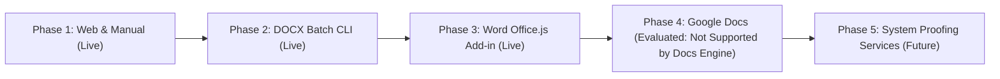

# Project Roadmap: tamil-toolkit

This document tracks current capabilities, active milestones, and long-term integration roadmaps across all `tamil-toolkit` domains.

---

## 1. Overview of Modules & Status

| Domain | Status | Key Deliverables & Documentation |
|---|---|---|
| **Core Linguistic Grammar** | Stable (v0.1.0-alpha.6) | Scalar segmentation, Uyir/Mei/Uyirmei splitting, Agara sorting, NFC/NFD normalization. |
| **Legacy Codecs** | Active / Expanding | Bamini, TSCII, TAB, TAM, Anjal, Vanavil, LT-TM / IndoWord. See [Codec Roadmap](docs/specs/codec-roadmap.md). |
| **Numerals & Calendar** | Candidate / Review | TN/SL numeral words, fractions, currency formatting; experimental astronomical profiles (`Thirukanitham` & `Vakya`). See [Calendar Candidate](docs/releases/numerals-calendar-candidate.md). |
| **Hyphenation & Desktop Publishing (DTP)** | Completed (v0.1.0-alpha.6) | Syllabic hyphenation, soft-hyphen injection, Frank Liang `.dic` generator, LibreOffice `.oxt`, InDesign & Scribus guides, upstream SMC kit. See [LibreOffice](docs/integrations/libreoffice.md), [InDesign](docs/integrations/indesign.md), and [Upstream PR](dist/upstream-smc/UPSTREAM_PR.md). |
| **Consumer Word Processors (Microsoft Word)** | **Active & Live** | Headless DOCX batch processor (`tamil-toolkit hyphen process-docx`), Office.js Add-in for Microsoft Word. See [Word Roadmap & Docs Analysis](docs/integrations/word-googledocs-roadmap.md). |
| **Interactive Playground** | Completed & Live | 100% client-side PWA web app with real-time converter, formatter, hyphenator, and developer sandbox. |

---

## 2. Hyphenation & Word Processor Integrations (Long-Term Roadmap)

Standard word processors do not support drop-in Hunspell / TeX `.dic` files, nor do they natively support Tamil syllabic line-breaking. 

To bridge this gap without distorting same-line letter spacing or breaking ligatures, the toolkit leverages the **Unicode Soft Hyphen (`\u{00AD}`)**. Soft hyphens remain completely invisible with zero width (`0px`) on the same line, activating only at right-margin collisions when paragraphs are Justified (`Ctrl + J`).

The phased delivery strategy is detailed in [docs/integrations/word-googledocs-roadmap.md](docs/integrations/word-googledocs-roadmap.md):



### Milestone Timeline

### Phase 1: Web Playground & Clipboard Workarounds (Completed & Live)
- **Playground Tool**: Syllabic Hyphenator & Line Wrapper tab 2 provides direct copy for `"Unicode Soft-Hyphen Text"` and `"Word (&shy;)"`.
- **User Action**: Paste Tamil text into the Playground, click copy, paste into Word, and enable Justification (`Ctrl + J`).

### Phase 2: Headless DOCX Batch CLI Processor (Completed & Live)
- **Status**: **Completed & Live** (v0.1.0-alpha.6 / feature `012-docx-hyphen`).
- **Guide**: [Word DOCX Batch Processing Guide](docs/integrations/word-docx-batch.md).
- **CLI Subcommand**:
  ```bash
  tamil-toolkit hyphen process-docx --input manuscript.docx --output manuscript_justified.docx
  ```
- **SDK Support**: Rust API (`tamil_hyphen::docx::process_docx_file`), Python SDK (`tamil_toolkit.process_docx`), and `python-docx` integration.
- **Guarantees**: Complete preservation of fonts, headings, comments, tables, and bold/italic styles; idempotent soft-hyphen insertion across `document.xml`, headers, footers, and footnotes.

### Phase 3: Microsoft Word Web Add-in (`Office.js`) (Completed & Live)
- **Status**: **Completed & Live** (v0.1.0-alpha.6 / feature `013-word-office-addin`).
- **Guide**: [Word Office.js Add-in Guide](docs/integrations/word-office-addin.md).
- **Source**: [`integrations/office-word-addin/`](integrations/office-word-addin/).
- **Features**: Native cross-platform Taskpane Add-in for Microsoft Word (Word 2019+, Microsoft 365 on Windows, macOS, and Word Online). Provides one-click "Hyphenate Selection" or "Hyphenate Entire Document", configurable minimum syllable margins (`left_min: 2`, `right_min: 2`). 100% offline and private.

### Phase 4: Google Docs Evaluation & Architecture Finding (Definitively Closed: Engine Limitation)
- **Status**: **Evaluated & Closed — Not Supported by Google Docs Canvas Engine**.
- **Finding**: Google Docs utilizes a custom HTML5 `<canvas>` text rasterizer (replacing the browser DOM) which **hardcodes against discretionary word breaking**. The Google Docs canvas engine completely ignores both Soft Hyphens (`\u{00AD}`) and Zero-Width Spaces (`\u{200B}`) across all languages (including English, German, and Tamil). Words will not break at syllable margins in Google Docs.
- **Official Recommendation**: Authors drafting in Google Docs should export their manuscripts (**File $\rightarrow$ Download $\rightarrow$ Microsoft Word (.docx)**) and process them with `tamil-toolkit hyphen process-docx` to achieve clean, justified line breaks in Microsoft Word or LibreOffice.

### Phase 5: System-Level Linguistic & Proofing Services (Future Exploration)
- **Windows**: Windows Linguistic Services / Spell Checking API Provider (`ISpellCheckProviderFactory`).
- **macOS**: `NSSpellServer` and CoreText hyphenation dictionary registration in `/Library/Spelling/`.

---

## 3. Other Active Roadmaps

- **Legacy Codecs**: Expansion of 16-bit and legacy font encodings. See [docs/specs/codec-roadmap.md](docs/specs/codec-roadmap.md).
- **Tamil Calendar**: Verification of Thirukanitham astronomical calculations, Vakiya civil profile, and holiday almanac. See [docs/releases/numerals-calendar-candidate.md](docs/releases/numerals-calendar-candidate.md).
- **Upstream FOSS**: Contribution of `hyph_ta_IN.dic` to `github.com/smc/hyphenation` for integration into Debian, Ubuntu, Fedora, and LibreOffice upstream. See [dist/upstream-smc/UPSTREAM_PR.md](dist/upstream-smc/UPSTREAM_PR.md).
