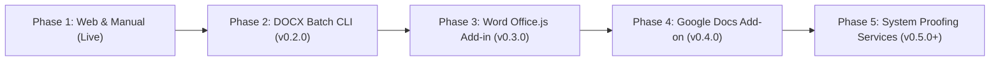

# Project Roadmap: tamil-toolkit

This document tracks current capabilities, active milestones, and long-term integration roadmaps across all `tamil-toolkit` domains.

---

## 1. Overview of Modules & Status

| Domain | Status | Key Deliverables & Documentation |
|---|---|---|
| **Core Linguistic Grammar** | Stable (v0.1.0-alpha.6) | Scalar segmentation, Uyir/Mei/Uyirmei splitting, Agara sorting, NFC/NFD normalization. |
| **Legacy Codecs** | Active / Expanding | Bamini, TSCII, TAB, TAM, Anjal, Vanavil, LT-TM / IndoWord. See [Codec Roadmap](docs/specs/codec-roadmap.md). |
| **Numerals & Calendar** | Candidate / Review | TN/SL numeral words, fractions, currency formatting; experimental astronomical profiles (`Thirukanitham` & `Vakya`). See [Calendar Candidate](docs/releases/numerals-calendar-candidate.md). |
| **Hyphenation & Desktop Publishing (DTP)** | Completed (v0.1.0-alpha.6) | Syllabic hyphenation, soft-hyphen injection, Frank Liang `.dic` generator, LibreOffice `.oxt`, InDesign & Scribus guides, upstream SMC kit. See [LibreOffice](docs/integrations/libreoffice.md), [InDesign](docs/integrations/indesign.md), and [Upstream PR](dist/upstream-smc/UPSTREAM_PR.md). |
| **Consumer Word Processors (Word & Docs)** | **Active Roadmap** | Headless DOCX batch processor, Office.js Add-in for Microsoft Word, Google Workspace Add-on for Google Docs. See [Word & Google Docs Roadmap](docs/integrations/word-googledocs-roadmap.md). |
| **Interactive Playground** | Completed & Live | 100% client-side PWA web app with real-time converter, formatter, hyphenator, and developer sandbox. |

---

## 2. Hyphenation & Word Processor Integrations (Long-Term Roadmap)

Standard word processors (Microsoft Word, Google Docs) do not support drop-in Hunspell / TeX `.dic` files, nor do they natively support Tamil syllabic line-breaking. 

To bridge this gap without distorting same-line letter spacing or breaking ligatures, the toolkit leverages the **Unicode Soft Hyphen (`\u{00AD}`)**. Soft hyphens remain completely invisible with zero width (`0px`) on the same line, activating only at right-margin collisions when paragraphs are Justified (`Ctrl + J`).

The phased delivery strategy is detailed in [docs/integrations/word-googledocs-roadmap.md](docs/integrations/word-googledocs-roadmap.md):



### Milestone Timeline

### Phase 1: Web Playground & Clipboard Workarounds (Completed & Live)
- **Playground Tool**: Syllabic Hyphenator & Line Wrapper tab 2 provides direct copy for `"Unicode Soft-Hyphen Text"` and `"Word (&shy;)"`.
- **User Action**: Paste Tamil text into the Playground, click copy, paste into Word/Docs, and enable Justification (`Ctrl + J`).

### Phase 2: Headless DOCX Batch CLI Processor (Target: v0.2.0)
- **Goal**: Allow publishers, editors, and authors to batch-hyphenate entire `.docx` book manuscripts without manual copy-pasting.
- **CLI Subcommand**:
  ```bash
  tamil-toolkit hyphen process-docx --input manuscript.docx --output manuscript_justified.docx
  ```
- **SDK Support**: Python SDK (`python-docx`) and Rust OpenXML DOM traversal.
- **Guarantees**: Complete preservation of fonts, headings, comments, tables, and bold/italic styles; idempotent soft-hyphen insertion.

### Phase 3: Microsoft Word Web Add-in (`Office.js`) (Target: v0.3.0)
- **Goal**: Cross-platform Taskpane Add-in for Microsoft Word (Word 2019+, Microsoft 365 on Windows, macOS, and Word Online).
- **Architecture**:
  - Built with Microsoft Office JavaScript API (`Office.js`).
  - Powered by client-side WebAssembly (`tamil-toolkit-wasm`).
  - 100% offline and private (no text leaves the user's computer).
- **Features**: One-click "Hyphenate Selection" or "Hyphenate Entire Document", configurable minimum syllable margins (`left_min: 2`, `right_min: 2`).

### Phase 4: Google Workspace Docs Add-on (Target: v0.4.0)
- **Goal**: Cloud-first extension for Google Docs via Google Workspace Marketplace.
- **Architecture**:
  - Implemented as a Google Apps Script Container-bound or Standalone Add-on with WebAssembly / JavaScript execution.
  - Sidebar interface providing paragraph-level and document-level syllabic hyphenation.
  - Dual support for soft-hyphens (`\u{00AD}`) and discretionary break wrappers (`<wbr>` / zero-width spaces `\u{200B}`) for Google Docs web canvas quirks.

### Phase 5: System-Level Linguistic & Proofing Services (Future Exploration)
- **Windows**: Windows Linguistic Services / Spell Checking API Provider (`ISpellCheckProviderFactory`).
- **macOS**: `NSSpellServer` and CoreText hyphenation dictionary registration in `/Library/Spelling/`.

---

## 3. Other Active Roadmaps

- **Legacy Codecs**: Expansion of 16-bit and legacy font encodings. See [docs/specs/codec-roadmap.md](docs/specs/codec-roadmap.md).
- **Tamil Calendar**: Verification of Thirukanitham astronomical calculations, Vakiya civil profile, and holiday almanac. See [docs/releases/numerals-calendar-candidate.md](docs/releases/numerals-calendar-candidate.md).
- **Upstream FOSS**: Contribution of `hyph_ta_IN.dic` to `github.com/smc/hyphenation` for integration into Debian, Ubuntu, Fedora, and LibreOffice upstream. See [dist/upstream-smc/UPSTREAM_PR.md](dist/upstream-smc/UPSTREAM_PR.md).
