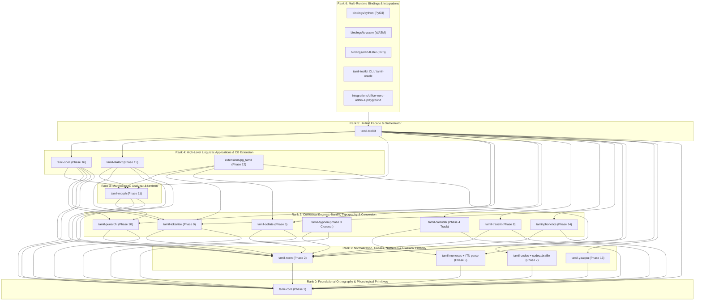
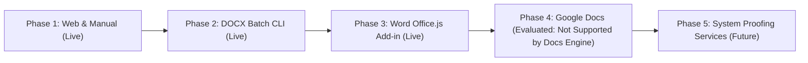

# Project Roadmap: tamil-toolkit

This document tracks current capabilities, architectural dependency ranks (`Rank 0`–`Rank 6`), capability difficulty tiers (`Tier 1`–`Tier 5`), identified gaps inside existing crates, planned/missing NLP crates, and the sequenced 18-phase execution roadmap across all `tamil-toolkit` domains.

See also the [canonical architecture contract](docs/specs/architecture-roadmap.md) and its [lifecycle evidence requirements](docs/specs/architecture-roadmap.md#lifecycle-and-acceptance).

For the full normative specification of crate boundaries, prerequisite rules, and acceptance gates, see [Feature Specification 016: Crate Dependency DAG, Capability Boundaries & Difficulty-Tiered Roadmap](specs/016-crate-dependency-roadmap/spec.md).

---

## 1. Overview of Modules & Status

| Domain / Crate | Rank | Difficulty Tier | Current Status | Key Deliverables & Documentation |
|---|---:|---|---|---|
| **`tamil-core`** | Rank 0 | Tier 1 | **Published** (`v0.1.0-alpha.6`); Phase 1 extensions `specified` | Scalar segmentation, UAX #29 tailored `Letters` (`க்ஷ`, `ஸ்ரீ`), `split_uyirmei`/`compose_uyirmei`, NFC/NFD. *Phase 1 Closeout*: `is_kuril`, `is_nedil`, `is_mei`/`is_otru`, `is_aytham`, `baseline_maathirai`, `ina_ezhuthu`, and narrow `Olippasai` syllable nucleus spans. |
| **`tamil-norm`** | Rank 1 | Tier 3 | **Published** (minimal facade); Phase 2 contracts `specified` | Currently re-exports NFC/NFD. *Phase 2 Closeout*: (1) Canonical NFC/NFD, (2) Opt-in `repair_tamil_text` (duplicate pulli, visual left-kombu reordering, control/SHY stripping with diagnostics), (3) Versioned lossy `fold_for_search` (*Mayangoli* & Grantha folding). |
| **`tamil-codec`** | Rank 1 | Tier 2 | **Published** (7 codecs + auto-detect); Phase 7 extensions `specified` | Bamini, TSCII, TAB, TAM, Anjal, Vanavil, LT-TM / IndoWord + heuristic `detect_encoding`. *Phase 7 Closeout*: Senthamil, Shree-Tam, Softview, TBO fonts, plus `tamil-codec::braille` (Bharathi / Unicode Braille `U+2800..U+28FF`). See [Codec Roadmap](docs/specs/codec-roadmap.md). |
| **`tamil-numerals`** | Rank 1 | Tier 2–3 | **Published** (`v0.3` active); Phase 6 extensions `specified` | TN/SL numeral words, 20 traditional fractions, INR/LKR currency, `U+0BF0..U+0BF2` traditional integers, ordinals, Gregorian date formatting. *Phase 6 Closeout*: Reverse word-to-number parsing (ITN), colloquial mixed fraction words (`ஒன்றேகால்`, `இரண்டரை`), diaspora currencies (`SGD`, `MYR`, `USD`, `EUR`, `GBP`, `CAD`). |
| **`tamil-yaappu`** | Rank 1 | Tier 3–4 | **Planned** (Workspace Scaffold) | Classical Tamil prosody (*Yaapparungalakkaarigai* / *Tolkappiyam*): contextual *Maathirai*, *Asai* (*Ner* / *Nirai*), *Seer*, *Thalai*, *Adi*, *Thodai*, and *Paa* meter validation (*Venpa*, *Asiriyappa*, *Kalippa*, *Vanjippa*). |
| **`tamil-calendar`** | Rank 2 | Tier 2 / Tier 5 | **Published** (4 civil suites `active`; 13 ephemeris/observance suites `planned`) | 60-year cycle, Thiruvalluvar year, TN/SL official holidays (`active`); bounded `Thirukanitham` (`astro` 2.0.0) & 1962 `Vakya` solar/lunar/civil engines and observance selectors (`planned` pending Phase 4 witness review). See [Calendar Candidate](docs/releases/numerals-calendar-candidate.md). |
| **`tamil-collate`** | Rank 2 | Tier 2 | **Published** (`agara-v1` active); Phase 5 extensions `specified` | Deterministic Mei-first *Agara Varisai* (`agara-v1`) `sort_key`, `search_key`, `compare`. *Phase 5 Closeout*: Versioned `folded_search_key` and modern Uyirmei-first school dictionary profile. |
| **`tamil-hyphen`** | Rank 2 | Tier 1 / Tier 3 | **Release-Approved** (`v0.1.0-alpha.6`, active in `release-policy.toml`); Phase 3 closeout `completed` | Canonical 5-step Tamil *Asai* + `left_min = 3, right_min = 3` (`MIN_WORD_LETTERS = 6`) syllabic hyphenation, soft-hyphen (`\u{00AD}`) injection, Frank Liang `.dic` generator, LibreOffice `.oxt`, headless OpenXML `.docx` batch processor. *Phase 3 Closeout*: Promoted to `release-policy.toml` `public_crates`, `hyphen_syllable.jsonl` activated in `manifest.json`, Playground & Word Add-in verified on shared WASM engine, and `tamil-toolkit` CLI subcommands expanded. |
| **`tamil-punarchi`** | Rank 2 | Tier 4 | **Planned** (Workspace Scaffold) | Sourced *Nannool* (Sutras 151–257) Sandhi engine: forward synthesis (`Thonral`, `Thirithal`, `Keduthal`, `Iyalbu`) with explicit *Vetrumai*/*Alvazhi* context, plus bounded inverse-rule candidate generation returning rule IDs, reconstructed forms, and surface spans. See [Punarchi Spec](docs/specs/punarchi-v0.1.md). |
| **`tamil-translit`** | Rank 2 | Tier 2 / Tier 5 | **New Planned** (Unscaffolded until Phase 8) | Bidirectional orthographic transliteration: Phase 8 reversible scholarly schemes (ISO 15919, Madras University Lexicon, ITRANS, Harvard-Kyoto); Phase 17 historical/epigraphic scripts (Tamil-Brahmi `U+11000`, Grantha `U+11300`, Vatteluttu), cross-script (Sinhala/Malayalam), and Tanglish IME. |
| **`tamil-phonetics`** | Rank 2 | Tier 4 | **New Planned** (Unscaffolded until Phase 14) | Context-sensitive Grapheme-to-Phoneme (G2P) and IPA pronunciation: allophonic voicing and intervocalic lenition of `க, ச, ட, த, ப`, post-nasal homorganic voicing, geminate invariance, and vowel reductions. |
| **`tamil-tokenize`** | Rank 2 | Tier 3 | **New Planned** (Unscaffolded until Phase 9) | Surface sentence and word tokenization with byte/letter spans, sourced Tamil abbreviation disambiguation (`திரு.`, `பி.ப.`, `மு.க.`), and stratified stopword lexicons. |
| **`tamil-morph`** | Rank 3 | Tier 4 | **Planned** (Workspace Scaffold) | FST / chart morphological analyzer, lemmatizer, 8-case noun declension (*Vetrumai*), 6-part *Pagu-padham* verb conjugation, clitic detachment, and lexical validation/ranking of `tamil-punarchi` compound split candidates. |
| **`tamil-dialect`** | Rank 4 | Tier 5 | **Planned** (Workspace Scaffold) | Pluricentric regional lexical & spoken-to-literary (*Senthamizh*) normalization across `ta-IN` (Central, Madurai, Kongu, Nellai, Madras) and `ta-LK` (Jaffna, Batticaloa, Vanni, Up-Country), plus `ta-SG`/`ta-MY`. |
| **`tamil-spell`** | Rank 4 | Tier 4–5 | **New Planned** (Unscaffolded until Phase 16) | *Mayangoli* (`ல/ள/ழ`, `ன/ண`, `ர/ற`) confusion-set spellchecker and morphology-backed *Valimigum / Valimigaa Idangal* (வல்லினம் மிகும்/மிகா இடங்கள்) fortis stop doubling linter. |
| **`extensions/pg_tamil`** | Rank 4 | Tier 2 / Tier 4 | **Scaffold** (Isolated PostgreSQL Extension) | Stage 1: PostgreSQL scalar normalization, repair, and `agara-v1`/folded collation keys (`tamil-norm` + `tamil-collate`). Stage 2: PostgreSQL Full-Text Search (FTS) parser, stopword filter, and morphological stemmer (`tamil-tokenize` + `tamil-morph`). |
| **`tamil-toolkit`** | Rank 5 | Tier 1 | **Published** (`v0.1.0-alpha.6`) | Unified Rust facade, JSON dispatcher, cross-crate orchestrator (e.g., compound-aware hyphenation combining `tamil-morph` + `tamil-hyphen`), `tamil-oracle`, and `tamil-toolkit` CLI. |
| **Adapters, Playground & Word Add-in** | Rank 6 | Tier 1–3 | **Completed & Live** | Python (`PyO3`), Node/Browser (`WASM`), Dart/Flutter (`FRB`), 100% client-side PWA Playground, and Microsoft Word `Office.js` Taskpane Add-in. |

---

## 2. Acyclic Crate Dependency DAG (`Rank 0` – `Rank 6`)

Every dependency edge (`[dependencies]`, `[dev-dependencies]`, `[build-dependencies]`, including optional features) MUST point strictly to a lower rank (`Rank(dependency) < Rank(dependent)`).

### Key Architectural Boundary Rules
1. **`tamil-core` vs. `tamil-hyphen` vs. `tamil-yaappu`**:
   - `tamil-core` (`Rank 0`) owns pure letter-quantity facts (`is_kuril`, `is_nedil`, `is_mei`/`is_otru`, `is_aytham`, nominal `baseline_maathirai`, `ina_ezhuthu`) and narrow orthographic syllable nuclei (`Olippasai` with spans).
   - `tamil-hyphen` (`Rank 2`) owns typographic line-breaking policies (`left_min = 3, right_min = 3`, `MIN_WORD_LETTERS = 6`, segment merging, `.dic`/`.oxt`/`.docx`).
   - `tamil-yaappu` (`Rank 1`) owns classical prosodic interpretation (contextual *Maathirai* reductions for *Kurriyalugaram*/*Alapedai*, *Ner*/*Nirai* *Asai* scanning, *Seer*, *Thalai*, *Adi*, *Thodai*, and *Paa* meter validation).
2. **`tamil-punarchi` vs. `tamil-morph` (Zero Cycle Guarantee)**:
   - `tamil-punarchi` (`Rank 2`) depends only on `tamil-core` and `tamil-norm`. It owns forward Sandhi synthesis (with explicit grammatical context) and bounded inverse-rule candidate generation (returning rule IDs, reconstructed underlying forms, and surface spans).
   - `tamil-morph` (`Rank 3`) depends on `tamil-punarchi` to apply/invert morphophonemic boundary transitions and validates/ranks compound split candidates against the morphological stem lexicon. `tamil-punarchi` never depends on `tamil-morph`.
3. **Facade Orchestration for Sibling Integrations**:
   - Morphology-aware compound hyphenation (`tamil-morph` + `tamil-hyphen`) and morphology-assisted pronunciation (`tamil-morph` + `tamil-phonetics`) are orchestrated in `tamil-toolkit` (`Rank 5`) by passing surface-aligned boundary hints into `tamil-hyphen` or `tamil-phonetics` without adding direct Cargo dependencies between those crates.

---

## 3. Sequenced Execution Roadmap (`Phase 0` – `Phase 17`)

Each phase specifies its **Difficulty Tier**, **Hard Prerequisites** (what must be completed before it starts), and **Exit Gate**.

| Phase | Deliverable / Milestone | Difficulty | Hard Prerequisites | Exit Gate & Verification Contract |
|---:|---|---:|---|---|
| **0** | **Freeze Spec 016 Architecture, DAG & Status Vocabulary** | Tier 1 | *None* | `specs/016-crate-dependency-roadmap/spec.md` and `ROADMAP.md` synchronized; status vocabulary (`unscaffolded`, `planned`, `specified`, `implemented`, `active`, `release-approved`, `published`) established. |
| **1** | **`tamil-core` Phonological & Nucleus Primitives Closeout** | Tier 1 | Phase 0 | Add sourced `is_kuril`, `is_nedil`, `is_mei`/`is_otru`, `is_aytham`, nominal `baseline_maathirai`, `ina_ezhuthu`, and narrow `Olippasai` nucleus spans to `tamil-core` with active golden vectors. |
| **2** | **`tamil-norm` Orthographic Repair & Search-Folding Contracts** | Tier 3 | Phase 1 | Expand `tamil-norm` into 3 explicit contracts: (1) canonical NFC/NFD, (2) opt-in `repair_tamil_text` with edit provenance, (3) versioned lossy `fold_for_search` profiles (*Mayangoli* & Grantha). |
| **3** | **`tamil-hyphen` Release Policy, Manifest & WASM Consolidation** | Tier 1 | Phase 1, Phase 2 | Refactor `tamil-hyphen` to consume `tamil-core` Phase 1 primitives; promote `hyphen_syllable.jsonl` to `active` in `tests/golden/manifest.json`; add `tamil-hyphen` to `release-policy.toml` `public_crates`; remove exemption in `tools/release_policy.py`; consolidate Playground & Word Add-in onto shared Rust/WASM; expand `tamil-toolkit` CLI subcommands. |
| **4** | **`tamil-calendar` Planned Suite Review & Activation Track** | Tier 5 | Phase 0 *(Independent Track)* | Review each of the 13 planned calendar/observance JSONL suites against independent primary witnesses; activate verified suites individually upon owner approval without blocking language phases. |
| **5** | **`tamil-collate` Folded Search & Uyirmei-First Profile** | Tier 2 | Phase 2 | Add versioned `folded_search_key` (preserving exact `agara-v1` `search_key` compatibility) and a sourced modern Uyirmei-first school dictionary collation profile. |
| **6** | **`tamil-numerals` Reverse Word Parsing (ITN), Mixed Fractions & Currencies** | Tier 2–3 | Phase 1 | Add reverse formal word-to-number parsing (`"நூற்று இருபத்து மூன்று"` $\rightarrow$ `123`), colloquial mixed-fraction words (`ஒன்றேகால்`, `இரண்டரை`), and diaspora currency profiles (`SGD`, `MYR`, `USD`, `EUR`, `GBP`, `CAD`). |
| **7** | **`tamil-codec` Legacy Font Expansion & `codec::braille`** | Tier 2 | Phase 1 | Add sourced legacy font tables (Senthamil, Shree-Tam, Softview, TBO) and `tamil-codec::braille` (Bharathi / Unicode Braille `U+2800..U+28FF` Grade 1). |
| **8** | **`tamil-translit` (Profile 1: Reversible Orthographic Romanization)** | Tier 2 | Phase 1, Phase 2 | Create `crates/tamil-translit`; implement reversible ISO 15919, Madras University Tamil Lexicon, ITRANS, and Harvard-Kyoto profiles. |
| **9** | **`tamil-tokenize` (Surface Sentence/Word Spans & Abbreviations)** | Tier 3 | Phase 1, Phase 2 | Create `crates/tamil-tokenize`; implement span-preserving word/sentence segmentation, sourced Tamil abbreviation lexicon (`திரு.`, `பி.ப.`, `மு.க.`), and stopword profiles. |
| **10** | **`tamil-punarchi` (Nannool Forward Synthesis & Inverse Candidates)** | Tier 4 | Phase 1, Phase 2 | Implement sourced Nannool Sutras 151–257 in `crates/tamil-punarchi`: forward synthesis with explicit *Vetrumai*/*Alvazhi* context and bounded inverse-rule candidate generation. |
| **11** | **`tamil-morph` (FST Analyzer, Noun/Verb Inflection & Compound Ranker)** | Tier 4 | Phase 10 | Implement FST/chart morphological analyzer in `crates/tamil-morph`: 8-case noun declension, 6-part *Pagu-padham* verb conjugation, clitic detachment, lemmatization, and compound split validation/ranking. |
| **12** | **Cross-Crate Integrations: Compound Hyphenation & `pg_tamil` FTS** | Tier 3–4 | Phase 3, Phase 5, Phase 9, Phase 11 | Wire `tamil-morph` compound boundaries into `tamil-hyphen` via `tamil-toolkit` (strictly respecting `left_min`/`right_min` margins), and complete `extensions/pg_tamil` Stage 1 (SQL norm/collation) & Stage 2 (PostgreSQL FTS dictionary/stemmer). |
| **13** | **`tamil-yaappu` (Classical Prosody & Meter Validation)** | Tier 3–4 | Phase 1 *(Optional Sandhi hints from Phase 10)* | Implement contextual *Maathirai*, *Asai* (*Ner*/*Nirai*), *Seer*, *Thalai*, *Adi*, *Thodai*, and meter validators (*Venpa*, *Asiriyappa*, *Kalippa*, *Vanjippa*) in `crates/tamil-yaappu`. |
| **14** | **`tamil-phonetics` (Contextual G2P & Allophonic IPA)** | Tier 4 | Phase 1, Phase 2 | Create `crates/tamil-phonetics`; implement contextual allophonic voicing, intervocalic lenition, post-nasal voicing, geminate invariance, and IPA output. |
| **15** | **`tamil-dialect` (Pluricentric Regional & Spoken-to-Literary Mapping)** | Tier 5 | Phase 9, Phase 11 | Implement sourced regional lexical and spoken-to-literary (*Senthamizh*) transformations across `ta-IN` and `ta-LK` (Jaffna, Batticaloa, Vanni, Up-Country) in `crates/tamil-dialect`. |
| **16** | **`tamil-spell` (*Mayangoli* Spellcheck & *Valimigum/Valimigaa* Linter)** | Tier 4–5 | Phase 9, Phase 10, Phase 11 | Create `crates/tamil-spell`; implement *Mayangoli* (`ல/ள/ழ`, `ன/ண`, `ர/ற`) confusion-set spellchecking and morphology-backed *Valimigum / Valimigaa Idangal* boundary diagnostics. |
| **17** | **Advanced Profiles (Tanglish IME, Epigraphic Scripts & Broad Grammar)** | Tier 5 | Phase 8, Phase 11, Phase 14, Phase 16 | Add noisy phonetic Roman/Tanglish IME conversion, Tamil-Brahmi (`U+11000` Systems I–III), Grantha (`U+11300`), Vatteluttu, Sinhala/Malayalam cross-script profiles, and full syntactic compound disambiguation. |

---

## 4. Hyphenation & Word Processor Integrations (Completed & Active Track)

Standard word processors do not support drop-in Hunspell / TeX `.dic` files, nor do they natively support Tamil syllabic line-breaking. To bridge this gap without distorting same-line letter spacing or breaking ligatures, the toolkit leverages the **Unicode Soft Hyphen (`\u{00AD}`)** under canonical 5-step Tamil *Asai* + `left_min = 3, right_min = 3` (`MIN_WORD_LETTERS = 6`) rules (`Spec 015`).

The phased delivery strategy is detailed in [docs/integrations/word-googledocs-roadmap.md](docs/integrations/word-googledocs-roadmap.md):

- **Phase 1: Web Playground & Clipboard Workarounds (Completed & Live)** — Syllabic Hyphenator & Line Wrapper in [`playground/`](playground/) with 3-letter minimum margins (`left_min = 3, right_min = 3`).
- **Phase 2: Headless DOCX Batch CLI Processor (Completed & Live)** — `tamil-toolkit hyphen process-docx` (`--left-min 3 --right-min 3` default) and `tamil_toolkit.process_docx`. See [Word DOCX Batch Processing Guide](docs/integrations/word-docx-batch.md).
- **Phase 3: Microsoft Word Web Add-in (`Office.js`) (Completed & Live)** — Cross-platform Taskpane Add-in (`v1.5.0.0`) in [`integrations/office-word-addin/`](integrations/office-word-addin/). See [Word Office.js Add-in Guide](docs/integrations/word-office-addin.md) and [Feature Spec 014: Word Tamil Utility Suite](specs/014-word-tamil-utility-suite/spec.md).
- **Phase 4: Google Docs Evaluation (Closed: Engine Limitation)** — Google Docs' `<canvas>` text rasterizer ignores `\u{00AD}` and `\u{200B}` across all languages; authors should export `.docx` and run `tamil-toolkit hyphen process-docx`.
- **Phase 5: System-Level Linguistic & Proofing Services (Future Exploration)** — Windows `ISpellCheckProviderFactory` and macOS `NSSpellServer` / CoreText dictionary registration.
