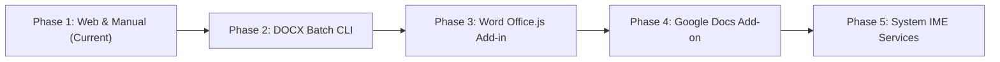

# Roadmap: Microsoft Word & Google Docs Tamil Hyphenation Integrations

This roadmap outlines the long-term technical strategy and milestones for bringing phonotactically verified, syllable-based Tamil hyphenation to **Microsoft Word** and **Google Docs**.

---

## 1. Technical Context & Challenges

Desktop publishing software (LibreOffice Writer, Adobe InDesign, Scribus) utilizes open-standard **Hunspell / TeX Frank Liang pattern dictionaries (`.dic`)**. In contrast, consumer word processors use closed, proprietary, or web-canvas rendering architectures:

| Application | Engine Architecture | Why `.dic` Files Don't Work Directly | Native Tamil Syllabic Line-Breaking? |
|---|---|---|---|
| **Microsoft Word** (Desktop / M365) | Windows CSAPI / Natural Language Proofing | Word does not allow user-installed Hunspell hyphenation dictionaries; proofing tools are signed binary packages. | **No**. Word has no built-in Tamil hyphenator and cannot automatically break Tamil syllables. |
| **Google Docs** (Web Canvas) | Web Canvas / Kix Web Layout Engine | Web-based editor running in the browser; does not support desktop dictionary extensions or local filesystem `.dic` files. | **No**. Google Docs lacks language-specific hyphenation dictionaries for Indic scripts. |

### The Universal Solution: Soft Hyphen (`\u00AD` / `&shy;`)

While neither application supports external `.dic` files directly, both engines are built on Unicode standards. The **Soft Hyphen (`U+00AD`)** serves as the universal bridge:
- **Same Line**: Completely invisible with **zero glyph width (`0px`)**; tracking, kerning, and letter spacing remain completely untouched.
- **At Margin Collision**: When text alignment is set to **Justified (`Ctrl + J`)**, the layout engine dynamically breaks the word at the soft hyphen and displays `-` at the line end.
- **Copy/Search Safe**: Search engines and spellcheckers normalize or strip soft hyphens during search and indexing.

---

## 2. Integration Phases & Milestones



---

### Phase 1: Web Playground & Manual Workarounds (Available Now)

- **Status**: **Completed & Live**.
- **Deliverables**:
  - **Tamil Toolkit Playground** > **Syllabic Hyphenator & Line Wrapper**:
    - Tab 2: "Paragraph & Soft-Hyphens" (`பத்தி & மென்-இணைப்புக் குறி`).
    - One-click copy buttons: `"Copy Unicode Soft-Hyphen Text"` and `"Copy Word (&shy;)"`.
  - **Workflow**:
    1. Paste Tamil text into the Playground.
    2. Click `"Copy Unicode Soft-Hyphen Text"`.
    3. Paste into Microsoft Word (`Ctrl + V`).
    4. Enable **Justify (`Ctrl + J`)**. Word automatically formats justified lines without white rivers or broken diacritics.

---

### Phase 2: Headless DOCX Batch CLI Processor (Target: v0.2.0)

- **Goal**: Enable authors, editors, and publishers to batch-hyphenate entire `.docx` book manuscripts, academic journals, and reports without manual copy-pasting.
- **Technical Architecture**:
  - Add subcommand to `tamil-toolkit` CLI:
    ```bash
    tamil-toolkit hyphen process-docx --input manuscript.docx --output manuscript_justified.docx
    ```
  - Also provide Python SDK support via `python-docx`:
    ```python
    import docx
    import tamil_hyphen

    doc = docx.Document("input.docx")
    for para in doc.paragraphs:
        for run in para.runs:
            if tamil_hyphen.has_tamil(run.text):
                run.text = tamil_hyphen.hyphenate_text(run.text)
    doc.save("output.docx")
    ```
- **Requirements**:
  - Strict preservation of OpenXML paragraph run styles, bold/italic markup, hyperlinks, tables, headers, and comments.
  - Zero modification to non-Tamil words, numbers, or punctuation.
  - Idempotent: Running the processor multiple times must never inject duplicate soft-hyphens.

---

### Phase 3: Microsoft Word Web Add-in (Office.js) (Target: v0.3.0)

- **Goal**: A modern, cross-platform Microsoft Word Taskpane Add-in deployable across Word for Windows, Word for Mac, and Word on the Web (Microsoft 365).
- **User Experience**:
  - Author opens Word, clicks the **Tamil Toolkit** ribbon icon under the Home tab.
  - A taskpane appears with:
    - **"Hyphenate Selected Text"** button.
    - **"Hyphenate Entire Document"** button.
    - Margin controls (`left_min: 2`, `right_min: 2`).
    - Language/Locale selector (`ta-IN`, `ta-LK`, etc.).
  - Clicking the button instantly processes the selection in-place, adding invisible soft-hyphens.
- **Technical Architecture**:
  - Built with the standard Microsoft **Office JavaScript API** (`Office.js` / Word API 1.3+).
  - Uses the compiled WebAssembly package of `tamil-hyphen` (`tamil-toolkit-wasm`).
  - **100% Client-Side & Private**: Processing occurs locally inside the taskpane iframe sandbox without sending document text to external servers.
  - Manifest registered for Microsoft AppSource / Microsoft 365 Admin Center centralized deployment.

---

### Phase 4: Google Docs Architectural Evaluation & Finding (Closed: Engine Limitation)

- **Status**: **Evaluated & Definitively Closed**.
- **The Core Issue**: Google Docs replaced the browser DOM layout with a custom **HTML5 `<canvas>` rendering pipeline**. Unlike Microsoft Word (which relies on standard OpenType DirectWrite/CoreText typography engines), Google Docs' canvas text measurement engine **hardcodes against discretionary word breaking**:
  1. Google Docs completely ignores Unicode Soft Hyphens (`\u00AD`).
  2. Google Docs completely ignores Zero-Width Spaces (`\u{200B}`).
  3. Google Docs has zero native hyphenation support across *all* languages (English, German, Hindi, Tamil).
- **Behavioral Finding**: Even when soft-hyphens or zero-width break points are inserted into the document data model via Apps Script (`DocumentApp`), Google Docs' canvas engine refuses to split words at right-margin collisions. Long Tamil words are pushed as indivisible blocks to the next line, leaving identical gaping whitespace holes under Justification (`Ctrl + Shift + J`).
- **Official Recommendation**: Authors composing drafts in Google Docs must download their files as Microsoft Word format (**File $\rightarrow$ Download $\rightarrow$ Microsoft Word (.docx)**) and process them with `tamil-toolkit hyphen process-docx` to achieve clean, justified line breaks in Microsoft Word or LibreOffice.

---

### Phase 5: System-Level Linguistic & Proofing Services (Future Exploration)

- **Goal**: System-wide integration across all native text fields (Notepad, WordPad, browser text areas, messaging clients).
- **Windows**:
  - Explore Windows Spell Checking / Hyphenation API Provider (`ISpellCheckProviderFactory` / Windows Linguistic Services).
- **macOS**:
  - Explore `NSSpellServer` and CoreText hyphenation dictionary registration (`/Library/Spelling/`).

---

## 3. Summary of Deliverables & Timeline

| Milestone | Deliverable | Target Platform | Status / Technology |
|---|---|---|---|
| **Phase 1** | Playground Soft-Hyphen Copy-Paste | Web / Cross-platform | Completed & Live (TypeScript / React / WASM) |
| **Phase 2** | `process-docx` CLI Subcommand & Python SDK | Windows, Linux, macOS | Completed & Live (Rust OpenXML / Python SDK) |
| **Phase 3** | Word Taskpane Add-in (`integrations/office-word-addin/`) | Word 2019+, M365, Word Online | Completed & Live (Office.js / HTML / JS) |
| **Phase 4** | Google Docs Evaluation | Google Workspace Docs | **Evaluated & Closed** (Not supported by Docs Canvas engine) |
| **Phase 5** | Windows & macOS System Proofing Handlers | Windows 11, macOS | Future Exploration (COM / Objective-C / FFI) |
