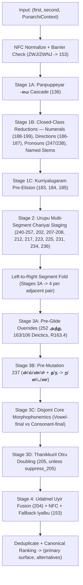

# Nannūl Eḻuttatikāram Punarchi Logic & Review Guide (`nannool-v1`)

> **Purpose:** Complete technical and linguistic review reference for `crates/tamil-punarchi` (`nannool-v1`, 117 sūtras) ahead of the `T049` Owner Review Gate. All sūtra metadata, declarative rule IDs, closed-class stem sets, and witness examples below are compiled directly from `lexicon/punarchi-nannool-inventory.toml`, `lexicon/punarchi-nannool.toml`, and `tests/golden/punarchi_nannool.jsonl`.

## 1. Quick Metrics & Verified Guarantees

| Metric | Value |
| --- | --- |
| Inventory coverage | **117 sūtras** (`93–94, 102–108, 136, 151–257`): **106 executable**, **11 non-executable** (`151–157, 239–241, 253`) |
| Declarative rules (`lexicon/punarchi-nannool.toml`) | **143 rules**, **35 closed-class stem sets**, **17 Chariyais**, **11 case suffixes** |
| Golden suite (`tests/golden/punarchi_nannool.jsonl`) | **261 vectors** (`97/97` transformation sūtras traced; `9/9` phonology/filter guards unit-tested; `0` rule_id mismatches) |
| Bilingual notes & CC0 crosswalk (`tests/reference/punarchi-nannool/vellaivaranar-crosswalk.json`) | **117/117** Tamil sūtra summaries + **85/117** verified *Tolkāppiyam* cross-references & Wikisource PDF scan links (Prof. K. Vellaivaranar, 2001 · `CC0-1.0`) |
| Native `--release` Rust latency | **`24.08 μs/call`** (`punarchi_join`, 80k calls) / **`1,044.22 μs/call`** (`punarchi_split_candidates`, 16k calls) |
| 4-runtime parity (`lexicon-core`, preactivation) | Rust `5/5` (`40,526`), Python `33/33`, Node+Browser WASM `40,553/40,553`, Dart `40,548/40,548` |
| Unicode & safety invariants | `#![forbid(unsafe_code)]`, NFC-normalized outputs, NFD canonical equivalence, verbatim ZWJ/ZWNJ preservation (`153`), atomic `க்ஷ`/`ஸ்ரீ` ligature boundaries, 256-byte split cap |

## 2. Acyclic 4-Stage Forward Pipeline

### Transient `BoundaryFlags` Anti-Clobbering Guards

| Flag | Purpose | Set By | Honored By |
| --- | --- | --- | --- |
| `is_derived_final` | Marks derived vowel/consonant finals (*விதியீறு*) | `136, 168, 169, 174, 183–185, 219, 247` | Stage 3C `165` eligibility |
| `block_165` | Prevents downstream Vallinam doubling | `167, 168, 170, 173, 174, 177, 179, 186, 188, 189` | `uyireeru::apply_vowel_plus_vallinam`, `meyyeeru::apply_ya_ra_zha` |
| `force_165` | Overrides `159` and forces Vallinam doubling | `183, 184, 197, 242.2 (கு), Chariyai உ/அ/அற்று` | `uyireeru::apply_vowel_plus_vallinam` |
| `suppress_205` | Blocks Thanikkuril consonant gemination before vowels | `247.5` (pronouns + 4th/6th case), `250.3` (`அவ்/இவ்/உவ்/எவ் + அற்று`), `164.3` | `meyyeeru::apply_stage_3d` (`205`) |
| `force_205` | Forces coda doubling on appended short-vowel Chariyais | `245` (`எல்லாநம்`), `246` (`எல்லார்தம்`, `எல்லீர்நும்`) | `meyyeeru::apply_stage_3d` (`205`) |
| `is_short_chariyai_m` | Preserves `ம்` instead of Sūtra `219` deletion | `202` (`அம்`), `223` (`ஈம்/கம்/உரும்`), `245`, `246` | `meyyeeru::apply_magaram` |
| `block_209_stop` | Keeps `ன்` natural on Chariyai/oblique before content words | `212, 238, 247, 248, 251, 254` | `meyyeeru::apply_nna_na` (`209`) |
| `is_chariyai_attu` | Triggers Sūtra `252` (`அ + அத்து → த்து`) before `162` | `244` (`மரம் + அத்து`, `மக + அத்து`) | `uyireeru::apply_stage_3a` (`252`) |
| `triggered_237` | Passes `(left_final, orig_right)` from Stage 3B to 3C | `meyyeeru::apply_stage_3b` (`237`) | `209, 210, 227, 228, 229` |
| `block_229` | Retains `ற்` instead of Sūtra `229` deletion | `186` (`மேற்கு + திசை → மேற்றிசை`) | `meyyeeru::apply_la_lla` (`229`) |

## 3. Core Phonological & Structural Invariants

### Sūtra `94` — 6-Class *Kurriyalugaram* vs *Mutriyalugaram*

- Only final `{கு, சு, டு, து, பு, று}` in words with `>= 2` written units qualify as *Kurriyalugaram* (`நெடில்தொடர்`, `ஆய்தத்தொடர்`, `உயிர்த்தொடர்`, `வன்தொடர்`, `மென்தொடர்`, `இடைத்தொடர்`).
- Short-vowel disyllabic words (`பசு`, `அது`, `இது`, `கதவு`) and non-Vallinam `உ`-finals (`கதவு`, `மரு`) classify as *Mutriyalugaram* — blocking mandatory `164` elision (using `162` `வ்` glide primarily, with lexicalized optional `164.3` elision only for attested `mutriyalugaram_elision_stems`).

### Sūtra `237` — 12-Way Surface Output Matrix (`ன்/ல்/ண்/ள் + த/ந`)

| Left Final | Word Shape | Right Initial | Relation | Surface | Rules |
| --- | --- | --- | --- | --- | --- |
| `ன்` | Thanikkuril (`பொன்`) | `த` (`தீது`) | Alvazhi / Vetrumai | `பொன்றீது` / `பொற்றீது` | `237 + 209` |
| `ன்` | Thanikkuril (`பொன்`) | `ந` (`நன்று`) | Both | `பொன்னன்று` | `237 + 209` |
| `ன்` | Non-Thanikkuril (`மான்`) | `ந` (`நன்று`) | Both | `மானன்று` | `237 + 210` |
| `ண்` | Thanikkuril (`மண்`) | `த` (`தீது`) | Alvazhi / Vetrumai | `மண்டீது` / `மட்டீது` | `237 + 209` |
| `ண்` | Thanikkuril (`மண்`) | `ந` (`நன்று`) | Both | `மண்ணன்று` | `237 + 209` |
| `ண்` | Non-Thanikkuril (`தூண்`) | `ந` (`நன்று`) | Both | `தூணன்று` | `237 + 210` |
| `ல்` | Thanikkuril (`கல்`) | `த` (`தீது`) | Alvazhi / Vetrumai | `கற்றீது` (opt `கஃறீது` Alvazhi) | `237 + 227 / 228` |
| `ல்` | Non-Thanikkuril (`பால்`) | `த` (`தீது`) | Alvazhi / Vetrumai | `பாறீது` / `பாற்றீது` | `237 + 229 / 227` |
| `ல்` | Thanikkuril (`கல்`) | `ந` (`நன்று`) | Both | `கன்னன்று` | `237 + 227` |
| `ல்` | Non-Thanikkuril (`பால்`) | `ந` (`நன்று`) | Both | `பானன்று` | `237 + 229` |
| `ள்` | Thanikkuril (`முள்`) | `த` (`தீது`) | Alvazhi / Vetrumai | `முட்டீது` (opt `முஃடீது` Alvazhi) | `237 + 227 / 228` |
| `ள்` | Non-Thanikkuril (`வாள்`) | `ந` (`நன்று`) | Both | `வாணன்று` | `237 + 229` |

### Poetic-Only Rules (`context.poetic = true`)

- `163.3`: Demonstrative `ஆ + இடை → ஆயிடை` (prose: `ஆவிடை`).
- `172.1`: Short-syllable `ஆ`-nouns (`நிலா/சுறா/கனா/இரா/புறா/விழா`) shorten to `அ` in verse (`நிலவந்தது` / `நிலாவுவந்தது`).
- `173`: `அன்றி`/`இன்றி → அன்று`/`இன்று` without Vallinam doubling.
- `180`: `அது + அன்று → அதான்று` (prose: `அதுவன்று` / `அதன்று`).
- `222`: `அகம் + சிறை → அஞ்சிறை` (prose: `அகஞ்சிறை`).
- `243.3`: Poetic omission of `அத்து` before `கு` (`மாடம் + கு → மாடக்கு`).

## 4. Complete 117-Sūtra Audit Inventory by Chapter

### 1. Ezhuttiyal Prerequisites (`93–94, 102–108` — 9 Sūtras)

| Sūtra | TVA p. | Kandigai | Tier | Exec | Declarative `rule_id`(s) | Sample Golden Witness | Ed. Note |
| ---: | ---: | ---: | --- | :---: | --- | --- | :---: |
| **93** | 166 | 93 | `phonological` | Yes | `nannool_093_kurriyaligaram` | `நாகு + யாது → நாகியாது` | — |
| **94** | 166 | 94 | `phonological` | Yes | `nannool_094_kurriyalugaram_classify` | — | — |
| **102** | 175 | 102 | `phonological` | Yes | `nannool_102_mozhi_muthal_general` | — | — |
| **103** | 175 | 103 | `phonological` | Yes | `nannool_103_mozhi_muthal_va` | — | — |
| **104** | 175 | 104 | `phonological` | Yes | `nannool_104_mozhi_muthal_ya` | — | Yes |
| **105** | 176 | 105 | `phonological` | Yes | `nannool_105_mozhi_muthal_nya` | — | Yes |
| **106** | 176 | 106 | `phonological` | Yes | `nannool_106_mozhi_muthal_nga_bound` | `அ + ஙனம் → அங்ஙனம்` | Yes |
| **107** | 177 | 107 | `phonological` | Yes | `nannool_107_mozhi_eetru_general` | — | — |
| **108** | 178 | 108 | `phonological` | Yes | `nannool_108_mozhi_eetru_special` | — | — |

### 2. Padaviyal Prerequisite (`136` — 1 Sūtra)

| Sūtra | TVA p. | Kandigai | Tier | Exec | Declarative `rule_id`(s) | Sample Golden Witness | Ed. Note |
| ---: | ---: | ---: | --- | :---: | --- | --- | :---: |
| **136** | 198 | 136 | `closed_class` | Yes | `nannool_136_panpuppeyar_eeru_pothal`, `nannool_136_panpuppeyar_idai_ugaram_i`, `nannool_136_panpuppeyar_aathi_needal`, `nannool_136_panpuppeyar_adi_agaram_ai`, `nannool_136_panpuppeyar_thannotru_irattal`, `nannool_136_panpuppeyar_mey_thirithal`, `nannool_136_panpuppeyar_inamigal` | `செம்மை + தாமரை → செந்தாமரை` | — |

### 3. Uyirīṟṟup Puṇariyal (`151–203` — 53 Sūtras)

| Sūtra | TVA p. | Kandigai | Tier | Exec | Declarative `rule_id`(s) | Sample Golden Witness | Ed. Note |
| ---: | ---: | ---: | --- | :---: | --- | --- | :---: |
| **151** | 218 | 151 | `definition_or_scope` | No | — | — | — |
| **152** | 219 | 152 | `definition_or_scope` | No | — | — | — |
| **153** | 221 | 153 | `definition_or_scope` | No | `nannool_153_iyalbu_passthrough` | `கல் + 123 → கல்123` | — |
| **154** | 222 | 154 | `definition_or_scope` | No | — | — | — |
| **155** | 223 | 155 | `definition_or_scope` | No | — | — | — |
| **156** | 224 | 156 | `definition_or_scope` | No | — | — | — |
| **157** | 225 | 157 | `definition_or_scope` | No | — | — | — |
| **158** | 225 | 158 | `phonological` | Yes | `nannool_158_nasal_approximant_iyalbu`, `nannool_158_kuril_y_ai_no_tu_nasal_double` | `கை + மாண்டது → கைம்மாண்டது` | — |
| **159** | 226 | 159 | `context_dependent` | Yes | `nannool_159_uyartinai_poduppeyar_iyalbu` | `நம்பி + கை → நம்பிகை` | — |
| **160** | 228 | 160 | `context_dependent` | Yes | `nannool_160_interrogative_clitic_iyalbu` | `அவனா + கொண்டான் → அவனாகொண்டான்` | — |
| **161** | 228 | 161 | `context_dependent` | Yes | `nannool_161_second_person_verb_iyalbu` | `நடந்தை + கொற்றா → நடந்தைகொற்றா` | — |
| **162** | 229 | 162 | `phonological` | Yes | `nannool_162_udambadumei_y`, `nannool_162_udambadumei_v` | `மணி + அடி → மணியடி` | — |
| **163** | 230 | 163 | `closed_class` | Yes | `nannool_163_deictic_v`, `nannool_163_deictic_geminate`, `nannool_163_non_udambadumei_v`, `nannool_163_poetic_aa_y` | `அ + அணி → அவ்வணி` | — |
| **164** | 231 | 164 | `phonological` | Yes | `nannool_164_kurriyalugaram_elision`, `nannool_164_mutriyalugaram_elision`, `nannool_164_mutriyalugaram_y_igaram` | `நாகு + அரிது → நாகரிது` | — |
| **165** | 233 | 165 | `phonological` | Yes | `nannool_165_valimigal`, `nannool_165_no_tu_valimigal` | `விள + கோடு → விளக்கோடு` | — |
| **166** | 234 | 166 | `closed_class` | Yes | `nannool_166_tree_name_nasal` | `மா + காய் → மாங்காய்` | — |
| **167** | 234 | 167 | `context_dependent` | Yes | `nannool_167_akara_alvazhi_iyalbu` | `வாழ்க + கொற்றா → வாழ்ககொற்றா` | — |
| **168** | 236 | 168 | `closed_class` | Yes | `nannool_168_vaazhiya` | `வாழிய + கொற்றா → வாழியகொற்றா` | — |
| **169** | 237 | 169 | `closed_class` | Yes | `nannool_169_saava` | `சாவ + குத்தினான் → சாவக்குத்தினான்` | — |
| **170** | 237 | 170 | `closed_class` | Yes | `nannool_170_pala_sila` | `பல + பல → பலபல` | — |
| **171** | 238 | 171 | `context_dependent` | Yes | `nannool_171_aakara_alvazhi_iyalbu` | `உண்ணா + குதிரைகள் → உண்ணாகுதிரைகள்` | — |
| **172** | 239 | 172 | `poetic_closed` | Yes | `nannool_172_short_aa_prose_vu`, `nannool_172_poetic_short_aa` | `நிலா + விரி → நிலாவிரி` | — |
| **173** | 240 | 173 | `poetic_closed` | Yes | `nannool_173_poetic_anri_inri` | `அன்றி + பிடியா → அன்றிப்பிடியா` | — |
| **174** | 241 | 174 | `closed_class` | Yes | `nannool_174_naazhi_uri` | `நாழி + உரி → நாடுரி` | — |
| **175** | 241 | 175 | `closed_class` | Yes | `nannool_175_suvai_puli` | `புளி + கறி → புளிக்கறி` | — |
| **176** | 242 | 176 | `context_dependent` | Yes | `nannool_176_ikara_aikara_alvazhi_iyalbu` | `கிளி + குறிது → கிளிகுறிது` | — |
| **177** | 243 | 177 | `closed_class` | Yes | `nannool_177_aa_pee` | `ஆ + பீ → ஆப்பி` | — |
| **178** | 244 | 178 | `closed_class` | Yes | `nannool_178_pee_nee_mee` | `நீ + கொடியை → நீகொடியை` | — |
| **179** | 245 | 179 | `context_dependent` | Yes | `nannool_179_mutriyalugaram_iyalbu` | `அது + குறிது → அதுகுறிது` | Yes |
| **180** | 246 | 180 | `poetic_closed` | Yes | `nannool_180_poetic_athu_anru` | `அது + அன்று → அதுவன்று` | Yes |
| **181** | 246 | 181 | `context_dependent` | Yes | `nannool_181_kurriyalugaram_alvazhi_iyalbu`, `nannool_181_locative_particle_valimigal` | `நாகு + கடிது → நாகுகடிது` | — |
| **182** | 246 | 182 | `context_dependent` | Yes | `nannool_182_kurriyalugaram_vetrumai_iyalbu` | `தெள்கு + கால் → தெள்குகால்` | — |
| **183** | 247 | 183 | `context_dependent` | Yes | `nannool_183_du_ru_gemination` | `ஆடு + கால் → ஆட்டுக்கால்` | — |
| **184** | 248 | 184 | `context_dependent` | Yes | `nannool_184_menthodar_to_vanthodar` | `மருந்து + பை → மருத்துப்பை` | — |
| **185** | 249 | 185 | `closed_class` | Yes | `nannool_185_kurriyalugaram_ai` | `பண்டு + காலம் → பண்டைக்காலம்` | — |
| **186** | 249 | 186 | `closed_class` | Yes | `nannool_186_direction_stem` | `வடக்கு + கிழக்கு → வடகிழக்கு` | — |
| **187** | 250 | 187 | `closed_class` | Yes | `nannool_187_thengu_kaai` | `தெங்கு + காய் → தேங்காய்` | — |
| **188** | 250 | 188 | `closed_class` | Yes | `nannool_188_numeral_base` | `ஆறு + கலம் → அறுகலம்` | — |
| **189** | 252 | 189 | `closed_class` | Yes | `nannool_189_one_two` | `ஒன்று + ஆனை → ஓரானை` | — |
| **190** | 252 | 190 | `closed_class` | Yes | `nannool_190_three` | `மூன்று + கலம் → முக்கலம்` | — |
| **191** | 252 | 191 | `closed_class` | Yes | `nannool_191_four` | `நான்கு + கலம் → நாற்கலம்` | — |
| **192** | 253 | 192 | `closed_class` | Yes | `nannool_192_five` | `ஐந்து + கலம் → ஐங்கலம்` | — |
| **193** | 253 | 193 | `closed_class` | Yes | `nannool_193_eight` | `எட்டு + கலம் → எண்கலம்` | — |
| **194** | 254 | 194 | `closed_class` | Yes | `nannool_194_onpathu_ten_hundred` | `ஒன்பது + பத்து → தொண்ணூறு` | — |
| **195** | 256 | 195 | `closed_class` | Yes | `nannool_195_decade_paththu` | `ஒன்று + பத்து → ஒருபது` | Yes |
| **196** | 256 | 196 | `closed_class` | Yes | `nannool_196_decade_plus_unit` | `ஒருபஃது + ஒன்று → ஒருபத்தொன்று` | — |
| **197** | 257 | 197 | `closed_class` | Yes | `nannool_197_paththu_onpathu_in_irru` | `பத்து + ஒன்று → பதினொன்று` | — |
| **198** | 258 | 198 | `closed_class` | Yes | `nannool_198_paththu_irandu` | `பத்து + இரண்டு → பன்னிரண்டு` | — |
| **199** | 259 | 199 | `closed_class` | Yes | `nannool_199_distributive_numeral` | `ஒன்று + ஒன்று → ஒவ்வொன்று` | — |
| **200** | 260 | 200 | `closed_class` | Yes | `nannool_200_poo_nasal` | `பூ + கொடி → பூக்கொடி` | — |
| **201** | 260 | 201 | `closed_class` | Yes | `nannool_201_ee_oo_clitic_iyalbu` | `அவனே + கொண்டான் → அவனேகொண்டான்` | — |
| **202** | 261 | 202 | `closed_class` | Yes | `nannool_202_ai_am_chariyai` | `புன்னை + காய் → புன்னையங்காய்` | — |
| **203** | 262 | 203 | `closed_class` | Yes | `nannool_203_panai_vetrumai` | `பனை + அட்டு → பனாட்டு` | — |

### 4. Meyyīṟṟup Puṇariyal (`204–239` — 36 Sūtras)

| Sūtra | TVA p. | Kandigai | Tier | Exec | Declarative `rule_id`(s) | Sample Golden Witness | Ed. Note |
| ---: | ---: | ---: | --- | :---: | --- | --- | :---: |
| **204** | 263 | 204 | `phonological` | Yes | `nannool_204_udalmel_uyir` | `மணி + அடி → மணியடி` | — |
| **205** | 263 | 205 | `phonological` | Yes | `nannool_205_thanikkuril_otru` | `நொ + அழகிது → நொவ்வழகிது` | — |
| **206** | 264 | 206 | `phonological` | Yes | `nannool_206_minority_i_before_ya` | `கல் + யாது → கல்யாது` | Yes |
| **207** | 264 | 207 | `context_dependent` | Yes | `nannool_207_verbal_noun_root_u` | `உண் + கடிது → உண்ணுக்கடிது` | — |
| **208** | 265 | 208 | `context_dependent` | Yes | `nannool_208_na_verbal_noun_a` | `பொருந் + கடுமை → பொருநுக்கடுமை` | — |
| **209** | 266 | 209 | `context_dependent` | Yes | `nannool_209_nna_na_vetrumai_stop`, `nannool_209_nna_na_iyalbu` | `பொன் + மணி → பொன்மணி` | — |
| **210** | 266 | 210 | `phonological` | Yes | `nannool_210_nna_na_elision_before_mutated_na` | `அரசன் + நல்லன் → அரசனல்லன்` | — |
| **211** | 267 | 211 | `closed_class` | Yes | `nannool_211_nna_branch_and_measure` | `பரண் + கால் → பரண்கால்` | — |
| **212** | 268 | 212 | `closed_class` | Yes | `nannool_212_na_branch_name` | `எயின் + குடி → எயின்குடி` | — |
| **213** | 268 | 213 | `closed_class` | Yes | `nannool_213_meen_vetrumai` | `மீன் + கண் → மீன்கண்` | — |
| **214** | 269 | 214 | `closed_class` | Yes | `nannool_214_then_special` | `தேன் + குடம் → தேன்குடம்` | — |
| **215** | 270 | 215 | `closed_class` | Yes | `nannool_215_ekin_swan` | `எகின் + கால் → எகின்கால்` | — |
| **216** | 270 | 216 | `closed_class` | Yes | `nannool_216_kuyin_oon_iyalbu` | `குயின் + கடுமை → குயின்கடுமை` | — |
| **217** | 270 | 217 | `closed_class` | Yes | `nannool_217_min_pin_pan_kan` | `மின் + கடிது → மின்னுக்கடிது` | — |
| **218** | 271 | 218 | `closed_class` | Yes | `nannool_218_than_en_nin` | `தன் + பகை → தன்பகை` | — |
| **219** | 272 | 219 | `phonological` | Yes | `nannool_219_magara_elision`, `nannool_219_magara_nasal_assimilation` | `மரம் + வேர் → மரவேர்` | — |
| **220** | 272 | 220 | `context_dependent` | Yes | `nannool_220_magara_vetrumai_nasal`, `nannool_220_magara_alvazhi_iyalbu` | `மரம் + அடைந்தது → மரமடைந்தது` | — |
| **221** | 272 | 221 | `closed_class` | Yes | `nannool_221_num_tham_em_nam` | `நும் + நூல் → நுந்நூல்` | — |
| **222** | 273 | 222 | `poetic_closed` | Yes | `nannool_222_agam_sevi_kai`, `nannool_222_poetic_agam_sirai` | `அகம் + கை → அங்கை` | — |
| **223** | 274 | 223 | `closed_class` | Yes | `nannool_223_eem_kam_urum` | `ஈம் + கடுமை → ஈமுக்கடுமை` | — |
| **224** | 274 | 224 | `context_dependent` | Yes | `nannool_224_ya_ra_zha_iyalbu`, `nannool_224_ya_ra_zha_valimigal`, `nannool_224_ya_ra_zha_nasal`, `nannool_224_ya_elision_before_ya` | `நாய் + கால் → நாய்க்கால்` | — |
| **225** | 275 | 225 | `closed_class` | Yes | `nannool_225_tamil_thaazh` | `தமிழ் + பிள்ளை → தமிழப்பிள்ளை` | Yes |
| **226** | 275 | 226 | `closed_class` | Yes | `nannool_226_keezh_vikalpam` | `கீழ் + குலம் → கீழ்குலம்` | — |
| **227** | 276 | 227 | `context_dependent` | Yes | `nannool_227_la_lla_stop_mutation`, `nannool_227_la_lla_nasal_mutation`, `nannool_227_la_lla_iyalbu` | `கல் + சிலை → கற்சிலை` | — |
| **228** | 277 | 228 | `phonological` | Yes | `nannool_228_la_lla_aytham` | `கல் + தீது → கற்றீது` | — |
| **229** | 277 | 229 | `phonological` | Yes | `nannool_229_la_lla_elision` | `வேல் + தீது → வேறீது` | — |
| **230** | 278 | 230 | `context_dependent` | Yes | `nannool_230_derived_verbal_noun_iyalbu` | `ஆடல் + கடிது → ஆடல்கடிது` | — |
| **231** | 279 | 231 | `closed_class` | Yes | `nannool_231_val_dice` | `வல் + கடுமை → வல்லுக்கடுமை` | — |
| **232** | 279 | 232 | `closed_class` | Yes | `nannool_232_nel_sel_kol_sol` | `நெல் + கடிது → நெற்கடிது` | — |
| **233** | 280 | 233 | `closed_class` | Yes | `nannool_233_il_negation` | `இல் + பொருள் → இல்லைப்பொருள்` | — |
| **234** | 281 | 234 | `closed_class` | Yes | `nannool_234_pul_val` | `புள் + கடிது → புள்ளுக்கடிது` | — |
| **235** | 282 | 235 | `closed_class` | Yes | `nannool_235_suttu_v_alvazhi` | `அவ் + கடிய → அஃகடிய` | — |
| **236** | 282 | 236 | `closed_class` | Yes | `nannool_236_thev` | `தெவ் + கடிது → தெவ்வுக்கடிது` | — |
| **237** | 283 | 237 | `phonological` | Yes | `nannool_237_ta_na_mutation` | `கல் + தீது → கற்றீது` | — |
| **238** | 283 | 238 | `context_dependent` | Yes | `nannool_238_vetrumai_porul_delegation` | `தான் + கை → தன்கை` | — |
| **239** | 284 | 239 | `definition_or_scope` | No | — | — | — |

### 5. Urupu Puṇariyal (`240–257` — 18 Sūtras)

| Sūtra | TVA p. | Kandigai | Tier | Exec | Declarative `rule_id`(s) | Sample Golden Witness | Ed. Note |
| ---: | ---: | ---: | --- | :---: | --- | --- | :---: |
| **240** | 286 | 240 | `definition_or_scope` | No | — | — | — |
| **241** | 286 | 241 | `definition_or_scope` | No | — | — | Yes |
| **242** | 287 | 242 | `context_dependent` | Yes | `nannool_242_urupu_ku_force_165` | — | Yes |
| **243** | 288 | 243 | `closed_class` | Yes | `nannool_243_multi_chariyai`, `nannool_243_poetic_attu_omission` | `மரம் + ஐ → மரத்தை` | — |
| **244** | 289 | 244 | `closed_class` | Yes | `nannool_244_chariyai_attu`, `nannool_244_chariyai_arru`, `nannool_244_chariyai_in`, `nannool_244_chariyai_an`, `nannool_244_chariyai_u`, `nannool_244_chariyai_a`, `nannool_244_chariyai_n`, `nannool_244_chariyai_aan` | `மரம் + ஐ → மரத்தை` | Yes |
| **245** | 290 | 245 | `closed_class` | Yes | `nannool_245_ellaam_arru_um`, `nannool_245_ellaam_nam_um` | `எல்லாம் + ஐ → எல்லாவற்றையும்` | Yes |
| **246** | 291 | 246 | `closed_class` | Yes | `nannool_246_ellaarum_ellaeerum_um` | `எல்லாரும் + ஐ → எல்லார்தம்மையும்` | — |
| **247** | 291 | 247 | `closed_class` | Yes | `nannool_247_pronoun_oblique`, `nannool_247_pronoun_naan_extended`, `nannool_247_pronoun_ku_a` | `யான் + கு → எனக்கு` | Yes |
| **248** | 292 | 248 | `closed_class` | Yes | `nannool_248_aa_maa_ko` | `ஆ + ஐ → ஆனை` | — |
| **249** | 293 | 249 | `closed_class` | Yes | `nannool_249_decade_aan` | `ஒருபது + ஐ → ஒருபானை` | — |
| **250** | 293 | 250 | `closed_class` | Yes | `nannool_250_av_iv_uv_arru` | `அவ் + ஐ → அவற்றை` | Yes |
| **251** | 294 | 251 | `closed_class` | Yes | `nannool_251_ahdu_an` | `அஃது + ஐ → அதனை` | — |
| **252** | 294 | 252 | `closed_class` | Yes | `nannool_252_attin_akaram` | `மரம் + ஐ → மரத்தை` | — |
| **253** | 295 | 253 | `definition_or_scope` | No | — | — | — |
| **254** | 295 | 254 | `context_dependent` | Yes | `nannool_254_in_filter` | — | — |
| **255** | 297 | 255 | `context_dependent` | Yes | `nannool_255_case2_thogai_equivalence` | `மண் + கொணர்ந்தான் → மண்கொணர்ந்தான்` | Yes |
| **256** | 299 | 256 | `context_dependent` | Yes | `nannool_256_case3_passive_agent` | `பேய் + கோட்பட்டான் → பேய்கோட்பட்டான்` | — |
| **257** | 300 | 257 | `context_dependent` | Yes | `nannool_257_ev_arru` | `எவ் + ஐ → எவற்றை` | — |

## 5. Verified Edition Discrepancies (15 Sūtras: TVA 1999 vs `pmuni0147` / Kandigai)

| Sūtra | Chapter | TVA p. | Discrepancy Note |
| ---: | --- | ---: | --- |
| **104** | `ezhuttiyal` | 175 | TVA Kandigaiyurai portal pno=104 displays a mis-indexed page (Sutra 103 text); TVA 1999 Viruttiyurai (pno=175..176) and pmuni0147.html carry the authoritative text. |
| **105** | `ezhuttiyal` | 176 | TVA Kandigaiyurai portal pno=105 displays a mis-indexed page (Sutra 103 text); TVA 1999 Viruttiyurai (pno=176) and pmuni0147.html carry the authoritative text. |
| **106** | `ezhuttiyal` | 176 | TVA Kandigaiyurai portal pno=106 displays a mis-indexed page (Sutra 93 text); TVA 1999 Viruttiyurai (pno=176..177) and pmuni0147.html carry the authoritative text. |
| **179** | `uyireeru` | 245 | Viruttiyurai fn. 180 notes Mayilainathar merges Sutras 179 and 180 into one sutra; TVA 1999, Kandigaiyurai, and pmuni0147.html keep them separate. |
| **180** | `uyireeru` | 246 | Merged with Sutra 179 by Mayilainathar per Viruttiyurai fn. 180; kept separate in TVA 1999, Kandigaiyurai, and pmuni0147.html. |
| **195** | `uyireeru` | 256 | TVA 1999 reads முதலிறு நான்காம் whereas pmuni0147.html and Kandigaiyurai read முதல் இரு நான்காம் (both denote numerals 1..8). |
| **206** | `meyyeeru` | 264 | Minority/contested reading (ilivu-sirappummai) alongside primary Sutra 158 Iyalbu; encoded as optional = true alternative. |
| **225** | `meyyeeru` | 275 | TVA Kandigaiyurai prints typo தழிழவ் for தமிழவ் in the root line. |
| **241** | `urupu` | 286 | Project Madurai pmuni0147.html erroneously prints duplicate number 242 for Sutra 241; TVA 1999 (pno=286) and Kandigaiyurai confirm 241. |
| **242** | `urupu` | 287 | TVA 1999 Viruttiyurai reads புணர்பே whereas Kandigaiyurai (புணர்ப்பே) and pmuni0147.html (புணர்ப்பு ஏ) double ப். |
| **244** | `urupu` | 289 | Root text across all three witnesses ends in ன (ஐகுன), while Kandigaiyurai gloss identifies it as pure consonant ன் (ஆன்). |
| **245** | `urupu` | 290 | Kandigaiyurai 245 prints typo என்ய for என்ப and எல்லாவற்றனையும் vs Viruttiyurai எல்லாவற்றினையும். |
| **247** | `urupu` | 291 | நான் does not appear in root Sutra 247 (தான்/தாம்/நாம்/யான்/யாம்/நீ/நீர் only; நீ->உன்/நீர்->உம் enter via பிற); நான்->என் is supported as extended usage. |
| **250** | `urupu` | 293 | Kandigaiyurai 250 prints கற்றுறதல் whereas TVA 1999 Viruttiyurai and pmuni0147.html read கற்றுறல். |
| **255** | `urupu` | 297 | pmuni0147.html prints விரிந்து உம் நின்று உம் whereas TVA 1999 Viruttiyurai and Kandigaiyurai read விரிந்து நின்றும். |

## 6. Declarative Closed-Class Stem Sets (`lexicon/punarchi-nannool.toml`)

| Class ID | Sūtra | Stems / Oblique Map | Notes |
| --- | ---: | --- | --- |
| `kurriyaligaram_particle` | 93 | மியா | Sutra 93: expletive particle miya containing lexical kurriyaligaram i |
| `bound_nganam_triggers` | 106 | அ, இ, உ, யா, எ | Sutra 106: demonstrative and interrogative triggers before bound nganam |
| `bound_nganam_target` | 106 | ஙனம் | Sutra 106: bound constituent starting with nga after demonstrative/interrogative triggers |
| `mozhi_eetru_o_allowed` | 108 | நொ | Sutra 108: only uyirmei with short o allowed as native word-final |
| `mozhi_eetru_au_allowed` | 108 | கௌ, வௌ | Sutra 108: only uyirmei with au allowed as native word-final |
| `mutriyalugaram_elision_stems` | 164 | கதவு, அது, இது, உது, செலவு | Sutra 164: attested mutriyalugaram stems allowing optional final u elision before vowels |
| `sutra_183_alvazhi_doublers` | 183 | காடு, களிறு, ஏறு, வரடு, குருடு, வெளிறு | Sutra 183: attested alvazhi stems undergoing du/ru gemination |
| `sutra_183_vetrumai_non_doublers` | 183 | நாடு, காடு, மிடறு | Sutra 183: stems with attested vetrumai non-doubling pair exceptions (நாடுகிழவோன், காடகம், மிடறணியல்) |
| `panpuppeyar_mai_stems` | 136 | செம்மை, பசுமை, சிறுமை, கருமை, பெருமை, நன்மை, வன்மை, வெறுமை, நெடுமை, வெண்மை, முதுமை, புதுமை, பழமை, குறுமை, தீமை, வெம்மை, மென்மை, மேன்மை, திண்மை, உண்மை, நுண்மை, பொன்மை, அணிமை, தண்மை, கீழ்மை, நொய்மை, இன்மை, பருமை, இளமை, அருமை, கடுமை, கொடுமை, சேய்மை | Sutra 136: Panpuppeyar (-மை) stems undergoing 8-way stem sandhi |
| `deictic_interrogative_clitics` | 163 | அ, இ, உ, எ | Sutra 163: demonstrative (அ, இ, உ) and interrogative (எ) clitics |
| `direction_stems` | 186 | வடக்கு, தெற்கு, மேற்கு, கிழக்கு, குடக்கு, குணக்கு *(oblique: வடக்கு→வட; குடக்கு→குட; குணக்கு→குண; தெற்கு→தென்; மேற்கு→மேல்/மேற்/மேலை; கிழக்கு→கீழ்/கீழை)* | Sutra 186: direction stems and their attested compound oblique allomorphs |
| `cardinal_numerals_1_to_10` | 188 | ஒன்று, இரண்டு, மூன்று, நான்கு, ஐந்து, ஆறு, ஏழு, எட்டு, ஒன்பது, பத்து | Sutra 188: base cardinal numerals 1..10 |
| `decade_numerals` | 195 | ஒருபது, ஒருபஃது, இருபது, இருபஃது, முப்பது, முப்பஃது, நாற்பது, நாற்பஃது, ஐம்பது, ஐம்பஃது, அறுபது, அறுபஃது, எழுபது, எழுபஃது, எண்பது, எண்பஃது | Sutra 195: decade numerals 10..80 in both பது and பஃது forms |
| `pronoun_oblique_stems` | 247 | தான், தாம், நாம், யான், யாம், நீ, நீர், நான் *(oblique: தான்→தன்; தாம்→தம்; நாம்→நம்; யான்→என்; யாம்→எம்; நீ→நின்/உன்; நீர்→நும்/உம்; நான்→என்)* | Sutra 247: personal pronoun oblique stems (including extended usage நான் -> என்) |
| `quantifier_ellam_stems` | 245 | எல்லாம், எல்லாரும், எல்லீரும் | Sutras 245-246: universal quantifier stems with post-positioned உம் |
| `aa_maa_ko_stems` | 248 | ஆ, மா, கோ, ஆமா | Sutra 248: long-vowel stems taking ன் chariyai |
| `demonstrative_v_stems` | 250 | அவ், இவ், உவ், எவ் | Sutras 250 and 257: வ்-final demonstrative and interrogative stems taking அற்று |
| `demonstrative_u_stems` | 251 | அஃது, இஃது, உஃது, அது, இது, உது | Sutra 251: demonstrative pronouns taking அன் chariyai before case suffixes |
| `menthodar_vanthodar_vetrumai` | 184 | மருந்து, சுரும்பு, கரும்பு, கன்று *(oblique: மருந்து→மருத்து; சுரும்பு→சுருப்பு; கரும்பு→கருப்பு; கன்று→கற்று)* | Sutra 184: lexicon-gated Menthodar stems hardening to Vanthodar in Vetrumai |
| `menthodar_vanthodar_alvazhi` | 184 | என்பு, அன்பு, குரங்கு *(oblique: என்பு→எற்பு; அன்பு→அற்பு; குரங்கு→குரக்கு)* | Sutra 184: attested Menthodar stems hardening in Alvazhi compounds |
| `kurriyalugaram_ai_stems` | 185 | பண்டு, இன்று, அன்று, நேற்று *(oblique: பண்டு→பண்டை; இன்று→இற்றை; அன்று→அற்றை; நேற்று→நேற்றை)* | Sutra 185: temporal Kurriyalugaram stems taking -ஐ increment |
| `ai_retain_am_stems` | 202 | புன்னை, கொல்லை, கொன்றை, முல்லை | Sutra 202: ஐ-final stems retaining ஐ before அம் chariyai in Vetrumai |
| `ai_drop_am_stems` | 202 | வழுதுணை, ஆவிரை, தாழை | Sutra 202: ஐ-final stems dropping ஐ before அம் chariyai in Vetrumai |
| `uri_eligible_commodities` | 174 | உப்பு, பயிறு, பயறு, மிளகு, வரகு, நெய் | Sutra 174: attested commodity stems after measure word உரி (உரிய) |
| `min_pin_pan_kan_stems` | 217 | மின், பின், பன், கன் | Sutra 217: ன்-final closed class taking உ chariyai (and கன் optional அ) |
| `num_tham_em_nam_stems` | 221 | நும், தம், எம், நம் | Sutra 221: pronoun ம்-final stems assimilating before ஞ/ந |
| `eem_kam_urum_stems` | 223 | ஈம், கம், உரும் | Sutra 223: ம்-final closed class taking உ chariyai (and கம் optional அ) |
| `nel_sel_kol_sol_stems` | 232 | நெல், செல், கொல், சொல் | Sutra 232: ல்-final stems mutating ல் -> ற் before vallinam even in Alvazhi |
| `pul_val_stems` | 234 | புள், வள் | Sutra 234: ள்-final stems optionally taking உ chariyai before non-ய consonants |
| `kuyin_oon_stems` | 216 | குயின், ஊன் | Sutra 216: ன்-final stems staying natural before vallinam even in Vetrumai |
| `short_aa_172_stems` | 172 | நிலா, சுறா, கனா, இரா, புறா, விழா | Sutra 172: short-syllable aa-final nouns taking vu in prose and shortening to a in verse |
| `locative_particles_181` | 181 | அங்கு, இங்கு, உங்கு, எங்கு, யாண்டு | Sutra 181: locative menthodar kurriyalugaram particles that double following vallinam |
| `temporal_particles_181` | 181 | அன்று, இன்று, என்று, பண்டு, முந்து | Sutra 181: temporal menthodar kurriyalugaram particles that stay natural in alvazhi |
| `paran_kavan_211_stems` | 211 | பரண், கவண் | Sutra 211: nna-final stems paran and kavan that stay natural in vetrumai |
| `tree_names_166` | 166 | மா, விளா, நாரத்தை, வாழை | Sutra 166: vowel-final tree names inserting homorganic nasal before vallinam in vetrumai |

## 7. Scope Boundaries & Phase 11 Handoff

- `tamil-punarchi` is a **pure morphophonemic engine** (dictionary-free reverse split candidate generation over 28 inverse pattern families, forward-verified via `punarchi_join`).
- Dictionary-backed lexical ranking, POS tagging, recursive multi-word chain splitting, and morphosyntactic disambiguation belong cleanly in **Phase 11 (`tamil-morph` + `tamil-lexicon`)** and **Phase 16 (*Valimigum*/*Valimigaa* syntactic linter)**.
- **Known Lexicon-Dependent Handoff Items (Pending Phase 11 / Phase 16 — Intentionally Unimplemented Without Dictionary/POS):**
  Under `PunarchiContext::default()` (`Unspecified`), these pairs produce a valid Nannūl output, but choosing the exact intended form automatically requires dictionary lookup, POS tagging, or semantic-sense disambiguation:
  1. `நாடு + இல்` (`Unspecified` → `நாடில்` vs locative `நாட்டில்` under `vetrumai`): requires POS/case disambiguation because `இல்` is both a 7th-case marker and the free noun "house".
  2. `ஆறு + ஆயிரம்` (`Unspecified` → `ஆறாயிரம்` "6000" vs `ஆற்றாயிரம்` under `vetrumai`): requires lexical sense separation between numeral `ஆறு` ("six") and noun `ஆறு` ("river").
  3. `கொல் + படை` / `செல் + காலம்` (Sūtra 232 `SmithKol` blacksmith vs verb root `கொல்`; `CloudSel` cloud vs verb root `செல்`): requires POS/sense tagging when `PunarchiContext` omits `lexical_class` / `subtype`.
  4. `நீ + கண்டாய்` / `எத்தனை + பேர்` / `பீ + கொடிது` (`Unspecified` → defaults to Sūtra 165 doubling without POS tags for pronoun/quantifier/`Alvazhi`).
  5. `நன்மை + அது` (`நல்லது` vs `நன்மையது`) / `நன்மை + கண்` (`நற்கண்` vs `நன்மையின்கண்`): `அது` and `கண்` are ambiguous between case markers and free nouns without syntactic analysis.
  6. `மரம் + கால்` / `குளம் + கரை` (`Unspecified` → Sūtra 219 *Alvazhi* nasal assimilation `மரங்கால்`/`குளங்கரை` vs *Vetrumai* `மரக்கால்`/`குளக்கரை`): requires relation disambiguation.
  7. `கயிறு + கண்` (`கயிறின்கண்` vs `கயிற்றின்கண்`) / `கல் + சிலை` (`கல்சிலை` vs `கற்சிலை`): requires *Alvazhi* vs *Vetrumai* relation tagging (`183`/`227`).
  8. `புளி + கறி` (`TastePuli`), `எண் + கடிது` (`FoodSesame`), `வல் + கடுமை` (`DiceVal`), `கீழ் + குலம்` (direction-derived vs Sūtra 226 lexical `கீழ்`): require word-sense disambiguation.
- Interactive review workbench is available in the Playground under **Words → Punarchi (Sandhi)** (`?tool=punarchi` / `/tools/tamil-punarchi/`).
