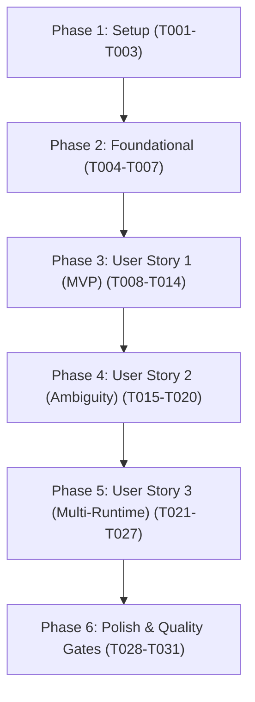

# Tasks: Automatic Legacy Tamil Encoding Detection (`detect_encoding`)

**Branch**: `003-codec-detection` | **Plan**: [plan.md](file:///C:/Users/abish/Documents/dev/tamil-toolkit/specs/003-codec-detection/plan.md) | **Spec**: [spec.md](file:///C:/Users/abish/Documents/dev/tamil-toolkit/specs/003-codec-detection/spec.md)

---

## Phase 1: Setup (Shared Infrastructure)

**Purpose**: Initialize module structure and shared data types

- [X] T001 Create detection module directory `crates/tamil-codec/src/detection/` and declare module in `crates/tamil-codec/src/lib.rs`
- [X] T002 [P] Define `DetectionStatus` enum (`"detected" | "uncertain"`), `EncodingCandidate` struct (`encoding: String`, `confidence: f64`), and `DetectionResult` struct (`status`, `encoding: Option<String>`, `confidence: f64`, `reason: Option<String>`, `candidates: Vec<EncodingCandidate>`) with Serde derive in `crates/tamil-codec/src/detection/mod.rs`
- [X] T003 [P] Initialize golden vector dataset file `tests/golden/codec_detection.jsonl` with schema header

---

## Phase 2: Foundational (Blocking Prerequisites)

**Purpose**: Core scoring algorithms, trie step validators, and candidate normalization

⚠️ **CRITICAL**: Foundational tasks MUST be completed before User Story implementation begins.

- [X] T004 Implement zero-allocation trie transition step evaluator for 8-bit node graphs in `crates/tamil-codec/src/detection/bytes.rs`
- [X] T005 [P] Implement zero-allocation 16-bit CID code unit transition step evaluator in `crates/tamil-codec/src/detection/cids.rs`
- [X] T006 [P] Define signature n-gram tables and illegal byte penalty rules for all 7 legacy profiles in `crates/tamil-codec/src/detection/signatures.rs`
- [X] T007 Implement confidence score normalization, candidate ranking, and descending sort logic in `crates/tamil-codec/src/detection/mod.rs`

**Checkpoint**: Foundational scoring primitives verified — User Story 1 (MVP) implementation can proceed.

---

## Phase 3: User Story 1 - High-Confidence Detection Across Supported Legacy Encodings (Priority: P1) 🎯 MVP

**Goal**: Accurately detect unlabelled byte and CID code buffers into their correct legacy profile with confidence $\ge 0.90$ across all 7 profiles plus modern UTF-8, and support single-call `detect_and_decode`.

**Independent Test**: Feed sample paragraphs from each of the 7 supported encodings + native UTF-8 into `detect_encoding` / `detect_encoding_cids` and verify top detected profile matches expected encoding with `confidence >= 0.90` and `status: "detected"`.

### Tests for User Story 1 🧪

- [X] T008 [P] [US1] Add positive golden test cases covering all 7 profiles (`bamini-v1`, `tscii-1.7-v1`, `tab-v1`, `tam-v1`, `anjal-v1`, `lt-tm-cid-v1`, `vanavil-avvaiyar-cid-v1`) and native UTF-8 to `tests/golden/codec_detection.jsonl`
- [X] T009 [P] [US1] Create unit tests for 8-bit legacy detection in `crates/tamil-codec/tests/detection_8bit.rs`
- [X] T010 [P] [US1] Create unit tests for 16-bit CID detection in `crates/tamil-codec/tests/detection_cids.rs`

### Implementation for User Story 1

- [X] T011 [US1] Implement 8-bit profile scoring loop evaluating Bamini, TSCII, TAB, TAM, Anjal, and native UTF-8 in `crates/tamil-codec/src/detection/bytes.rs`
- [X] T012 [US1] Implement 16-bit CID profile scoring loop evaluating LT-TM and Vanavil Avvaiyar in `crates/tamil-codec/src/detection/cids.rs`
- [X] T013 [US1] Expose public API functions `detect_encoding(input: &[u8]) -> DetectionResult` and `detect_encoding_cids(codes: &[u16]) -> DetectionResult` in `crates/tamil-codec/src/lib.rs`
- [X] T014 [US1] Implement `detect_and_decode(input: &[u8]) -> Result<String, String>` delegating to matching decode functions on `DetectionStatus::Detected` in `crates/tamil-codec/src/lib.rs`

**Checkpoint**: User Story 1 complete — 7 legacy encodings and UTF-8 detect with high confidence and auto-decode successfully.

---

## Phase 4: User Story 2 - Ambiguity Handling & Uncertain Fallback (Priority: P2)

**Goal**: Prevent false positives and data corruption by explicitly designating ambiguous, short (< 4 bytes), mixed-language, or pure English buffers as `status: "uncertain"` with an informative `reason`.

**Independent Test**: Verify that plain ASCII sentences (`"Hello World"`), inputs with length $< 4$ bytes, and conflicting byte distributions return `status: "uncertain"`, `encoding: None`, and `reason` populated.

### Tests for User Story 2 🧪

- [X] T015 [P] [US2] Add negative golden test cases for plain English, short buffers (< 4 bytes), empty buffers, and mixed English-Tamil text to `tests/golden/codec_detection.jsonl`
- [X] T016 [P] [US2] Create ambiguity and edge-case unit test suite in `crates/tamil-codec/tests/detection_ambiguity.rs`

### Implementation for User Story 2

- [X] T017 [US2] Enforce 4,096 byte/code unit maximum inspection cap and short-input guard (`len < 4` returning `reason: "insufficient input length"`, empty returning `reason: "empty input"`) in `crates/tamil-codec/src/detection/mod.rs`
- [X] T018 [US2] Implement ASCII neutrality (`0x00..0x7F`) for 8-bit profiles and English stop-word / n-gram penalties for typewriter profiles (Bamini/Anjal) in `crates/tamil-codec/src/detection/bytes.rs`
- [X] T019 [US2] Enforce score delta gate ($< 0.15$ delta between top two candidates or top confidence $< 0.60$ returning `status: "uncertain"`) in `crates/tamil-codec/src/detection/mod.rs`
- [X] T020 [US2] Update `detect_and_decode` to return typed `UncertainEncoding` error describing the specific reason when status is uncertain in `crates/tamil-codec/src/lib.rs`

**Checkpoint**: User Story 2 complete — zero false positives on plain English text, short buffers safely rejected, and mixed documents classified accurately.

---

## Phase 5: User Story 3 - Multi-Runtime Access via Umbrella Toolkit (Priority: P3)

**Goal**: Expose unified detection and auto-decode capabilities through the central `tamil-toolkit` dispatcher across Python, WebAssembly, and Dart.

**Independent Test**: Execute multi-runtime parity test fixtures across Rust, Python, and WebAssembly verifying identical detection results for all golden test cases.

### Tests for User Story 3 🧪

- [X] T021 [P] [US3] Add integration tests for `op: "detect_encoding"` and `op: "detect_and_decode"` in `crates/tamil-toolkit/tests/test_codec_detection.rs`

### Implementation for User Story 3

- [X] T022 [US3] Add `"detect_encoding"` and `"detect_and_decode"` to `OPERATIONS` slice and implement dispatch handlers in `crates/tamil-toolkit/src/lib.rs`
- [X] T023 [US3] Implement unified string evaluation in `crates/tamil-toolkit/src/lib.rs` (inspecting UTF-8 bytes for 8-bit profiles and UTF-16 code units for CID profiles when PUA or non-ASCII 16-bit units are present)
- [X] T024 [P] [US3] Implement Python bindings `detect_encoding` and `detect_and_decode` in `bindings/python/src/lib.rs` and update type stubs in `bindings/python/tamil_toolkit/__init__.pyi`
- [X] T025 [P] [US3] Implement WebAssembly bindings `detectEncoding` and `detectAndDecode` in `bindings/js-wasm/src/lib.rs` and update TypeScript declarations in `bindings/js-wasm/index.d.ts`
- [X] T026 [P] [US3] Implement Dart C-ABI bindings `detectEncoding` and `detectAndDecode` in `bindings/dart/lib/src/bindings.dart`
- [X] T027 [US3] Validate tri-runtime parity by executing `just test-parity`

**Checkpoint**: User Story 3 complete — Python, WebAssembly, and Dart runtimes expose identical detection APIs matching Rust.

---

## Phase 6: Polish & Cross-Cutting Concerns

**Purpose**: Benchmark validation, documentation, and pre-stop quality gates

- [X] T028 [P] Implement criterion micro-benchmarks verifying $< 5\mu\text{s}$ execution on 1KB buffers in `crates/tamil-codec/benches/codec_detection.rs`
- [X] T029 [P] Update module documentation and architectural specs in `crates/tamil-codec/src/lib.rs` and `docs/specs/003-codec-detection.md`
- [X] T030 Execute all quickstart validation scenarios from `specs/003-codec-detection/quickstart.md`
- [X] T031 Execute repository quality gate `just agent-pre-stop-gate` verifying formatting, clippy, Unicode integrity, schema conformance, and multi-runtime parity

---

## Dependencies & Execution Order

### Phase Dependencies

### User Story Dependencies

- **User Story 1 (P1)**: Depends on Foundational Phase (T004-T007). Delivers core detection MVP for all 7 profiles + UTF-8.
- **User Story 2 (P2)**: Depends on User Story 1. Refines scoring with ASCII neutrality, short-buffer guards, and ambiguity thresholds.
- **User Story 3 (P3)**: Depends on User Story 2. Connects validated engine into `tamil-toolkit` dispatcher and multi-runtime bindings.

---

## Parallel Execution Opportunities

- **Phase 1**: `T002` (data types) and `T003` (golden file skeleton) can execute concurrently.
- **Phase 2**: `T005` (CID evaluator) and `T006` (signature tables) can execute in parallel with `T004` (byte evaluator).
- **Phase 3 (US1)**: Test tasks `T008`, `T009`, and `T010` can be written in parallel before implementation tasks `T011`-`T014`.
- **Phase 4 (US2)**: Tests `T015` and `T016` can be written in parallel.
- **Phase 5 (US3)**: Bindings tasks `T024` (Python), `T025` (WASM), and `T026` (Dart) can be implemented in parallel after dispatcher task `T022`.
- **Phase 6**: `T028` (benchmarks) and `T029` (documentation) can execute concurrently.

---

## Implementation Strategy & MVP Scope

1. **MVP (Phases 1, 2, and 3)**:
   - Delivers working Rust detection for all 7 legacy profiles (`bamini-v1`, `tscii-1.7-v1`, `tab-v1`, `tam-v1`, `anjal-v1`, `lt-tm-cid-v1`, `vanavil-avvaiyar-cid-v1`) and UTF-8.
   - Verified via unit tests in `crates/tamil-codec` and golden test cases.
2. **Robustness Increment (Phase 4)**:
   - Adds 0% false-positive guard against English text, mixed-document ASCII neutrality, and 4KB buffer cap.
3. **Multi-Runtime Delivery (Phase 5 & 6)**:
   - Dispatches through umbrella toolkit across Python, WebAssembly, and Dart with 100% parity and sub-5µs benchmark verification.
