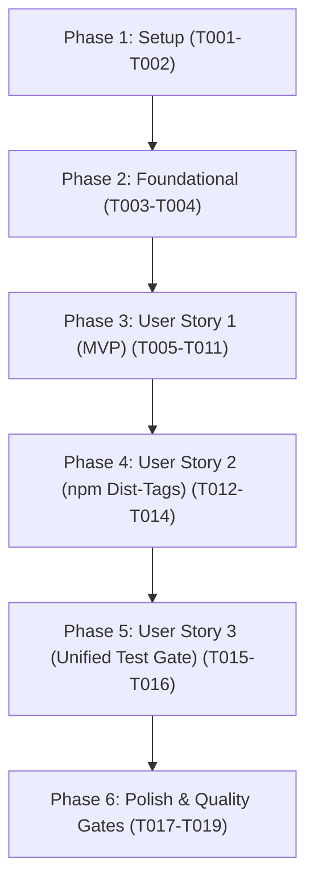

# Tasks: Autonomous Release Pipeline & npm Dist-Tag Modernization

**Branch**: `004-autonomous-release-pipeline` | **Plan**: [plan.md](file:///C:/Users/abish/Documents/dev/tamil-toolkit/specs/004-autonomous-release-pipeline/plan.md) | **Spec**: [spec.md](file:///C:/Users/abish/Documents/dev/tamil-toolkit/specs/004-autonomous-release-pipeline/spec.md)

---

## Phase 1: Setup (Shared Infrastructure)

**Purpose**: Initialize release task entries and CLI scaffolding

- [X] T001 Initialize release pipeline module structure in `tools/release_pipeline.py`
- [X] T002 [P] Add `release-test`, `release`, and `npm-sync-tags` recipes to `justfile`

---

## Phase 2: Foundational (Blocking Prerequisites)

**Purpose**: Core pre-flight guards, git state verifiers, and GitHub CLI wrappers

⚠️ **CRITICAL**: No user story work can begin until this phase is complete.

- [X] T003 Implement git state inspection and cleanliness checks (uncommitted files, branch is `master`, synchronized with `origin/master`) in `tools/release_pipeline.py`
- [X] T004 [P] Implement GitHub CLI (`gh`) authentication and permission verifier in `tools/release_pipeline.py`

**Checkpoint**: Foundational checks ready — user story implementation can proceed.

---

## Phase 3: User Story 1 - Autonomous End-to-End Release Execution (Priority: P1) 🎯 MVP

**Goal**: Deliver single-command release (`just release <version>`) executing test check, version bump, commit, push, artifact build wait, publish wait, release ledger recording, and tagging unattended.

**Independent Test**: Running `python tools/release_pipeline.py release <version> --dry-run` on a clean `master` branch verifies the repo, runs tests, bumps version, pushes commit, triggers `alpha-artifacts.yml`, watches to completion, and halts safely before publish.

### Tests for User Story 1 🧪

- [X] T005 [P] [US1] Create automated unit tests for version validation, git guards, and pipeline stage transitions in `tests/harness/test_release_pipeline.py`

### Implementation for User Story 1

- [X] T006 [P] [US1] Implement GitHub Actions workflow dispatch and monitoring helpers (`alpha-artifacts.yml` and `publish-release.yml`) using `gh` CLI in `tools/release_pipeline.py`
- [X] T007 [US1] Implement atomic version bump, lockfile update, commit, and remote push in `tools/release_pipeline.py`
- [X] T008 [US1] Implement artifact run ID and 40-character source SHA extraction from `alpha-artifacts.yml` in `tools/release_pipeline.py`
- [X] T009 [US1] Implement publish dispatch to `publish-release.yml` with exponential backoff status polling in `tools/release_pipeline.py`
- [X] T010 [US1] Implement release record generation via `release_policy.py release-record`, git tag `v<version>`, and final documentation push in `tools/release_pipeline.py`
- [X] T011 [US1] Implement `--dry-run` flag support to stop safely after artifact build verification in `tools/release_pipeline.py`

**Checkpoint**: User Story 1 complete — releases can be triggered and verified unattended via a single command.

---

## Phase 4: User Story 2 - npm Default Landing Page & Dist-Tag Synchronization (Priority: P2)

**Goal**: Ensure the npm package landing page on npmjs.com and `npm install tamil-toolkit` resolve to the active release instead of staying frozen on `0.1.0-alpha.1`.

**Independent Test**: Running `just npm-sync-tags` updates npm's `latest` dist-tag for `tamil-toolkit` to match the current release (`0.1.0-alpha.5`), verified via `npm view tamil-toolkit dist-tags`.

### Implementation for User Story 2

- [X] T012 [US2] Update `.github/workflows/publish-release.yml` npm publish step to dual-tag package with both `$NPM_TAG` and `latest` using OIDC trusted publishing
- [X] T013 [P] [US2] Create standalone npm dist-tag reconciliation utility in `tools/release_npm_tags.py`
- [X] T014 [US2] Wire `npm-sync-tags` task into `tools/tasks.py` and `justfile`

**Checkpoint**: User Story 2 complete — npm landing page always displays the active release.

---

## Phase 5: User Story 3 - Unified One-Command Pre-Release Test Gate (Priority: P3)

**Goal**: Run all lint, formatting, unit test, golden vector parity, and distribution packaging smoke checks in `< 2 minutes` locally with one CLI call.

**Independent Test**: Running `just release-test` executes all checks and exits 0 cleanly in `< 2 minutes`.

### Implementation for User Story 3

- [X] T015 [US3] Implement `release_test()` composite task in `tools/tasks.py` combining `agent-pre-stop-gate`, `test-dart`, and `release.py all`
- [X] T016 [US3] Add `release-test` task mapping and CLI argument handler in `tools/tasks.py`

**Checkpoint**: User Story 3 complete — single command tests everything before release.

---

## Phase 6: Polish & Cross-Cutting Concerns

**Purpose**: Documentation updates, validation against quickstart, and pre-stop quality gates

- [X] T017 [P] Update documentation in `docs/specs/release-harness.md` with autonomous release commands and npm dist-tag policy
- [X] T018 Execute validation scenarios from `specs/004-autonomous-release-pipeline/quickstart.md`
- [X] T019 Execute repository quality gate `uv run --locked python tools/tasks.py agent-pre-stop-gate`

---

## Dependencies & Execution Order

### Phase Dependencies

### User Story Dependencies

- **User Story 1 (P1)**: Depends on Foundational phase (T003-T004). Delivers the core autonomous release pipeline.
- **User Story 2 (P2)**: Independent enhancement to npm workflow and dist-tag synchronization.
- **User Story 3 (P3)**: Unifies local testing gates; integrated into US1 pre-flight checks.

---

## Parallel Execution Opportunities

- `T002` (justfile scaffolding) can run in parallel with `T001` (pipeline scaffolding).
- `T004` (GitHub CLI verifier) can run in parallel with `T003` (git state checks).
- In User Story 1: `T005` (tests) and `T006` (GH workflow helpers) can run in parallel before `T007`-`T011`.
- In User Story 2: `T013` (sync script) can run in parallel with `T012` (workflow YAML edit).
- In Phase 6: `T017` (docs) can run in parallel with `T018` (quickstart validation).

---

## Implementation Strategy & MVP Scope

1. **MVP (Phases 1, 2, and 3)**:
   - Delivers working autonomous release orchestrator (`tools/release_pipeline.py`) with `--dry-run` support.
   - Tested via unit test suite in `tests/harness/test_release_pipeline.py`.
2. **npm Landing Page Fix (Phase 4)**:
   - Updates `publish-release.yml` with dual-tagging and creates `tools/release_npm_tags.py`.
3. **Unified Test Gate (Phase 5 & 6)**:
   - Implements `just release-test` and validates quickstart scenarios.
