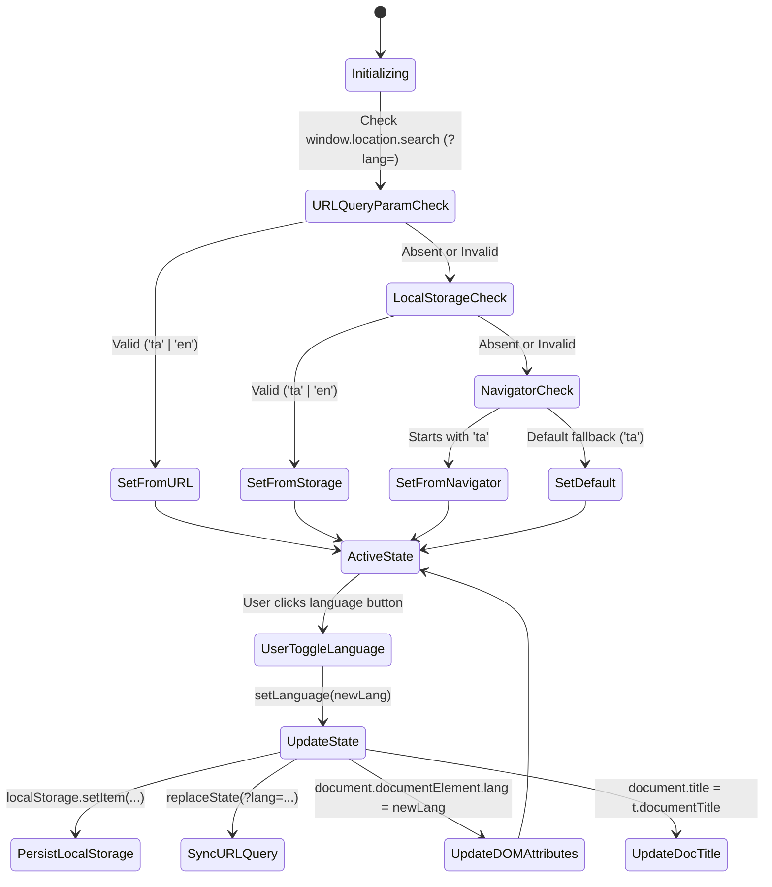

# Data Model: Bilingual Internationalization Architecture

## Types and Entities

### 1. `Language`
Literal union type representing supported locales.
```typescript
export type Language = "ta" | "en";
```

### 2. `Translations`
Exhaustive contract representing all interface copy in the application:

```typescript
export interface Translations {
  siteTitle: string;
  siteSubtitle: string;
  privacyBadge: string;
  documentTitle: string;
  nav: {
    hub: string;
    publicTools: string;
    devTools: string;
    switchPrompt: string;
    currentLanguageName: string;
    switchLanguageName: string;
  };
  actions: {
    copy: string;
    copied: string;
    clear: string;
    swap: string;
    loadSample: string;
    autoDetect: string;
    manualSelect: string;
    runNow: string;
    downloadFile: string;
    openTool: string;
    inspect: string;
  };
  hub: {
    heroBadge: string;
    realtimeUtilitiesHeading: string;
    realtimeUtilitiesDesc: string;
    developerLabHeading: string;
    developerLabDesc: string;
    tags: {
      realtime: string;
      financial: string;
      solar: string;
      collation: string;
      unicode: string;
      api: string;
      code: string;
      batch: string;
    };
  };
  tools: {
    codec: { ... };
    numeral: { ... };
    calendar: { ... };
    sorter: { ... };
    scalar: { ... };
    dispatcher: { ... };
    codegen: { ... };
    batch: { ... };
  };
}
```

### 3. `LanguageContextType`
React context value passed to consumers via `useLanguage()`:
```typescript
export interface LanguageContextType {
  language: Language;
  setLanguage: (lang: Language) => void;
  t: Translations;
}
```

## State Transitions


