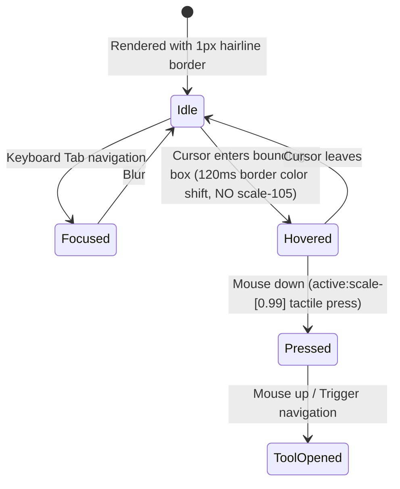

# Data Model: Unslop Workbench Architecture

## Components & Visual Hierarchy

### 1. `WorkbenchHeader` (Replacing Floating Marketing Hero)
- **Role**: Utilitarian status bar and quick navigation anchor.
- **Attributes**:
  - `engineStatus`: Active WebAssembly status (`"ready"` | `"evaluating"`).
  - `activeLocale`: Current locale indicator (`"ta"` | `"en"`).
  - `quickActions`: Fast jumps to primary tools.
  - `metrics`: Non-fabricated, factual operational stats (e.g. `7 Legacy Font Encodings`, `60-Year Drik Solar Cycle`, `Client-Only WASM`).

### 2. `AsymmetricWorkbenchGrid` (Replacing 4-Card Uniform Rows)
- **Grid Layout**: 12-column responsive Bento grid:
  - **Zone 1: Primary Linguistic Hub (Col-span 7 on desktop)**:
    - Dedicated to Legacy Font & Unicode Converter (`CodecConverter`).
    - Includes interactive preview chips for direct format jumping (Bamini, TSCII, TAB, TAM, Anjal, Vanavil, LT-TM).
  - **Zone 2: Financial & Word Notation (Col-span 5 on desktop)**:
    - Dedicated to Numeral & Currency Formatter (`NumeralFormatter`).
    - Contextual preview showing formal Tamil words and legal cheque representation.
  - **Zone 3: Solar Calendar & Panchangam (Col-span 6 on desktop)**:
    - Dedicated to Tamil Solar Calendar (`CalendarExplorer`).
    - Integrated daily period indicator (Rahu Kalam / Yamagandam) and live solar date badge.
  - **Zone 4: Classical Agara Varisai (Col-span 6 on desktop)**:
    - Dedicated to Alphabetical Collation (`TextSorter`).
    - Visual guide of classical grammatical sorting (`உயிர்` → `மெய்` → `உயிர்மெய்`).

### 3. `DiagnosticConsole` (Replacing Marketing Cards for Dev Tools)
- **Role**: High-density engineering panel grouping developer utilities:
  - `ScalarInspector`: Unicode codepoint inspector.
  - `DispatcherSandbox`: Raw WebAssembly JSON request/response runner.
  - `CodeGenerator`: Polyglot SDK code generator (Rust, Python, TS, Dart).
  - `BatchProcessor`: Background Web Worker batch transformer.
- **Styling**: Distinct hairline separation, monospace accents, compact action rows.

## State Transitions & Micro-Interactions

