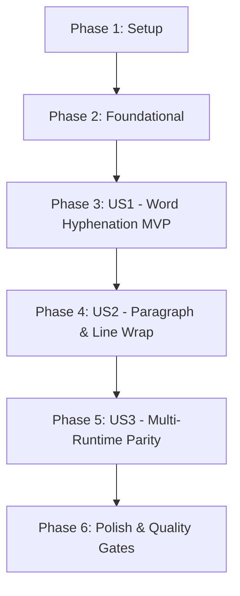

# Tasks: Syllable and Orthographic Boundary Hyphenation (`tamil-hyphen`)

**Feature**: `009-tamil-hyphen` | **Date**: 2026-11-05 | **Spec**: [specs/009-tamil-hyphen/spec.md](file:///C:/Users/abish/Documents/dev/tamil-toolkit/specs/009-tamil-hyphen/spec.md) | **Plan**: [specs/009-tamil-hyphen/plan.md](file:///C:/Users/abish/Documents/dev/tamil-toolkit/specs/009-tamil-hyphen/plan.md)

## Summary of Phases

1. **Phase 1: Setup**: Crate configuration, dependencies, and test fixtures setup.
2. **Phase 2: Foundational**: Core syllable definitions, Akshara classification, and golden test vector harness.
3. **Phase 3: User Story 1 (P1) 🎯 MVP**: Word-level hyphenation (`hyphenate_word`, `hyphenation_points`) with strict Mei-tail binding and safe margins.
4. **Phase 4: User Story 2 (P2)**: Paragraph scanning (`hyphenate_text`), soft-hyphen idempotency, and deterministic line wrapping (`wrap_text`).
5. **Phase 5: User Story 3 (P3)**: Umbrella dispatcher integration (`tamil-toolkit`), multi-runtime parity (Python, JS/WASM, Dart), and dialect tests.
6. **Phase 6: Polish & Cross-Cutting**: Quality gates, benchmarks, documentation, and manifest verification.

---

### Phase 1: Setup

**Purpose**: Initialize crate dependencies, exports, and directory layout.

- [X] T001 Update workspace dependencies in `crates/tamil-hyphen/Cargo.toml` adding `tamil-core`, `tamil-norm`, and `serde`
- [X] T002 [P] Create test directory structure and unit test harness in `crates/tamil-hyphen/tests/hyphen_tests.rs`

---

## Phase 2: Foundational (Akshara Phonotactics & Types)

**Purpose**: Core types, phonetic classification, and golden vector structure required across all user stories.

- [X] T003 Define `LetterClass` and `classify_letter` matching Uyir, Uyirmei, Mei, Aytham, and Atomic Grantha in `crates/tamil-hyphen/src/syllable.rs`
- [X] T004 [P] Define `HyphenationConfig`, `HyphenationPoint`, `HyphenationResult`, and `WrapResult` in `crates/tamil-hyphen/src/types.rs`
- [X] T005 [P] Create initial planned golden vector suite with 120+ cases in `tests/golden/hyphen_syllable.jsonl`
- [X] T006 Register `hyphen_syllable.jsonl` as planned suite in `tests/golden/manifest.json`

**Checkpoint**: Core classification and types ready; user story implementation can proceed.

---

## Phase 3: User Story 1 - Word-Level Syllabic Hyphenation (Priority: P1) 🎯 MVP

**Goal**: Identify valid syllable break points in individual Tamil words, strictly bind Mei/Aytham codas to the preceding nucleus, and enforce configurable safe margins (`left_min = 2, right_min = 2` default).

**Independent Test**: Pass single Tamil words (`தமிழ்நாடு`, `பல்கலைக்கழகம்`, `துர்ப்பிரயோகம்`) to `hyphenate_word` and `hyphenation_points`; verify that segments never start with a Mei or Aytham and that `segments.join("") == original`.

- [X] T007 [US1] Write unit tests for word hyphenation, coda binding, and margin enforcement in `crates/tamil-hyphen/tests/word_tests.rs`
- [X] T008 [US1] Implement syllable break point detection algorithm (`hyphenation_points`) in `crates/tamil-hyphen/src/syllable.rs`
- [X] T009 [US1] Implement `hyphenate_word` assembling syllable segments and inserting delimiters in `crates/tamil-hyphen/src/syllable.rs`
- [X] T010 [US1] Add validation for `left_min < 1` and `right_min < 1` configuration errors in `crates/tamil-hyphen/src/syllable.rs`
- [X] T011 [US1] Implement proptest property test verifying 100% lossless reconstruction (`segments.join("") == original`) across 10,000 inputs in `crates/tamil-hyphen/tests/property_tests.rs`

**Checkpoint**: User Story 1 complete and independently testable as an MVP.

---

## Phase 4: User Story 2 - Paragraph Soft-Hyphenation & Line Wrapping (Priority: P2)

**Goal**: Process full paragraphs and mixed-script text, injecting soft hyphens into Tamil words, preserving non-Tamil content verbatim, and deterministically wrapping text to line width without corrupting words.

**Independent Test**: Pass mixed Tamil/English paragraphs into `hyphenate_text` and `wrap_text`; verify soft-hyphen idempotency, preservation of non-Tamil tokens/links, and clean line wraps.

- [X] T012 [US2] Write unit tests for paragraph tokenization, idempotency, and line wrapping in `crates/tamil-hyphen/tests/text_tests.rs`
- [X] T013 [US2] Implement Tamil word token scanner (`tokenize_words`) distinguishing Tamil letter runs from punctuation, symbols, and non-Tamil tokens in `crates/tamil-hyphen/src/text.rs`
- [X] T014 [US2] Implement `hyphenate_text` with soft-hyphen deduplication and idempotency in `crates/tamil-hyphen/src/text.rs`
- [X] T015 [US2] Implement `wrap_text` breaking lines at valid hyphenation points and leaving non-Tamil tokens/links to host wrapping in `crates/tamil-hyphen/src/text.rs`
- [X] T016 [US2] Expose all public functions (`hyphenate_word`, `hyphenation_points`, `hyphenate_text`, `wrap_text`) from `crates/tamil-hyphen/src/lib.rs`

**Checkpoint**: User Stories 1 & 2 fully functional.

---

## Phase 5: User Story 3 - Multi-Runtime Parity & Dispatcher Integration (Priority: P3)

**Goal**: Expose hyphenation operations through `tamil-toolkit::execute` and verify identical behavior across Python, WebAssembly, and Dart for both TN and SL regional vocabulary.

**Independent Test**: Run `tests/golden/hyphen_syllable.jsonl` across Rust, Python, and WebAssembly, verifying 100% parity across all runtimes.

- [X] T017 [US3] Add `tamil-hyphen` dependency to `crates/tamil-toolkit/Cargo.toml`
- [X] T018 [US3] Implement routing for `"hyphenate_word"`, `"hyphenation_points"`, `"hyphenate_text"`, and `"wrap_text"` in `crates/tamil-toolkit/src/lib.rs`
- [X] T019 [P] [US3] Add Python bindings for hyphenation operations in `bindings/python/src/lib.rs` and types in `bindings/python/tamil_toolkit/__init__.pyi`
- [X] T020 [P] [US3] Add WebAssembly bindings for hyphenation operations in `bindings/js-wasm/src/lib.rs` and types in `bindings/js-wasm/index.d.ts`
- [X] T021 [P] [US3] Add Dart FFI bindings for hyphenation operations in `bindings/dart-flutter/rust/src/lib.rs` and `bindings/dart-flutter/lib/src/tamil_toolkit.dart`
- [X] T022 [US3] Add regional vocabulary probes (`TN` and `SL` dialect words) to `tests/golden/hyphen_syllable.jsonl` and verify invariant behavior

**Checkpoint**: All user stories functional with cross-runtime parity.

---

## Phase 6: Polish & Cross-Cutting Concerns

**Purpose**: Performance benchmarking, documentation, and repository gate verification.

- [X] T023 [P] Add Criterion benchmark verifying < 5µs word hyphenation and < 100µs paragraph hyphenation in `crates/tamil-hyphen/benches/hyphen_bench.rs`
- [X] T024 [P] Update crate documentation and examples in `crates/tamil-hyphen/README.md` and repository `README.md`
- [X] T025 [P] Run `quickstart.md` validation scenarios across Rust, Python, and JS/WASM
- [X] T026 Run full verification gates: `just check-unicode`, `just sync-release-files`, `cargo test --all`, and `just agent-pre-stop-gate`

---

## Dependencies & Execution Order

### Parallel Opportunities

- **Phase 1**: T001 and T002 can run in parallel.
- **Phase 2**: T004, T005, and T006 can run in parallel.
- **Phase 5**: T019 (Python), T020 (WASM), and T021 (Dart) bindings can be implemented in parallel once T018 (dispatcher) is complete.
- **Phase 6**: T023 (benchmarks), T024 (docs), and T025 (quickstart validation) can run in parallel.

---

## Implementation Strategy: MVP First

1. **Sprint 1 (MVP)**: Deliver **Phase 1**, **Phase 2**, and **Phase 3** (User Story 1). This yields a standalone, verified word hyphenation engine in `tamil-hyphen`.
2. **Sprint 2**: Add **Phase 4** (User Story 2: Paragraph text hyphenation and line wrapping).
3. **Sprint 3**: Add **Phase 5** & **Phase 6** (Umbrella dispatcher, multi-runtime parity, and full quality gates).
