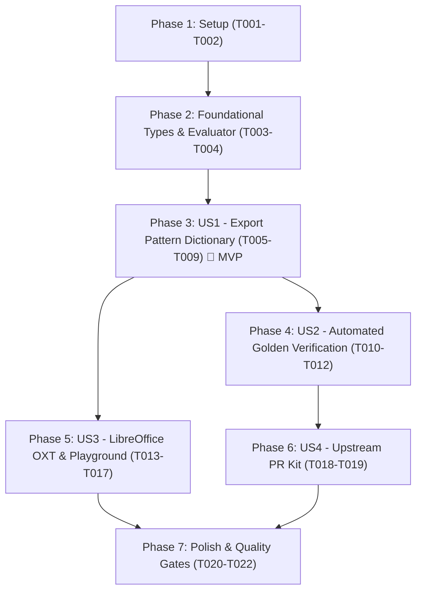

# Tasks: Phonotactically Verified Hunspell / TeX Hyphenation Dictionary & LibreOffice Extension (`tamil-hyphen-dic`)

**Feature**: `011-tamil-hyphen-dic` | **Date**: 2026-11-06 | **Spec**: [specs/011-tamil-hyphen-dic/spec.md](file:///C:/Users/abish/Documents/dev/tamil-toolkit/specs/011-tamil-hyphen-dic/spec.md) | **Plan**: [specs/011-tamil-hyphen-dic/plan.md](file:///C:/Users/abish/Documents/dev/tamil-toolkit/specs/011-tamil-hyphen-dic/plan.md)

## Summary of Phases

1. **Phase 1: Setup**: Dependencies, workspace configuration, and directory layout.
2. **Phase 2: Foundational**: Core Liang pattern types and simulated pattern evaluator.
3. **Phase 3: User Story 1 (P1) 🎯 MVP**: Algorithmic pattern synthesizer, `.dic` serializer, and CLI export.
4. **Phase 4: User Story 2 (P2)**: Automated verification against golden corpus and legacy SMC comparative benchmark.
5. **Phase 5: User Story 3 (P3)**: LibreOffice `.oxt` packager, desktop publishing guides, and Playground download card.
6. **Phase 6: User Story 4 (P4)**: Upstream contribution PR bundle for `smc/hyphenation`.
7. **Phase 7: Polish & Quality Gates**: End-to-end quickstart validation and repository verification gates.

---

## Phase 1: Setup

**Purpose**: Configure crate dependencies, output directories, and packaging layout.

- [X] T001 Add `zip` dependency (`version = "2.2"`, `default-features = false`, `features = ["deflate"]`) to `crates/tamil-hyphen/Cargo.toml`
- [X] T002 [P] Create output and documentation directories: `dist/dictionaries/`, `dist/upstream-smc/ta_IN/`, and `docs/integrations/`

---

## Phase 2: Foundational

**Purpose**: Core data structures and pattern simulation infrastructure blocking all user stories.

**⚠️ CRITICAL**: Pattern synthesis, verification, and packaging rely on these core types.

- [X] T003 Define `LiangPattern`, `DicHeader`, and `HyphenDictionary` types in `crates/tamil-hyphen/src/types.rs`
- [X] T004 Implement simulated Frank Liang pattern evaluator in `crates/tamil-hyphen/src/verify_dic.rs` to parse `.dic` files and calculate hyphenation points for test words

**Checkpoint**: Core data structures and verification engine ready; user stories can proceed.

---

## Phase 3: User Story 1 - Export Phonotactically Verified TeX/Hunspell Pattern Dictionary (Priority: P1) 🎯 MVP

**Goal**: Programmatically synthesize Frank Liang hyphenation patterns from Tamil phonotactic grammar enforcing `LEFTHYPHENMIN 2`, `RIGHTHYPHENMIN 2`, Grantha ligature protection (`2க்ஷ2`, `2ஸ்ரீ2`), coda binding (`2C\u0BCD`), and Aytham (`2ஃ`), exporting to `hyph_ta_IN.dic`.

**Independent Test**: Run `tamil-toolkit hyphen export-dic --output dist/dictionaries/hyph_ta_IN.dic` and verify the exported file contains valid UTF-8 headers, minimum margins, and complete pattern rules.

- [X] T005 [P] [US1] Write unit tests for pattern generation in `crates/tamil-hyphen/tests/dic_tests.rs`
- [X] T006 [US1] Implement algorithmic pattern synthesizer and `.dic` serializer (`generate_patterns`, `export_dic_file`) in `crates/tamil-hyphen/src/dic.rs`
- [X] T007 [US1] Expose `export_dictionary` and `generate_patterns` from `crates/tamil-hyphen/src/lib.rs`
- [X] T008 [US1] Implement CLI command `tamil-toolkit hyphen export-dic` with `--output`, `--lefthyphenmin`, and `--righthyphenmin` options in `crates/tamil-toolkit/src/bin/tamil-toolkit.rs`
- [X] T009 [US1] Execute `export-dic` to generate the production dictionary in `dist/dictionaries/hyph_ta_IN.dic`

**Checkpoint**: User Story 1 functional as a standalone MVP deliverable.

---

## Phase 4: User Story 2 - Automated Pattern Verification Against Golden Corpus (Priority: P2)

**Goal**: Automatically verify generated patterns against `tests/golden/hyphen_syllable.jsonl` and execute comparative benchmarks documenting 100% resolution of legacy 2018 SMC defects.

**Independent Test**: Run `cargo test -p tamil-hyphen --test dic_verification_tests` and `cargo test -p tamil-hyphen --test legacy_comparison_tests` and assert 0 broken diacritics and 0 illegal line starts.

- [X] T010 [P] [US2] Write verification test runner in `crates/tamil-hyphen/tests/dic_verification_tests.rs` evaluating all words in `tests/golden/hyphen_syllable.jsonl`
- [X] T011 [P] [US2] Save legacy 2018 SMC `hyph_ta_IN.dic` benchmark fixture in `crates/tamil-hyphen/tests/fixtures/smc_2018_hyph_ta_IN.dic`
- [X] T012 [US2] Implement comparative benchmark test in `crates/tamil-hyphen/tests/legacy_comparison_tests.rs` proving 0 defects in new patterns vs legacy SMC defects (broken `க்ஷ`, 1-letter breaks, coda splits)

**Checkpoint**: User Stories 1 & 2 complete with empirical automated verification.

---

## Phase 5: User Story 3 - LibreOffice Extension (`.oxt`) & Desktop Publishing (Priority: P3)

**Goal**: Package the dictionary into a one-click LibreOffice extension (`tamil-hyphenation.oxt`) with multi-locale support (`ta-IN`, `ta-LK`, `ta-SG`, `ta-MY`, `ta`), create setup guides for InDesign and Scribus, and add a direct download card to the Playground.

**Independent Test**: Verify that `tamil-hyphenation.oxt` contains valid XMLs (`manifest.xml`, `dictionaries.xcu`, `description.xml`), and verify Playground provides direct browser downloads for `.oxt` and `.dic`.

- [X] T013 [P] [US3] Create XML template generators (`manifest.xml`, `dictionaries.xcu` binding `ta-IN ta-LK ta-SG ta-MY ta`, and `description.xml`) in `crates/tamil-hyphen/src/oxt.rs`
- [X] T014 [US3] Implement `package_oxt` in `crates/tamil-hyphen/src/oxt.rs` building `dist/tamil-hyphenation.oxt` ZIP archive
- [X] T015 [US3] Add CLI subcommand `tamil-toolkit hyphen package-oxt` in `crates/tamil-toolkit/src/bin/tamil-toolkit.rs`
- [X] T016 [P] [US3] Author desktop publishing integration guides in `docs/integrations/libreoffice.md`, `docs/integrations/indesign.md`, and `docs/integrations/scribus.md`
- [X] T017 [US3] Add "Integrations & Downloads" card in `playground/src/components/public-tools/HyphenatorTool.tsx` with direct `.oxt` / `.dic` download buttons and bilingual i18n in `playground/src/lib/i18n.ts`

**Checkpoint**: User Stories 1, 2 & 3 complete with desktop packaging and web download availability.

---

## Phase 6: User Story 4 - Upstream Contribution Kit for `smc/hyphenation` (Priority: P4)

**Goal**: Prepare the upstream PR contribution bundle ready for submission to `github.com/smc/hyphenation`.

**Independent Test**: Verify `dist/upstream-smc/UPSTREAM_PR.md` contains comprehensive rationale, phonotactic evidence, comparative benchmark tables, and clean licensing attribution.

- [X] T018 [P] [US4] Copy generated dictionary to `dist/upstream-smc/ta_IN/hyph_ta_IN.dic`
- [X] T019 [US4] Generate upstream contribution kit in `dist/upstream-smc/UPSTREAM_PR.md` documenting PR title, phonotactic rationale, benchmark diffs, and test commands

**Checkpoint**: All user stories complete and ready for ecosystem upstreaming.

---

## Phase 7: Polish & Quality Gates

**Purpose**: End-to-end validation, documentation updates, and repository gate compliance.

- [X] T020 [P] Update repository `README.md` and `crates/tamil-hyphen/README.md` documenting dictionary export and office integrations
- [X] T021 Execute validation scenarios from `specs/011-tamil-hyphen-dic/quickstart.md`
- [X] T022 Run complete quality gates: `cargo test --all`, `pnpm --filter tamil-toolkit-playground test`, `pnpm --filter tamil-toolkit-playground build`, and `python tools/release_policy.py check`

---

## Phase 8: Long-Term Integration Roadmap (Post-MVP Horizons)

**Purpose**: Multi-phase roadmap for consumer word processors (Microsoft Word & Google Docs) via Unicode Soft Hyphens (`\u{00AD}`). Spec: [docs/integrations/word-googledocs-roadmap.md](file:///C:/Users/abish/Documents/dev/tamil-toolkit/docs/integrations/word-googledocs-roadmap.md) and [ROADMAP.md](file:///C:/Users/abish/Documents/dev/tamil-toolkit/ROADMAP.md).

- [X] T023 [P] Document 5-phase long-term integration strategy in `docs/integrations/word-googledocs-roadmap.md` and repository `ROADMAP.md`
- [ ] T024 (Phase 2 - Target v0.2.0) Implement headless OpenXML DOCX batch processing CLI subcommand (`tamil-toolkit hyphen process-docx`) and Python script
- [ ] T025 (Phase 3 - Target v0.3.0) Build cross-platform Microsoft Word Web Add-in (`Office.js` Taskpane) running `tamil-toolkit-wasm` locally
- [ ] T026 (Phase 4 - Target v0.4.0) Author Google Workspace Docs Add-on via Google Apps Script for cloud-first authoring
- [ ] T027 (Phase 5 - Exploration) Research Windows Linguistic Services (`ISpellCheckProviderFactory`) and macOS `NSSpellServer` CoreText hyphenation registration

---

## Dependencies & Execution Order

### Parallel Opportunities

- **Phase 1**: `T002` (directory creation) can run alongside `T001`.
- **Phase 3**: `T005` (unit tests) can be written in parallel with `T006`.
- **Phase 4**: `T010` (test runner) and `T011` (benchmark fixture) can run concurrently.
- **Phase 5**: `T013` (XML generators) and `T016` (documentation guides) can run in parallel.
- **Phase 6**: `T018` (file copy) and `T019` (PR documentation) can be prepared in parallel.
