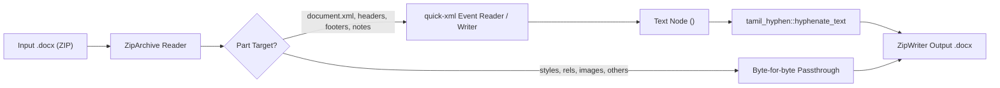

# Implementation Plan: Headless OpenXML DOCX Batch Processor (`docx-hyphen`)

**Branch**: `012-docx-hyphen` | **Date**: 2026-11-07 | **Spec**: [specs/012-docx-hyphen/spec.md](file:///C:/Users/abish/Documents/dev/tamil-toolkit/specs/012-docx-hyphen/spec.md)

## Summary

Build a high-performance, headless OpenXML `.docx` batch processor in Rust (`crates/tamil-hyphen/src/docx.rs`), expose it via CLI (`tamil-toolkit hyphen process-docx`) and Python SDK, and verify it across synthetic and real `.docx` documents. The engine reads the ZIP container, processes `<w:t>` text nodes in all prose parts (`document.xml`, headers, footers, footnotes, endnotes) using `tamil-hyphen::hyphenate_text`, and writes out a byte-for-byte syntactically valid OpenXML archive with idempotent Unicode Soft-Hyphens (`\u{00AD}`).

## Technical Context

- **Language/Version**: Modern Stable Rust (MSRV 1.83+) and Python 3.11+ (via PyO3).
- **Core Dependencies**: `zip` (already in `tamil-hyphen` for `.oxt`), `quick-xml` (streaming zero-copy XML reader/writer), `tamil-hyphen`, `clap`.
- **Target Platform**: Windows, macOS, Linux, WebAssembly.
- **Constraints**: 100% preservation of non-Tamil text, paragraph formatting runs, bookmarks, hyperlinks, comments, tables, and images. Zero XML corruption or repair prompts in Microsoft Word or LibreOffice.

## Architecture

## Constitution Check

- **Principle I: Rust Owns Linguistic Behavior**: **PASS**. OpenXML parsing and soft-hyphen injection are implemented purely in Rust (`crates/tamil-hyphen/src/docx.rs`). CLI and Python are thin wrappers.
- **Principle II: Inspect Tamil by Scalars**: **PASS**. Words are segmented and soft-hyphenated by Unicode scalars (`\u{00AD}` inserted after vowel nuclei or Mei coda clusters).
- **Principle III: Golden Vectors Precede Implementation**: **PASS**. Test cases verify lossless roundtrip and XML syntax validity.
- **Principle IV: Separation of Data and Logic**: **PASS**. Reuses `tamil-hyphen` phonotactic syllable engine.
- **Principle V: Pluricentric Scope**: **PASS**. Invariant across TN and SL dialects.
- **Principle VI: Platform Naming**: **PASS**. `tamil-toolkit hyphen process-docx` in CLI; `tamil_toolkit.hyphen.process_docx` in Python.
- **Principle VII: Explicit Guarantees**: **PASS**. Preserves all non-Tamil text and XML run tags.
