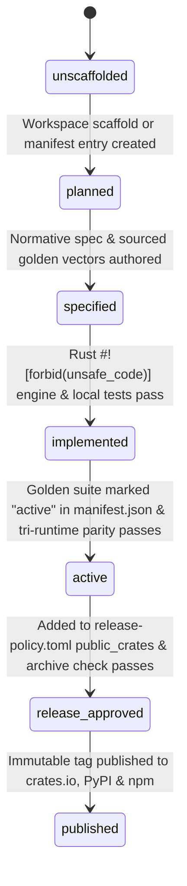

# Phase 1 Data Model: Crate Dependency DAG, Capability Tiers & Roadmap Governance (`016`)

**Date**: 2026-11-08  
**Feature**: [spec.md](spec.md)

---

## 1. Core Architectural Entities

### 1.1 `DependencyRank` (`Rank 0` – `Rank 6`)
Represents the strict topological layer of a crate, extension, or binding target in the `tamil-toolkit` monorepo.

- **Values**:
  - `Rank 0`: Foundational Unicode scalars, tailored `Letters`, and context-free phonological/nucleus primitives (`tamil-core`).
  - `Rank 1`: Normalization contracts, legacy/tactile codecs, numerals, and classical prosody (`tamil-norm`, `tamil-codec`, `tamil-numerals`, `tamil-yaappu`).
  - `Rank 2`: Contextual/tabular engines, Sandhi rules, typography, transliteration, phonetics, and surface tokenization (`tamil-calendar`, `tamil-collate`, `tamil-hyphen`, `tamil-punarchi`, `tamil-translit`, `tamil-phonetics`, `tamil-tokenize`).
  - `Rank 3`: Lexical & finite-state morphological analysis (`tamil-morph`).
  - `Rank 4`: High-level morpho-syntactic applications and database extensions (`tamil-dialect`, `tamil-spell`, `extensions/pg_tamil`).
  - `Rank 5`: Unified Rust facade, cross-branch orchestrator, and CLI (`tamil-toolkit`).
  - `Rank 6`: Multi-runtime FFI bindings and client applications (`bindings/python`, `bindings/js-wasm`, `bindings/dart-flutter/rust`, `playground`, `integrations/office-word-addin`).
- **Validation Invariant (`FR-001`)**:
  - For every crate/target $A$ and every `tamil-*` dependency $B \in \text{deps}(A) \cup \text{build\_deps}(A) \cup \text{dev\_deps}(A)$:
    $$\text{Rank}(B) < \text{Rank}(A)$$

---

### 1.2 `DifficultyTier` (`Tier 1` – `Tier 5`)
Classifies individual capabilities and profiles by both algorithmic complexity and primary-source verification difficulty.

| Tier | Identifier | Algorithmic & Evidence Profile |
|---:|---|---|
| `1` | `Foundation` | Finite Unicode/phonological facts, mechanical adapter wiring, CLI subcommands, and release-policy closeout. |
| `2` | `BoundedConversion` | Deterministic 1-to-1 or trie-based conversions backed by fixed tables, statutory schedules, or reversible standards. |
| `3` | `ContextualProcessing` | Local context windows, finite state machines, structured numeral AST parsing, or typographic margin rules. |
| `4` | `LinguisticEngine` | Multi-rule classical grammar engines (Nannool Sandhi, Yaappu meters), FST morphology, and allophonic G2P rules. |
| `5` | `AmbiguousSynthesis` | Diglossic dialect transformation, syntactic compound disambiguation, noisy IME input, epigraphic scripts, and contested almanac witnesses. |

---

### 1.3 `CapabilityStatus` (7-State Lifecycle Vocabulary)
Every crate, module profile, and golden test suite transitions monotonically through the following states:

---

### 1.4 Cross-Crate Data & Interface Boundaries

#### A. `tamil-core` Phonological & Nucleus Primitives (`Phase 1` Target)
- `LetterQuantity`: `Kuril` ($1.0$), `Nedil` ($2.0$), `Mei` ($0.5$), `Aytham` ($0.5$), `NonTamil` ($0.0$).
- `InaEzhuthuPair`: Homorganic consonant pairs (`க்↔ங்`, `ச்↔ஞ்`, `ட்↔ண்`, `த்↔ந்`, `ப்↔ம்`, `ற்↔ன்`) and vowel pairs (`அ↔ஆ`, `இ↔ஈ`, `உ↔ஊ`, `எ↔ஏ`, `ஐ↔இ`, `ஒ↔ஓ`, `ஔ↔உ`).
- `OrthographicNucleus` (`Olippasai`):
  - `byte_range: Range<usize>`
  - `letter_range: Range<usize>`
  - `onset_vowel_letter: &str` (`Uyir` or `Uyirmei`)
  - `codas: SmallVec<[&str; 2]>` (contiguous `Mei` or `Aytham` letters)

#### B. `tamil-punarchi` $\rightarrow$ `tamil-morph` Boundary (`Phase 10`–`Phase 11` Target)
- `PunarchiContext`: Explicit grammatical construction hint (`Vetrumai` case relation vs. `Alvazhi` non-case relation).
- `SandhiSplitCandidate`:
  - `rule_id: &'static str` (e.g., `"nannool-162-uyir-varin-ukkurul-mei-vittodum"`)
  - `left_reconstructed: String` (underlying stem, which may contain elided characters not present as a surface substring)
  - `right_reconstructed: String`
  - `left_surface_span: Range<usize>`
  - `right_surface_span: Range<usize>`
  - `transformation_kind: TransformationKind` (`Iyalbu`, `Thonral`, `Thirithal`, `Keduthal`)
- `tamil-morph` consumes `Vec<SandhiSplitCandidate>` and filters/ranks them by verifying whether `left_reconstructed` and `right_reconstructed` are valid lexical stems/inflections.

#### C. `tamil-toolkit` Compound-Aware Hyphenation Boundary (`Phase 12` Target)
- `HyphenationBoundaryHint`:
  - `letter_offset: usize` (tailored `Letters` index corresponding to a verified morphological compound boundary)
  - `priority: BoundaryPriority` (`PreferredCompoundBoundary` vs. `StandardAsaiBoundary`)
- **Precedence Rule (`FR-008`)**: `tamil-hyphen` first filters all candidate break indices by `index >= left_min && (word_letter_len - index) >= right_min` (default `3/3`, `MIN_WORD_LETTERS = 6`). Only hints that satisfy the active typographic margin constraints are eligible for compound preference.
