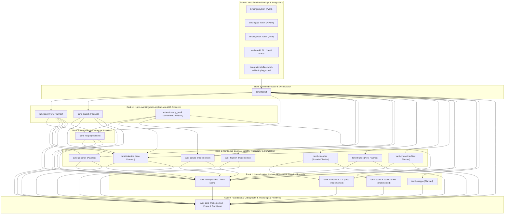

# Feature Specification: Crate Dependency DAG, Capability Boundaries & Difficulty-Tiered Roadmap

**Feature Branch**: `016-crate-dependency-roadmap`

**Created**: 2026-11-08

**Status**: Complete — architecture documentation and DAG governance verified (2026-11-08)

**Completion evidence**: All Feature 016 tasks are checked in [tasks.md](tasks.md); validation results are recorded in [the project handoff](../../docs/status.md). Roadmap Phases 1–17 remain future work.

**Input**: User description: "based on the difficulty level and some things need to be done before something. like tamil-core is the basic like for this hyphen rules when calculate letters we use tamil-core. so we need to plan a proper roadmap this need to be done before this. Also there can be something we missed in our crates. if we miss anything add to roadmap. we can do it later. research with flash subagents. then discuss with sol xhigh and come with the final plan. This is the documentation and project structure task not an implementation task"

## 1. Executive Summary & Architectural Philosophy

`tamil-toolkit` is a Rust-first, multi-runtime Tamil linguistic and computational infrastructure monorepo targeting native Rust, Python (`PyO3`), JavaScript/WebAssembly (`wasm-bindgen`), Dart/Flutter (`flutter_rust_bridge`), CLI (`tamil-toolkit`), and PostgreSQL (`extensions/pg_tamil`).

As the toolkit expands from foundational Unicode primitives (`tamil-core`), legacy font transcoding (`tamil-codec`), collation (`tamil-collate`), numerals (`tamil-numerals`), calendar ephemeris (`tamil-calendar`), and syllabic hyphenation (`tamil-hyphen`) into classical Sandhi (`tamil-punarchi`), morphology (`tamil-morph`), prosody (`tamil-yaappu`), dialect normalization (`tamil-dialect`), and missing NLP capabilities (`tamil-translit`, `tamil-phonetics`, `tamil-tokenize`, `tamil-spell`), **strict prerequisite ordering and acyclic crate boundaries** are mandatory.

For example:
- `tamil-hyphen` could not compute canonical Tamil syllable breaks (`left_min = 3, right_min = 3` in tailored *Ezhuthu* units) without `tamil-core::Letters` and `split_uyirmei`.
- Conversely, both `tamil-hyphen` (typographic line breaking) and `tamil-yaappu` (classical prosodic scansion) require shared letter-quantity primitives (*Kuril*, *Nedil*, *Mei/Otru*, *Aytham*, *Ina-ezhuthu*, and a phonetic syllable nucleus kernel *Olippasai*) in `tamil-core` so they never duplicate or diverge on foundational phonology—while keeping typographic margin merging strictly in `tamil-hyphen` and contextual metrical scansion (*Ner/Nirai*, *Alapedai*, *Kurriyalugaram*) strictly in `tamil-yaappu`.
- Similarly, `tamil-morph` (FST inflection and lemmatization) cannot strip or attach suffixes without `tamil-punarchi`'s morphophonemic transition rules, while reverse Sandhi compound splitting in `tamil-punarchi` generates structural candidates that require `tamil-morph`'s stem lexicon to disambiguate and rank without creating a circular dependency.

## Clarifications

### Session 2026-11-08

- Q: How should the project enforce the acyclic `Rank 0`–`Rank 6` crate dependency rules across the repository as new phases are built? (FR-001) → A: Enforce the `Rank 0`–`Rank 6` DAG automatically in `tools/release_policy.py` (`just check-release-policy`) across `[dependencies]`, `[build-dependencies]`, and `[dev-dependencies]`.
- Q: How should the project handle the 4 existing placeholder crates (`tamil-punarchi`, `tamil-morph`, `tamil-yaappu`, `tamil-dialect`) versus the 4 newly planned crates (`tamil-translit`, `tamil-phonetics`, `tamil-tokenize`, `tamil-spell`) in the workspace until their implementation phase begins? (FR-006) → A: Keep the 4 existing placeholder crates as internal workspace scaffolds excluded from `public_crates`, and create `tamil-translit`, `tamil-phonetics`, `tamil-tokenize`, and `tamil-spell` only when their roadmap phase starts.
- Q: When `tamil-toolkit` combines morphological compound boundaries from `tamil-morph` with syllabic hyphenation in `tamil-hyphen` (Phase 12), how should compound boundaries interact with the typographic margin rules (`left_min = 3, right_min = 3`)? (FR-008) → A: Typographic margins (`left_min` and `right_min`, default `3/3`) strictly govern first; morphological compound boundaries are preferred only when both sides satisfy the active margin settings.

---

## 2. User Scenarios & Testing *(mandatory)*

### User Story 1 - Enforce Acyclic Prerequisite Ordering Across All Workspace Crates (Priority: P1)

A maintainer or AI agent planning the next feature in `tamil-toolkit` consults the architecture roadmap and dependency DAG (`Rank 0` through `Rank 6`) to determine which foundational primitives and prerequisite crates must be completed before starting a downstream crate or capability.

**Why this priority**: Building higher-tier linguistic engines (`tamil-morph`, `tamil-spell`, `tamil-dialect`, `tamil-yaappu`) before their foundational primitives in `tamil-core`, `tamil-norm`, and `tamil-punarchi` causes duplicated logic, incompatible representations of Tamil letters/syllables, or circular Cargo dependencies.

**Independent Test**: Can be independently verified by checking every existing and planned workspace crate against the `Rank 0`–`Rank 6` DAG table and verifying that every Cargo dependency (normal, optional, build, and dev) strictly points to a lower rank (`Rank(target) < Rank(source)`).

**Acceptance Scenarios**:

1. **Given** any crate at `Rank N` in the workspace dependency DAG, **When** its `Cargo.toml` dependencies (including optional, target-specific, build, and dev dependencies) are inspected, **Then** every `tamil-*` dependency MUST belong to a strictly lower rank (`Rank < N`), guaranteeing zero cycles.
2. **Given** a shared linguistic primitive needed by two sibling crates at the same rank (such as *Kuril*/*Nedil* vowel length classification and phonetic syllable nuclei needed by both `tamil-hyphen` and `tamil-yaappu`), **When** the capability boundary is defined, **Then** the pure letter/nucleus primitive MUST reside in `tamil-core` (`Rank 0`), while typographic margin policy stays in `tamil-hyphen` (`Rank 2`) and classical metrical *Ner*/*Nirai* scansion stays in `tamil-yaappu` (`Rank 1`).
3. **Given** the bidirectional interaction between Sandhi (`tamil-punarchi`) and Morphology (`tamil-morph`), **When** crate dependencies are wired, **Then** `tamil-punarchi` (`Rank 2`) MUST depend only on `tamil-core` and `tamil-norm` (handling forward synthesis and bounded inverse-rule candidate generation), and `tamil-morph` (`Rank 3`) MUST depend on `tamil-punarchi` (consuming its morphophonemic rules and validating/ranking compound split candidates against the stem lexicon).

---

### User Story 2 - Close Foundational Gaps in Existing Crates Before Upstream Expansion (Priority: P1)

Before implementing new Tier 4/5 linguistic crates, maintainers close the specific missing primitives, normalization contracts, and release/activation gaps discovered in the existing implemented crates (`tamil-core`, `tamil-norm`, `tamil-hyphen`, `tamil-calendar`, `tamil-collate`, `tamil-numerals`, `tamil-codec`).

**Why this priority**: Downstream crates rely on `tamil-core` and `tamil-norm` as their foundation. Today, `tamil-norm` is only a 2-line NFC/NFD re-export, `tamil-core` lacks `is_kuril`/`is_nedil`/`ina_ezhuthu` helpers, and `tamil-hyphen` has a temporary exemption in [`tools/release_policy.py`](file:///C:/Users/abish/Documents/dev/tamil-toolkit/tools/release_policy.py#L109) and planned status in [`tests/golden/manifest.json`](file:///C:/Users/abish/Documents/dev/tamil-toolkit/tests/golden/manifest.json).

**Independent Test**: Can be tested by auditing each Phase 1–7 closeout deliverable against its exit criteria (e.g., `tamil-core` exposing sourced quantity/cognate primitives, `tamil-norm` exposing separate canonical, repair, and search-folding contracts, and `tamil-hyphen` passing `just check-release-policy` without exemption).

**Acceptance Scenarios**:

1. **Given** `tamil-core`, **When** Phase 1 foundational closeout is completed, **Then** `tamil-core` exposes sourced `is_kuril`, `is_nedil`, `is_mei` / `is_otru`, `is_aytham`, nominal `baseline_maathirai`, sourced `ina_ezhuthu` homorganic consonant/vowel pairs, and a narrow orthographic nucleus/cluster primitive (*Olippasai*) with byte/letter spans.
2. **Given** `tamil-norm`, **When** Phase 2 normalization closeout is completed, **Then** `tamil-norm` provides three strictly separated contracts: (a) lossless canonical NFC/NFD normalization, (b) explicit opt-in orthographic repair (duplicate pullis, visual left-kombu reordering, optional SHY/zero-width control stripping with diagnostic provenance), and (c) explicit lossy search-folding profiles (*Mayangoli* `ல/ள/ழ`, `ன/ண`, `ர/ற` and Grantha folding) that never mutate non-search pipelines.
3. **Given** `tamil-hyphen`, **When** Phase 3 closeout is completed, **Then** `hyphen_syllable.jsonl` is promoted from `"planned"` to `"active"` in [`tests/golden/manifest.json`](file:///C:/Users/abish/Documents/dev/tamil-toolkit/tests/golden/manifest.json), `tamil-hyphen` is added to `public_crates` in [`release-policy.toml`](file:///C:/Users/abish/Documents/dev/tamil-toolkit/release-policy.toml), the `UNRELEASED_DEPENDENCY_EXEMPTIONS` workaround in [`tools/release_policy.py`](file:///C:/Users/abish/Documents/dev/tamil-toolkit/tools/release_policy.py#L109) is removed, and standalone JS/TS hyphen engines in the Playground and Word Add-in are consolidated onto the shared Rust/WASM engine.

---

### User Story 3 - Incorporate Missing Tamil NLP Capabilities with Clean Crate vs. Module Boundaries (Priority: P2)

Architects and contributors use the roadmap inventory to understand which missing Tamil computational linguistics capabilities belong in **new standalone workspace crates** (`tamil-translit`, `tamil-phonetics`, `tamil-tokenize`, `tamil-spell`) versus **modules inside existing crates** (`tamil-codec::braille`, `tamil-numerals` reverse word-to-number parsing), avoiding both missing features and premature crate bloat.

**Why this priority**: A complete Tamil computational toolkit requires transliteration, G2P phonetics, sentence/word tokenization, spell/grammar linting (*Mayangoli* & *Valimigum/Valimigaa*), Braille accessibility, and verbal number parsing—but scaffolding empty crates prematurely or conflating orthographic transliteration with phonetic pronunciation creates architectural debt.

**Independent Test**: Verify that every identified missing capability has an assigned owner (existing crate module vs. future standalone crate), an explicit rank in the Dependency DAG, a difficulty tier (`Tier 1`–`Tier 5`), and a rule prohibiting empty placeholder crate creation until its specification phase begins.

**Acceptance Scenarios**:

1. **Given** the need for Tamil Braille (`U+2800..U+28FF` / Bharathi Braille) and reverse verbal number parsing (`"நூற்று இருபத்து மூன்று"` $\rightarrow$ `123`), **When** consulting the roadmap, **Then** Bharathi Braille is assigned to `tamil-codec::braille` (`Rank 1`) and reverse word-to-number parsing (ITN) is assigned to `tamil-numerals` (`Rank 1`) rather than spawning unnecessary micro-crates.
2. **Given** the four missing domain engines (`tamil-translit`, `tamil-phonetics`, `tamil-tokenize`, `tamil-spell`), **When** consulting the roadmap, **Then** each is defined with strict non-overlapping boundaries:
   - `tamil-translit` (`Rank 2`): Reversible orthographic script/romanization schemes first (ISO 15919, Madras University Lexicon, ITRANS/HK), with historical scripts (Tamil-Brahmi, Grantha, Vatteluttu) and noisy Tanglish separated into distinct later profiles.
   - `tamil-phonetics` (`Rank 2`): Context-sensitive Grapheme-to-Phoneme (G2P), allophonic voicing/lenition, and IPA output (kept separate from `tamil-translit` because orthography alone does not equal pronunciation).
   - `tamil-tokenize` (`Rank 2`): Surface sentence/word span segmentation, Tamil abbreviation awareness (`திரு.`, `பி.ப.`, `மு.க.`), and stopword profiles (leaving morphological clitic detachment to `tamil-morph`).
   - `tamil-spell` (`Rank 4`): *Mayangoli* confusion-set spellchecking and morphology-backed *Valimigum / Valimigaa Idangal* (வல்லினம் மிகும்/மிகா இடங்கள்) boundary diagnostics.

---

### User Story 4 - Execute Features by Difficulty Tier & Sequenced Phase Gates (Priority: P2)

Contributors schedule work across the 5 Difficulty Tiers (`Tier 1: Foundation` through `Tier 5: Ambiguous Synthesis & Validation`) and 18 sequenced Roadmap Phases (`Phase 0` through `Phase 17`), using explicit prerequisite gates and distinguishing engineering complexity from source-witness evidence complexity.

**Why this priority**: Not all crates or modules within a crate have the same difficulty. For example, civil calendar tables (`Tier 2`) are already active, whereas historical Vakya local-station ephemeris and contested religious observance selectors (`Tier 5`) require external primary witnesses and must not block unrelated language crates.

**Independent Test**: Verify that [`ROADMAP.md`](file:///C:/Users/abish/Documents/dev/tamil-toolkit/ROADMAP.md) and [`specs/016-crate-dependency-roadmap/spec.md`](file:///C:/Users/abish/Documents/dev/tamil-toolkit/specs/016-crate-dependency-roadmap/spec.md) contain the synchronized 5-tier difficulty classification and 18-phase execution table with explicit prerequisite and exit gates.

**Acceptance Scenarios**:

1. **Given** any capability in the roadmap, **When** its difficulty is evaluated, **Then** it is classified at the **capability/profile level** (`Tier 1` to `Tier 5`) rather than assigning a single monolithic difficulty score to an entire crate.
2. **Given** an independent high-evidence track like `Phase 4` (`tamil-calendar` planned suite review), **When** a historical witness remains unresolved, **Then** that specific calendar suite remains `"planned"` without blocking `Phase 5`–`Phase 16` language and NLP tracks.

---

### Edge Cases

- **Compound-Word Hyphenation vs. Typographic Margins**: When `tamil-toolkit` orchestrates morphology-aware hyphenation by passing compound boundaries from `tamil-morph` into `tamil-hyphen`, typographic margin constraints (`left_min = 3, right_min = 3` from Spec 015) MUST still govern. For example, `தமிழ்நாடு` has 5 tailored letters (`த-மி-ழ்-நா-டு`), where `நாடு` has only 2 letters (`நா-டு`). Under default `3/3` margins, `தமிழ்-நாடு` (`3 + 2`) is rejected by the 3-letter right margin even though it is a morphological compound boundary; morphological boundary preference only activates on words where both sides satisfy the active `left_min`/`right_min` constraints (e.g., `பல்கலைக்கழகம்` $\rightarrow$ `பல்கலைக்-கழகம்`, or when caller explicitly configures `right_min = 2`).
- **Canonical Equivalence vs. Orthographic Repair in `tamil-norm`**: Two-part vowel sequences such as `\u{0BC6}\u{0BBE}` are already canonically equivalent to `\u{0BCA}` under standard Unicode NFC and are handled by `normalize_nfc`. Orthographic repair in `tamil-norm` must specifically target non-canonical corruptions: duplicate pullis (`\u{0BCD}\u{0BCD}`), visually typed left-kombu before consonant, stray control characters (`\u{00AD}`, `\u{200B}`, `\u{200C}`, `\u{200D}`), and legacy encoding artifacts.
- **Backward Compatibility of Persisted Collation & Search Keys**: `tamil-collate::search_key` currently returns exact keys documented in [`docs/specs/collate-v0.1.md`](file:///C:/Users/abish/Documents/dev/tamil-toolkit/docs/specs/collate-v0.1.md). Adding lossy *Mayangoli* or Grantha search folding MUST be exposed as a versioned profile/API (e.g., `folded_search_key`) rather than silently mutating `agara-v1` keys and corrupting existing database indexes.
- **Reconstructed Sandhi Stems Without Surface Substrings**: In reverse Sandhi (`tamil-punarchi`), splitting `மரக்கலம்` yields reconstructed underlying stems `["மரம்", "கலம்"]` (`மரம்` ends in `ம்`, which elided before `க்`). The candidate contract MUST separate **reconstructed underlying forms** from **surface byte/letter spans** so callers never assume a reconstructed character exists as a direct slice of the input string.
- **Publication Dependency Closure**: Under [`tools/release_policy.py`](file:///C:/Users/abish/Documents/dev/tamil-toolkit/tools/release_policy.py), a public crate on `crates.io` cannot depend (even optionally) on an unpublished workspace crate. Therefore, cross-crate integrations between an already-published lower-rank crate (like `tamil-hyphen`) and a higher-rank crate (like `tamil-morph`) MUST be orchestrated in `tamil-toolkit` (`Rank 5`) or via inversion-of-control traits defined in the lower-rank crate.

---

## 3. Target Crate Dependency DAG (`Rank 0` – `Rank 6`)

Every dependency edge MUST point strictly from a higher rank number to a lower rank number (`Rank(dependency) < Rank(dependent)`). This rule applies to `[dependencies]`, `[dev-dependencies]`, and `[build-dependencies]`. Cross-crate integration tests that require multiple sibling crates belong in `crates/tamil-toolkit/tests/` or the root test harness.

### Canonical Dependency Matrix

| Rank | Crate / Target | Status Vocabulary | Direct `tamil-*` Dependencies | Owned Domain & Boundary Contract |
|---:|---|---|---|---|
| **0** | [`tamil-core`](file:///C:/Users/abish/Documents/dev/tamil-toolkit/crates/tamil-core/Cargo.toml) | `published` (v0.1.0-alpha.6); Phase 1 extensions `specified` | *None* (Zero `tamil-*` deps) | NFC/NFD, UAX #29 tailored `Letters` (`க்ஷ`, `ஸ்ரீ`), `split_uyirmei`/`compose_uyirmei`, scalar inspection, **plus Phase 1**: `is_kuril`, `is_nedil`, `is_mei`/`is_otru`, `is_aytham`, nominal `baseline_maathirai`, sourced `ina_ezhuthu`, and narrow orthographic syllable nucleus (`Olippasai`) with spans. |
| **1** | [`tamil-norm`](file:///C:/Users/abish/Documents/dev/tamil-toolkit/crates/tamil-norm/Cargo.toml) | `published` (minimal facade); Phase 2 contracts `specified` | `tamil-core` | Three explicit contracts: (1) Canonical NFC/NFD, (2) Opt-in orthographic repair (duplicate pulli, visual left-kombu, control/SHY stripping with diagnostics), (3) Versioned lossy search folding (*Mayangoli* & Grantha folding). |
| **1** | [`tamil-codec`](file:///C:/Users/abish/Documents/dev/tamil-toolkit/crates/tamil-codec/Cargo.toml) | `published` (7 codecs + auto-detect); Phase 7 extensions `specified` | `tamil-core` | Bidirectional legacy font transcoding (Bamini, TSCII, TAB, TAM, Anjal, LT-TM, Vanavil), heuristic auto-detection, **plus Phase 7**: remaining legacy fonts (Senthamil, Shree-Tam, Softview, TBO) and `tamil-codec::braille` (Bharathi / Unicode Braille `U+2800..U+28FF`). |
| **1** | [`tamil-numerals`](file:///C:/Users/abish/Documents/dev/tamil-toolkit/crates/tamil-numerals/Cargo.toml) | `published` (v0.3 active); Phase 6 extensions `specified` | `tamil-core` | CLDR 49 integer/decimal spellout (`ta-IN`, `ta-LK`), INR/LKR currency, 20 traditional fractions, `U+0BF0..U+0BF2` numerals, ordinals, Gregorian date formatting, **plus Phase 6**: reverse word-to-number parsing (ITN), colloquial mixed fraction words (`ஒன்றேகால்`, `இரண்டரை`), diaspora currencies (`SGD`, `MYR`, `USD`, `EUR`, `GBP`, `CAD`). |
| **1** | [`tamil-yaappu`](file:///C:/Users/abish/Documents/dev/tamil-toolkit/crates/tamil-yaappu/Cargo.toml) | `planned` (scaffold in workspace) | `tamil-core` | Classical Tamil prosody (*Yaapparungalakkaarigai* / *Tolkappiyam*): contextual *Maathirai* (*Kurriyalugaram*, *Kurriyaligaram*, *Alapedai*, *Aytham*), *Asai* (*Ner* / *Nirai*), *Seer*, *Thalai*, *Adi*, *Thodai* (*Monai*, *Ethugai*, *Iyaibu*, *Muran*), and *Paa* meter validation (*Venpa*, *Asiriyappa*, *Kalippa*, *Vanjippa*). Optional pre-split Sandhi hints passed via API/facade. |
| **2** | [`tamil-calendar`](file:///C:/Users/abish/Documents/dev/tamil-toolkit/crates/tamil-calendar/Cargo.toml) | `published` (4 civil suites `active`, 13 ephemeris/observance suites `planned`) | `tamil-core`, `tamil-numerals` | 60-year cycle, Thiruvalluvar year, TN/SL official holidays, bounded Thirukanitham (`astro` 2.0.0) & 1962 Vakya solar/lunar/civil engines, daylight periods, lunar phases, and sourced observance rules. |
| **2** | [`tamil-collate`](file:///C:/Users/abish/Documents/dev/tamil-toolkit/crates/tamil-collate/Cargo.toml) | `published` (`agara-v1` active); Phase 5 extensions `specified` | `tamil-core`, `tamil-norm` | Deterministic Mei-first *Agara Varisai* (`agara-v1`) `sort_key`/`search_key`/`compare`, **plus Phase 5**: versioned `folded_search_key` (consuming `tamil-norm` search folding) and modern Uyirmei-first school dictionary profile. |
| **2** | [`tamil-hyphen`](file:///C:/Users/abish/Documents/dev/tamil-toolkit/crates/tamil-hyphen/Cargo.toml) | `implemented` (Spec 015 parity complete; pending `release-policy.toml` & manifest promotion) | `tamil-core`, `tamil-norm` | Canonical 5-step Tamil *Asai* + `left_min = 3, right_min = 3` (`MIN_WORD_LETTERS = 6`) typographic hyphenation, soft-hyphen (`\u{00AD}`) injection, Frank Liang `.dic` synthesis, LibreOffice `.oxt` packager, OpenXML `.docx` processor, and optional morphological boundary hints API. |
| **2** | [`tamil-punarchi`](file:///C:/Users/abish/Documents/dev/tamil-toolkit/crates/tamil-punarchi/Cargo.toml) | `planned` (scaffold in workspace; source notes in `docs/specs/punarchi-v0.1.md`) | `tamil-core`, `tamil-norm` | Sourced *Nannool Ezhuthathikaram* (Sutras 151–257) Sandhi engine: (1) Forward synthesis (`Thonral`, `Thirithal`, `Keduthal`, `Iyalbu`) with explicit grammatical context (*Vetrumai* vs *Alvazhi*), and (2) Bounded inverse-rule candidate generation returning rule IDs, reconstructed forms, and surface spans. Never depends on `tamil-morph`. |
| **2** | `tamil-translit` | `unscaffolded` (New Planned Crate — create in Phase 8) | `tamil-core`, `tamil-norm` | Bidirectional orthographic transliteration: Phase 8 reversible scholarly schemes (ISO 15919, Madras University Tamil Lexicon, ITRANS, Harvard-Kyoto); Phase 17 historical/epigraphic scripts (Tamil-Brahmi `U+11000`, Grantha `U+11300`, Vatteluttu), cross-script (Sinhala-Tamil, Malayalam-Tamil), and noisy phonetic Roman/Tanglish input. |
| **2** | `tamil-phonetics` | `unscaffolded` (New Planned Crate — create in Phase 14) | `tamil-core`, `tamil-norm` | Profile-specific Grapheme-to-Phoneme (G2P) and IPA transcription: contextual allophonic voicing and intervocalic lenition of `க, ச, ட, த, ப`, post-nasal homorganic voicing, geminate invariance, and vowel reduction rules. |
| **2** | `tamil-tokenize` | `unscaffolded` (New Planned Crate — create in Phase 9) | `tamil-core`, `tamil-norm` | Surface sentence and word tokenization with byte/letter span preservation, sourced Tamil abbreviation disambiguation (`திரு.`, `பி.ப.`, `மு.க.`, `எ.கா.`, `ரூ.`), and stratified stopword lexicons. |
| **3** | [`tamil-morph`](file:///C:/Users/abish/Documents/dev/tamil-toolkit/crates/tamil-morph/Cargo.toml) | `planned` (scaffold in workspace) | `tamil-core`, `tamil-norm`, `tamil-punarchi` | Finite-State Transducer (FST) / chart morphological analyzer, lemmatizer, and stemmer: noun declension across 8 *Vetrumai* cases + *Cariyai* increments + plural `-கள்`, verb 6-part *Pagu-padham* conjugation (`பகுதி, விகுதி, இடைநிலை, சந்தி, சாரியை, விகாரம்`), clitic detachment (`-உம், -ஏ, -ஓ, -தான்`), and lexical validation/ranking of `tamil-punarchi` compound split candidates. |
| **4** | [`tamil-dialect`](file:///C:/Users/abish/Documents/dev/tamil-toolkit/crates/tamil-dialect/Cargo.toml) | `planned` (scaffold in workspace) | `tamil-core`, `tamil-norm`, `tamil-tokenize`, `tamil-morph` | Sourced pluricentric regional lexical & spoken-to-literary (*Senthamizh*) mapping across `ta-IN` (Central, Madurai, Kongu, Nellai, Madras) and `ta-LK` (Jaffna, Batticaloa, Vanni, Up-Country), plus `ta-SG`/`ta-MY`. |
| **4** | `tamil-spell` | `unscaffolded` (New Planned Crate — create in Phase 16) | `tamil-core`, `tamil-norm`, `tamil-tokenize`, `tamil-punarchi`, `tamil-morph` | Orthographic & morpho-syntactic linter: (1) *Mayangoli* (`ல/ள/ழ`, `ன/ண`, `ர/ற`) confusion-set detection & grapheme-weighted edit distance, and (2) *Valimigum / Valimigaa Idangal* (வல்லினம் மிகும்/மிகா இடங்கள்) fortis stop doubling diagnostics using `tamil-morph` POS/case tags and `tamil-punarchi` rules. |
| **4** | [`extensions/pg_tamil`](file:///C:/Users/abish/Documents/dev/tamil-toolkit/extensions/pg_tamil/Cargo.toml) | `scaffold` (isolated outside workspace) | `tamil-norm`, `tamil-collate`, `tamil-tokenize`, `tamil-morph` (staged) | PostgreSQL `pgrx` extension: Stage 1 SQL normalization, orthographic repair, and `agara-v1` / folded collation keys (`tamil-norm` + `tamil-collate`); Stage 2 Tamil Full-Text Search (FTS) parser, stopword filter, and morphological stemmer dictionary (`tamil-tokenize` + `tamil-morph`). |
| **5** | [`tamil-toolkit`](file:///C:/Users/abish/Documents/dev/tamil-toolkit/crates/tamil-toolkit/Cargo.toml) | `published` (v0.1.0-alpha.6) | All active `Rank 0`–`Rank 4` library crates (never `pg_tamil`) | Unified Rust facade, JSON dispatcher (`execute` / `execute_json`), cross-crate pipeline orchestrator (e.g., passing `tamil-morph` compound boundaries into `tamil-hyphen`), `tamil-oracle`, and `tamil-toolkit` CLI. |
| **6** | `bindings/*`, `playground/`, `integrations/*` | `published` / `live` | `tamil-toolkit` | Thin runtime adapters (`bindings/python`, `bindings/js-wasm`, `bindings/dart-flutter/rust`), PWA Playground, and Microsoft Word Office.js Add-in consuming the single shared Rust/WASM implementation. |

---

## 4. Capability Difficulty Tiers (`Tier 1` – `Tier 5`)

Difficulty is rated at the **capability and profile level** rather than assigning one flat score to an entire crate. Each tier reflects both **algorithmic/engineering complexity** and **primary-source verification/evidence complexity**.

| Difficulty Tier | Classification Name | Defining Characteristics | Assigned Capabilities & Crate Modules |
|---|---|---|---|
| **Tier 1** | **Foundation & Mechanical Wiring** | Finite, unambiguous Unicode/phonological facts, deterministic table projections, CLI subcommand wiring, and release-policy alignment. | • `tamil-core`: Existing scalar/grapheme segmentation + Phase 1 `is_kuril`, `is_nedil`, `is_mei`, `is_aytham`, nominal `baseline_maathirai`, `ina_ezhuthu`, and narrow `Olippasai` nucleus spans. • `tamil-hyphen`: Promotion to `release-policy.toml` `public_crates`, removal of `release_policy.py` exemption, activation of `hyphen_syllable.jsonl` in `manifest.json`, and WASM consolidation in Playground/Word Add-in. • `tamil-toolkit`: CLI subcommand exposure for `codec`, `collate`, `numerals`, `norm`, and `calendar`. |
| **Tier 2** | **Bounded Table & Rule Conversions** | Deterministic 1-to-1 or finite-state trie conversions backed by published standards, lexicon tables, or statutory schedules. | • `tamil-collate`: Existing `agara-v1` sorting + Phase 5 `folded_search_key` and Uyirmei-first school dictionary profile. • `tamil-codec`: Existing 7 codecs + Phase 7 additional legacy font tables (Senthamil, Shree-Tam, Softview, TBO) and `tamil-codec::braille` (Bharathi / Unicode Braille Grade 1). • `tamil-numerals`: Existing v0.3 spellout/fractions + Phase 6 diaspora currency labels (`SGD`, `MYR`, `USD`, `EUR`, `GBP`, `CAD`) and colloquial mixed-fraction words (`ஒன்றேகால்`, `இரண்டரை`). • `tamil-calendar`: Active Phase 1 civil/tabular suites (`calendar_year_cycle`, `calendar_official_holidays`, `calendar_tamil_display`, `calendar_thiruvalluvar_year`). • `tamil-translit` (Profile 1): Reversible orthographic romanization (ISO 15919, Madras University Tamil Lexicon, ITRANS, Harvard-Kyoto). • `extensions/pg_tamil` (Stage 1): SQL scalar normalization and collation functions. |
| **Tier 3** | **Contextual Processing & Bounded Grammars** | Local context windows, finite state machines, AST parsing of structured phrases, or typographic constraint satisfaction. | • `tamil-norm`: Opt-in orthographic repair engine (duplicate pullis, visual left-kombu reordering, control/SHY stripping with edit provenance) and versioned lossy search-folding profiles. • `tamil-hyphen`: Existing 5-step *Asai* + `left_min=3, right_min=3` hyphenator, Frank Liang `.dic` synthesizer, `.oxt`, and streaming `.docx` XML processor. • `tamil-numerals` (ITN): Reverse formal word-to-number parser (`"நூற்று இருபத்து மூன்று"` $\rightarrow$ `123`). • `tamil-tokenize`: Abbreviation-aware Tamil sentence splitter, surface word tokenizer with byte/letter spans, and stopword filtering. • `tamil-yaappu` (Phase 13a): Contextual *Maathirai* and *Ner*/*Nirai* *Asai* + *Seer*/*Thalai*/*Adi*/*Thodai* scansion on pre-tokenized verse. |
| **Tier 4** | **Classical Rule Engines & FST Morphology** | Multi-rule interaction across classical grammatical treatises, finite-state morphological transducers, allophonic phonology, and lexicon-backed disambiguation. | • `tamil-punarchi`: Forward Nannool Sandhi synthesizer (Sutras 151–257 with explicit *Vetrumai* / *Alvazhi* context) and bounded inverse-rule split candidate generator. • `tamil-morph`: FST morphological analyzer, lemmatizer, 8-case noun declension, 6-part *Pagu-padham* verb conjugation, clitic detachment, and lexical ranking of `tamil-punarchi` compound candidates. • `tamil-phonetics`: Rule-based G2P and IPA transcription (allophonic voicing/lenition, post-nasal voicing, geminate invariance, vowel reductions). • `tamil-yaappu` (Phase 13b): Full *Venpa*, *Asiriyappa*, *Kalippa*, and *Vanjippa* meter validators. • `tamil-spell` (Phase 16a): *Mayangoli* confusion-set spellchecker and unambiguous *Valimigum/Valimigaa* boundary diagnostics. • `extensions/pg_tamil` (Stage 2): PostgreSQL Tamil Full-Text Search (FTS) dictionary and morphological stemmer. |
| **Tier 5** | **Ambiguous Synthesis, Diglossia & Contested Witnesses** | High structural ambiguity, unstandardized spoken orthography, or historical/sectarian primary sources requiring independent witness adjudication. | • `tamil-calendar` (Phase 4): Independent witness review and activation of the 13 planned Thirukanitham/Vakya ephemeris and religious observance suites, arbitrary-location Vakya station geometry, and contested festival selectors (e.g., Krishna Jayanthi, Smartha vs. Vaishnava Ekadashi, Dharmasindhu Pradosham). • `tamil-dialect`: Pluricentric spoken-to-literary (*Senthamizh*) normalization and regional dialect transformation packs (`ta-IN` TN dialects, `ta-LK` Jaffna/Batticaloa/Vanni/Up-Country). • `tamil-spell` (Phase 16b): Full syntactic *Valimigum/Valimigaa* disambiguation across ambiguous compounds (*Vinait-thogai* vs. *Vetrumait-thogai*). • `tamil-translit` (Phase 17): Ambiguous phonetic Roman/Tanglish IME conversion, Tamil-Brahmi (`U+11000` Systems I–III), Grantha (`U+11300`), Vatteluttu, and cross-script Sinhala/Malayalam conversion. |

---

## 5. Comprehensive Gap Inventory (Existing Crates + Missing Capabilities)

### 5.1 Gaps & Missing Primitives Inside Existing Crates

1. **[`crates/tamil-core`](file:///C:/Users/abish/Documents/dev/tamil-toolkit/crates/tamil-core/src/lib.rs)**:
   - Missing letter-quantity predicates: `is_kuril(letter)`, `is_nedil(letter)`, `is_mei(letter)` / `is_otru(letter)`, `is_aytham(letter)`, and nominal `baseline_maathirai(letter)` (returning exact rational/half-unit measures: Kuril = `1`, Nedil = `2`, Mei/Aytham = `1/2`).
   - Missing homorganic cognate mapping (`ina_ezhuthu`): Vallinam-Mellinam cognate pairs (`க்↔ங்`, `ச்↔ஞ்`, `ட்↔ண்`, `த்↔ந்`, `ப்↔ம்`, `ற்↔ன்`) and Uyir cognate pairs (`அ↔ஆ`, `இ↔ஈ`, `உ↔ஊ`, `எ↔ஏ`, `ஐ↔இ`, `ஒ↔ஓ`, `ஔ↔உ`).
   - Missing shared orthographic nucleus kernel (`Olippasai`): Currently embedded privately inside [`crates/tamil-hyphen/src/syllable.rs`](file:///C:/Users/abish/Documents/dev/tamil-toolkit/crates/tamil-hyphen/src/syllable.rs); extracting the pure nucleus + coda grouping (without typographic margin merging) into `tamil-core` allows `tamil-hyphen` and `tamil-yaappu` to share it without code duplication.
2. **[`crates/tamil-norm`](file:///C:/Users/abish/Documents/dev/tamil-toolkit/crates/tamil-norm/src/lib.rs)**:
   - Currently a 2-line facade (`pub use tamil_core::{normalize_nfc, normalize_nfd};`).
   - Missing opt-in **Orthographic Repair** (`repair_tamil_text`): healing duplicate pullis (`\u{0BCD}\u{0BCD}` $\rightarrow$ `\u{0BCD}`), reordering visually typed left-side vowel signs (`\u{0BC6}`, `\u{0BC7}`, `\u{0BC8}`) placed before consonants, stripping stray zero-width/discretionary characters (`\u{00AD}`, `\u{200B}`, `\u{200C}`, `\u{200D}`) when explicitly requested, and returning structured diagnostic edit counts (needed by Spec 014 Word Utility Suite).
   - Missing opt-in **Search Folding** (`fold_for_search`): versioned lossy folding for *Mayangoli* equivalents (`ல/ள/ழ`, `ன/ண`, `ர/ற`) and Grantha-to-Tamil phonetic equivalents for fuzzy search and indexing.
3. **[`crates/tamil-hyphen`](file:///C:/Users/abish/Documents/dev/tamil-toolkit/crates/tamil-hyphen/src/lib.rs)**:
   - Missing from `public_crates` in [`release-policy.toml`](file:///C:/Users/abish/Documents/dev/tamil-toolkit/release-policy.toml) and carries a temporary exemption in [`tools/release_policy.py`](file:///C:/Users/abish/Documents/dev/tamil-toolkit/tools/release_policy.py#L109).
   - [`tests/golden/manifest.json`](file:///C:/Users/abish/Documents/dev/tamil-toolkit/tests/golden/manifest.json) still marks `hyphen_syllable.jsonl` as `"planned"` despite all 122 canonical Spec 015 vectors passing in Rust tests.
   - [`playground/src/lib/engine.ts`](file:///C:/Users/abish/Documents/dev/tamil-toolkit/playground/src/lib/engine.ts) and [`integrations/office-word-addin/engine.js`](file:///C:/Users/abish/Documents/dev/tamil-toolkit/integrations/office-word-addin/engine.js) maintain mirrored JS/TS implementations of the 5-step hyphenator that should be consolidated onto the shared Rust/WASM bundle.
   - Missing optional compound-word boundary preference hook (to be orchestrated via `tamil-toolkit` once `tamil-morph` is built, while strictly enforcing `left_min` and `right_min`).
4. **[`crates/tamil-calendar`](file:///C:/Users/abish/Documents/dev/tamil-toolkit/crates/tamil-calendar/src/lib.rs)**:
   - 13 of 17 golden suites in [`tests/golden/manifest.json`](file:///C:/Users/abish/Documents/dev/tamil-toolkit/tests/golden/manifest.json) remain `"planned"` awaiting independent witness verification per suite.
   - Open source-evidence items documented in [`docs/status.md`](file:///C:/Users/abish/Documents/dev/tamil-toolkit/docs/status.md): arbitrary-location Vakya station geometry (Bhujaantara interpolation & Udayantara omission in the 1962 edition), 2026 Thiruvalluvar Gazette boundary conflict, and contested annual festival month selectors (Krishna Jayanthi, Dharmasindhu Pradosham, Smartha Ekadashi).
5. **[`crates/tamil-collate`](file:///C:/Users/abish/Documents/dev/tamil-toolkit/crates/tamil-collate/src/lib.rs)**:
   - `search_key` is currently identical to `sort_key`; needs a distinct versioned `folded_search_key` consuming `tamil-norm` search folding while preserving exact `search_key` backward compatibility.
   - Only implements Mei-first `agara-v1`; missing modern Uyirmei-first school dictionary profile.
6. **[`crates/tamil-numerals`](file:///C:/Users/abish/Documents/dev/tamil-toolkit/crates/tamil-numerals/src/lib.rs)**:
   - Missing reverse word-to-number parsing (Inverse Text Normalization: `"நூற்று இருபத்து மூன்று"` $\rightarrow$ `123`).
   - Missing colloquial inflected mixed-fraction word synthesis/parsing (`ஒன்றேகால்`, `இரண்டரை`, `மூன்றேமுக்கால்`, `அரைக்கால்`).
   - Missing diaspora currency profiles (`SGD`, `MYR`, `USD`, `EUR`, `GBP`, `CAD`).
7. **[`crates/tamil-codec`](file:///C:/Users/abish/Documents/dev/tamil-toolkit/crates/tamil-codec/src/lib.rs)**:
   - Missing remaining legacy font tables tracked in [`docs/specs/codec-roadmap.md`](file:///C:/Users/abish/Documents/dev/tamil-toolkit/docs/specs/codec-roadmap.md) (Senthamil, Shree Lipi / Shree-Tam, Softview, TBO, Anu/Pallavar).
   - Missing Bharathi Braille / Unicode Braille (`U+2800..U+28FF`) conversion module (`tamil-codec::braille`).
8. **[`crates/tamil-toolkit`](file:///C:/Users/abish/Documents/dev/tamil-toolkit/crates/tamil-toolkit/src/bin/tamil-toolkit.rs)**:
   - Production CLI binary currently exposes only `hyphen` subcommands (`export-dic`, `package-oxt`, `process-docx`); needs subcommands for `core`, `norm`, `codec`, `collate`, `numerals`, and `calendar`.

### 5.2 Planned & Newly Identified Workspace Crates

| Crate | Current State | Target Rank | Target Difficulty | Why It Exists & What Prerequisite It Requires |
|---|---|---:|---|---|
| [`tamil-punarchi`](file:///C:/Users/abish/Documents/dev/tamil-toolkit/crates/tamil-punarchi/src/lib.rs) | Scaffold (`STATUS = "planned"`) | **Rank 2** | **Tier 4** | Implements Nannool Sandhi Sutras 151–257 (forward synthesis + bounded inverse split candidates). **Requires**: `tamil-core` Phase 1 primitives (`is_kuril`, `is_nedil`, `ina_ezhuthu`) and `tamil-norm`. **Prerequisite for**: `tamil-morph` and `tamil-spell`. |
| [`tamil-morph`](file:///C:/Users/abish/Documents/dev/tamil-toolkit/crates/tamil-morph/src/lib.rs) | Scaffold (`STATUS = "planned"`) | **Rank 3** | **Tier 4** | FST morphological analyzer, lemmatizer, noun cases, verb *Pagu-padham* conjugation, clitic detachment, and compound split validator/ranker. **Requires**: `tamil-punarchi` (to apply/invert morphophonemic boundary transitions) + `tamil-core` + `tamil-norm`. **Prerequisite for**: `tamil-spell`, `tamil-dialect`, `extensions/pg_tamil` FTS, and compound-aware hyphenation in `tamil-toolkit`. |
| [`tamil-yaappu`](file:///C:/Users/abish/Documents/dev/tamil-toolkit/crates/tamil-yaappu/src/lib.rs) | Scaffold (`STATUS = "planned"`) | **Rank 1** | **Tier 3–4** | Classical prosody (*Asai, Seer, Thalai, Adi, Thodai*) and meter validation (*Venpa, Asiriyappa, Kalippa, Vanjippa*). **Requires**: `tamil-core` Phase 1 letter-quantity and `Olippasai` nucleus primitives. |
| [`tamil-dialect`](file:///C:/Users/abish/Documents/dev/tamil-toolkit/crates/tamil-dialect/src/lib.rs) | Scaffold (`STATUS = "planned"`) | **Rank 4** | **Tier 5** | Pluricentric spoken-to-literary (*Senthamizh*) and regional dialect mapping (`ta-IN`, `ta-LK`, `ta-SG`, `ta-MY`). **Requires**: `tamil-tokenize` and `tamil-morph` (to normalize contracted spoken verb/noun inflections like `வந்துட்டான்` $\rightarrow$ `வந்துவிட்டான்` accurately). |
| `tamil-translit` | New Planned (Unscaffolded) | **Rank 2** | **Tier 2 / Tier 5** | Bidirectional orthographic transliteration (ISO 15919, Madras University Lexicon, ITRANS/HK; later profiles for Tamil-Brahmi, Grantha, Vatteluttu, Sinhala-Tamil, and Tanglish IME). **Requires**: `tamil-core` and `tamil-norm`. |
| `tamil-phonetics` | New Planned (Unscaffolded) | **Rank 2** | **Tier 4** | Context-sensitive G2P and IPA pronunciation (intervocalic lenition, post-nasal voicing, geminate invariance). Kept separate from `tamil-translit` because Tamil orthography is archiphonemic. **Requires**: `tamil-core` Phase 1 (`ina_ezhuthu`, `is_kuril`/`is_nedil`) and `tamil-norm`. |
| `tamil-tokenize` | New Planned (Unscaffolded) | **Rank 2** | **Tier 3** | Surface word/sentence segmentation with byte/letter spans, Tamil abbreviation handling (`திரு.`, `பி.ப.`, `மு.க.`), and stopword sets. **Requires**: `tamil-core` and `tamil-norm`. **Prerequisite for**: `tamil-spell`, `tamil-dialect`, and `extensions/pg_tamil`. |
| `tamil-spell` | New Planned (Unscaffolded) | **Rank 4** | **Tier 4–5** | *Mayangoli* (`ல/ள/ழ`, `ன/ண`, `ர/ற`) spellchecker and *Valimigum / Valimigaa Idangal* (வல்லினம் மிகும்/மிகா இடங்கள்) grammatical linter. **Requires**: `tamil-tokenize`, `tamil-punarchi`, and `tamil-morph` (because distinguishing *Valimigum* from *Valimigaa* requires knowing whether a word is an accusative/dative noun, demonstrative, relative participle *Peyarechcham*, or verbal compound *Vinait-thogai*). |

---

## 6. Sequenced Execution Roadmap (`Phase 0` – `Phase 17`)

Each phase has explicit **Hard Prerequisites** (phases that MUST be completed before it can start) and an **Exit Gate**. Phases whose hard prerequisites are satisfied may run in parallel tracks.

| Phase | Milestone / Deliverable | Difficulty | Hard Prerequisites | Exit Gate & Verification Contract |
|---:|---|---:|---|---|
| **0** | **Architectural Roadmap & Status Governance (Spec 016)** | Tier 1 | *None* | `specs/016-crate-dependency-roadmap/spec.md` and `ROADMAP.md` synchronized; status vocabulary (`unscaffolded`, `planned`, `specified`, `implemented`, `active`, `release-approved`, `published`) frozen. |
| **1** | **`tamil-core` Phonological & Nucleus Primitives Closeout** | Tier 1 | Phase 0 | `is_kuril`, `is_nedil`, `is_mei`/`is_otru`, `is_aytham`, `baseline_maathirai`, sourced `ina_ezhuthu`, and narrow `Olippasai` nucleus spans added to `tamil-core` with active golden vectors; zero regressions in existing `Letters` segmentation. |
| **2** | **`tamil-norm` Repair & Search-Folding Contracts** | Tier 3 | Phase 1 | `tamil-norm` expanded from 2-line facade to 3 explicit contracts: (1) NFC/NFD, (2) opt-in `repair_tamil_text` with diagnostic counts, (3) versioned `fold_for_search` profiles (*Mayangoli* & Grantha) with golden vectors. |
| **3** | **`tamil-hyphen` Release Policy, Manifest & WASM Consolidation** | Tier 1 | Phase 1, Phase 2 | `tamil-hyphen` refactored to use `tamil-core` Phase 1 primitives; `hyphen_syllable.jsonl` activated in `manifest.json`; `tamil-hyphen` added to `release-policy.toml` `public_crates`; `release_policy.py` exemption removed; Playground & Word Add-in consolidated onto shared Rust/WASM engine; CLI subcommands added for existing crates. |
| **4** | **`tamil-calendar` Planned Suite Review & Activation Track** | Tier 5 | Phase 0 *(Independent Track)* | Each of the 13 planned calendar/observance JSONL suites reviewed individually against primary witnesses; verified suites promoted to `active` upon owner approval; unresolved historical witnesses remain `planned` without blocking language phases. |
| **5** | **`tamil-collate` Folded Search & Uyirmei-First Profile** | Tier 2 | Phase 2 | Versioned `folded_search_key` added (preserving existing `agara-v1` `search_key` exact contract) alongside a sourced modern Uyirmei-first school dictionary collation profile. |
| **6** | **`tamil-numerals` Reverse Word Parsing (ITN), Mixed Fractions & Currencies** | Tier 2–3 | Phase 1 | Reverse formal word-to-number parser (`parse_number_words`), colloquial mixed-fraction words (`ஒன்றேகால்`, `இரண்டரை`), and diaspora currency profiles (`SGD`, `MYR`, `USD`, `EUR`, `GBP`, `CAD`) added with active golden vectors. |
| **7** | **`tamil-codec` Legacy Font Expansion & `codec::braille`** | Tier 2 | Phase 1 | Remaining sourced legacy font tables (Senthamil, Shree-Tam, Softview, TBO) and `tamil-codec::braille` (Bharathi / Unicode Braille `U+2800..U+28FF` Grade 1) implemented and verified. |
| **8** | **`tamil-translit` (Profile 1: Reversible Orthographic Romanization)** | Tier 2 | Phase 1, Phase 2 | Create `crates/tamil-translit`; implement reversible ISO 15919, Madras University Tamil Lexicon, ITRANS, and Harvard-Kyoto schemes with round-trip golden vectors. |
| **9** | **`tamil-tokenize` (Surface Sentence/Word Spans & Abbreviations)** | Tier 3 | Phase 1, Phase 2 | Create `crates/tamil-tokenize`; implement span-preserving word/sentence segmentation, sourced Tamil abbreviation lexicon (`திரு.`, `பி.ப.`, `மு.க.`), and stopword profiles. |
| **10** | **`tamil-punarchi` (Nannool Forward Synthesis & Inverse Candidates)** | Tier 4 | Phase 1, Phase 2 | Implement sourced Nannool Sutras 151–257 in `crates/tamil-punarchi`: forward synthesis with explicit *Vetrumai*/*Alvazhi* context and bounded inverse-rule candidate generation returning rule IDs, reconstructed stems, and surface spans. |
| **11** | **`tamil-morph` (FST Analyzer, Noun/Verb Inflection & Compound Ranker)** | Tier 4 | Phase 10 | Implement FST/chart analyzer in `crates/tamil-morph`: 8-case noun declension, 6-part *Pagu-padham* verb conjugation, clitic detachment, lemmatization, and lexical validation/ranking of `tamil-punarchi` compound split candidates. |
| **12** | **Cross-Crate Integrations: Compound Hyphenation & `pg_tamil` FTS** | Tier 3–4 | Phase 3, Phase 5, Phase 9, Phase 11 | Wire `tamil-morph` surface-aligned compound boundaries into `tamil-hyphen` via `tamil-toolkit` (respecting `left_min`/`right_min` margins), and implement `extensions/pg_tamil` Stage 1 (SQL norm/collation) & Stage 2 (PostgreSQL FTS dictionary/stemmer). |
| **13** | **`tamil-yaappu` (Classical Prosody & Meter Validation)** | Tier 3–4 | Phase 1 *(Optional Sandhi hints from Phase 10)* | Implement contextual *Maathirai*, *Asai* (*Ner*/*Nirai*), *Seer*, *Thalai*, *Adi*, *Thodai*, and meter validators (*Venpa*, *Asiriyappa*, *Kalippa*, *Vanjippa*) in `crates/tamil-yaappu`. |
| **14** | **`tamil-phonetics` (Contextual G2P & Allophonic IPA)** | Tier 4 | Phase 1, Phase 2 | Create `crates/tamil-phonetics`; implement Tolkappiyam/modern allophonic voicing, intervocalic lenition, post-nasal voicing, geminate invariance, and IPA transcription. |
| **15** | **`tamil-dialect` (Pluricentric Regional & Spoken-to-Literary Mapping)** | Tier 5 | Phase 9, Phase 11 | Implement sourced regional lexical and spoken-to-literary (*Senthamizh*) transformations across `ta-IN` and `ta-LK` (Jaffna, Batticaloa, Vanni, Up-Country) in `crates/tamil-dialect`. |
| **16** | **`tamil-spell` (*Mayangoli* Spellcheck & *Valimigum/Valimigaa* Linter)** | Tier 4–5 | Phase 9, Phase 10, Phase 11 | Create `crates/tamil-spell`; implement *Mayangoli* (`ல/ள/ழ`, `ன/ண`, `ர/ற`) confusion-set spellchecking and morphology-backed *Valimigum / Valimigaa Idangal* boundary diagnostics and suggestions. |
| **17** | **Advanced Profiles (Tanglish IME, Epigraphic Scripts & Broad Grammar)** | Tier 5 | Phase 8, Phase 11, Phase 14, Phase 16 | Add ambiguous phonetic Roman/Tanglish input conversion, Tamil-Brahmi (`U+11000` Systems I–III), Grantha (`U+11300`), Vatteluttu, Sinhala/Malayalam cross-script profiles, and full syntactic compound disambiguation. |

---

## 7. Requirements *(mandatory)*

### Functional Requirements

- **FR-001 (Acyclic Rank Invariant & Automated Enforcement)**: Every workspace crate and extension MUST be assigned an integer dependency rank (`Rank 0` through `Rank 6`), and every Cargo dependency edge (`[dependencies]`, `[dev-dependencies]`, `[build-dependencies]`, including optional features) MUST point strictly to a lower rank (`Rank(dependency) < Rank(dependent)`). This invariant MUST be enforced automatically in [`tools/release_policy.py`](file:///C:/Users/abish/Documents/dev/tamil-toolkit/tools/release_policy.py) (`just check-release-policy`).
- **FR-002 (Core vs. Yaappu vs. Hyphen Boundary)**: Pure letter-quantity classifications (`is_kuril`, `is_nedil`, `is_mei`/`is_otru`, `is_aytham`), nominal baseline duration (`baseline_maathirai`), homorganic pairs (`ina_ezhuthu`), and narrow orthographic syllable nuclei (`Olippasai` with spans) MUST reside in `tamil-core` (`Rank 0`). Typographic minimum-margin segment merging (`left_min`/`right_min`) MUST remain in `tamil-hyphen` (`Rank 2`), and contextual metrical duration (*Kurriyalugaram*, *Alapedai*) and *Ner*/*Nirai* scansion MUST reside in `tamil-yaappu` (`Rank 1`).
- **FR-003 (Punarchi vs. Morph Unidirectional Boundary)**: `tamil-punarchi` (`Rank 2`) MUST depend only on `tamil-core` and `tamil-norm`, owning forward Sandhi synthesis (with explicit grammatical context) and bounded inverse-rule candidate generation (returning rule IDs, reconstructed forms, and surface spans). `tamil-morph` (`Rank 3`) MUST depend on `tamil-punarchi` to validate stems and rank compound split candidates. `tamil-punarchi` MUST NEVER depend on `tamil-morph`.
- **FR-004 (Three Distinct Normalization Contracts)**: `tamil-norm` (`Rank 1`) MUST separate (a) lossless canonical normalization (`normalize_nfc`, `normalize_nfd`), (b) explicit opt-in orthographic repair (`repair_tamil_text` with diagnostic provenance and preservation of `ZWJ`/`ZWNJ` unless stripping is explicitly requested), and (c) explicit versioned lossy search-folding profiles (`fold_for_search` for *Mayangoli* and Grantha).
- **FR-005 (Collation Key Stability)**: `tamil-collate` (`Rank 2`) MUST preserve the exact byte/integer output of `sort_key` and `search_key` under `agara-v1` (`docs/specs/collate-v0.1.md`) and introduce folded search keys or Uyirmei-first ordering only via distinct versioned profiles/functions.
- **FR-006 (No Premature Empty Crate Scaffolding)**: The four existing planned crate directories (`tamil-punarchi`, `tamil-morph`, `tamil-yaappu`, `tamil-dialect`) are retained as workspace scaffolds, but the four newly identified standalone crates (`tamil-translit`, `tamil-phonetics`, `tamil-tokenize`, `tamil-spell`) MUST NOT be created as empty placeholder directories in `crates/` until their respective specification phase (`Phase 8`, `Phase 14`, `Phase 9`, `Phase 16`) begins.
- **FR-007 (Module vs. Crate Assignment for Braille & ITN)**: Bharathi / Unicode Braille (`U+2800..U+28FF`) MUST be scheduled initially as `tamil-codec::braille` (`Rank 1`), and reverse word-to-number parsing (ITN) MUST be scheduled inside `tamil-numerals` (`Rank 1`), preventing unnecessary micro-crate proliferation.
- **FR-008 (Facade Orchestration & Margin Precedence for Cross-Branch Integrations)**: Integrations that combine sibling branches—such as morphology-aware compound hyphenation (`tamil-morph` + `tamil-hyphen`) or morphology-assisted pronunciation (`tamil-morph` + `tamil-phonetics`)—MUST be orchestrated in `tamil-toolkit` (`Rank 5`) or via lightweight boundary hints passed by the caller, without adding direct Cargo dependencies between `tamil-hyphen`/`tamil-phonetics` and `tamil-morph`. In compound-aware hyphenation, typographic margin constraints (`left_min` and `right_min`, default `3/3`) MUST strictly govern first; morphological compound boundaries are preferred only when both resulting segments satisfy the active margin settings.
- **FR-009 (Publication Dependency Closure & Hyphen Closeout)**: No crate may be added to `public_crates` in [`release-policy.toml`](file:///C:/Users/abish/Documents/dev/tamil-toolkit/release-policy.toml) unless its entire Cargo dependency closure is also in `public_crates`. Phase 3 MUST promote `tamil-hyphen` to `public_crates`, activate `hyphen_syllable.jsonl` in [`tests/golden/manifest.json`](file:///C:/Users/abish/Documents/dev/tamil-toolkit/tests/golden/manifest.json), and remove the temporary `tamil-hyphen` exemption from [`tools/release_policy.py`](file:///C:/Users/abish/Documents/dev/tamil-toolkit/tools/release_policy.py#L109).
- **FR-010 (Standardized Milestone Acceptance Gate)**: Every roadmap phase (`Phase 1` through `Phase 17`) MUST follow the 6-step repository gate before mark-complete: (1) source-backed specification in `docs/specs/` and `specs/`, (2) escaped golden vectors in `tests/golden/`, (3) `#![forbid(unsafe_code)]` Rust implementation, (4) shared-dispatcher exposure in `tamil-toolkit` + CLI + Python/WASM/Dart adapters, (5) multi-runtime parity verification, and (6) explicit suite activation & release-policy review.

### Key Entities

- **Dependency Rank (`Rank 0` – `Rank 6`)**: Topological layer index in the workspace Directed Acyclic Graph (DAG) guaranteeing zero circular dependencies across code, build scripts, and tests.
- **Difficulty Tier (`Tier 1` – `Tier 5`)**: Capability-level classification measuring algorithmic complexity, state space, and primary-source verification difficulty.
- **Capability Status Vocabulary**: Standardized lifecycle states across all crates and golden suites:
  - `unscaffolded`: Planned in roadmap (`Spec 016`), no `crates/<name>` directory yet.
  - `planned`: Scaffold or golden suite registered in workspace/manifest, implementation or witness review pending.
  - `specified`: Normative specification and sourced test vectors authored.
  - `implemented`: Rust implementation and unit/golden tests passing locally.
  - `active`: Golden suite marked `"status": "active"` in `tests/golden/manifest.json` and enforced across Rust, Python, WASM, and Dart gates.
  - `release-approved`: Listed in `release-policy.toml` `public_crates` with full archive consumer verification.
  - `published`: Immutable version tag published to `crates.io`, `PyPI`, and `npm`.

---

## 8. Success Criteria *(mandatory)*

### Measurable Outcomes

- **SC-001 (100% Crate & Extension Coverage)**: 100% of existing workspace crates (12 crates), isolated extensions (`extensions/pg_tamil`), and newly identified NLP capabilities (4 future standalone crates + 2 in-crate modules) are mapped with explicit Dependency Ranks (`Rank 0`–`Rank 6`), Difficulty Tiers (`Tier 1`–`Tier 5`), and prerequisite chains.
- **SC-002 (Zero Circular Dependencies)**: 0 circular dependency edges exist in the target `Rank 0`–`Rank 6` DAG across all 17 library/extension targets (`Rank(dependency) < Rank(dependent)` holds for 100% of edges).
- **SC-003 (Complete Gap Accounting)**: 100% of identified gaps in existing crates (`tamil-core`, `tamil-norm`, `tamil-hyphen`, `tamil-calendar`, `tamil-collate`, `tamil-numerals`, `tamil-codec`, `tamil-toolkit`) are assigned to specific closeout phases (`Phase 1`–`Phase 7`) scheduled prior to or independently of high-tier NLP crates (`Phase 8`–`Phase 17`).
- **SC-004 (Documentation & Spec Synchronization)**: Both [`specs/016-crate-dependency-roadmap/spec.md`](file:///C:/Users/abish/Documents/dev/tamil-toolkit/specs/016-crate-dependency-roadmap/spec.md) and root [`ROADMAP.md`](file:///C:/Users/abish/Documents/dev/tamil-toolkit/ROADMAP.md) reflect the unified dependency DAG, difficulty tiers, and 18-phase execution order with zero `[NEEDS CLARIFICATION]` markers and zero unauthorized edits to Rust source files.

---

## 9. Assumptions

- **Documentation & Architecture Scope Only**: Per explicit user instruction (*"This is the documentation and project structure task not an implementation task"*), this feature produces the normative specification (`specs/016-crate-dependency-roadmap/spec.md`), quality checklist (`specs/016-crate-dependency-roadmap/checklists/requirements.md`), and updated root [`ROADMAP.md`](file:///C:/Users/abish/Documents/dev/tamil-toolkit/ROADMAP.md) without modifying any Rust code or Cargo manifests.
- **Rust-First Single Source of Truth**: All new capabilities in Phases 1–17 will be implemented once in Rust (`#![forbid(unsafe_code)]`) and exposed to Python, Node/Browser WASM, Dart/Flutter, CLI, Playground, and the Microsoft Word Add-in via `tamil-toolkit`.
- **Primary Source Provenance**: Every grammatical, lexical, prosodic, and astronomical rule in Phases 1–17 requires a citable primary standard (e.g., Unicode 17, CLDR 49, *Tolkappiyam*, *Nannool* critical edition by A. Thamodaran 1999, *Yaapparungalakkaarigai*, Tamil Virtual Academy, or Madras University Tamil Lexicon) before its golden suite can transition from `planned` to `active`.
