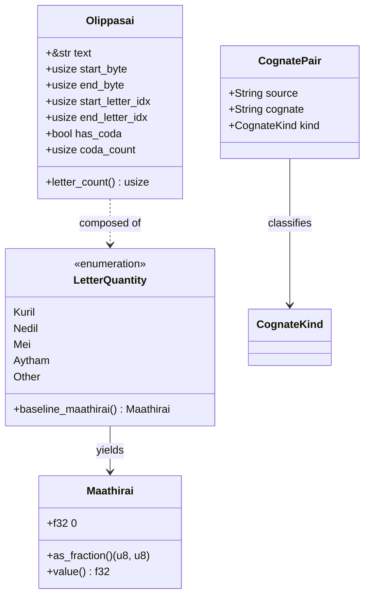

# Data Model: Tamil Core Phonological & Nucleus Primitives (`017`)

**Feature**: [spec.md](spec.md)  
**Status**: Complete

---

## 1. Domain Entities & Type Definitions

### 1.1 `LetterQuantity` (Phonological Weight Classification)

Represents the classical phonological quantity category of an isolated Tamil letter or composite grapheme cluster.

```rust
#[derive(Debug, Clone, Copy, PartialEq, Eq, Hash, Serialize, Deserialize)]
#[serde(rename_all = "lowercase")]
pub enum LetterQuantity {
    /// Short vowel or consonant-vowel composite (1.0 mora)
    /// Examples: அ, இ, உ, எ, ஒ, க, கி, கு, தெ, நொ
    Kuril,

    /// Long vowel, diphthong, or long consonant-vowel composite (2.0 morae)
    /// Examples: ஆ, ஈ, ஊ, ஏ, ஐ, ஓ, ஔ, கா, கீ, கூ, தே, கை, நோ, கௌ, ஸ்ரீ
    Nedil,

    /// Pure consonant terminating in a pulli virama (0.5 mora)
    /// Examples: க், ங், ச், ட், த், ப், ற், ம், ய், ர், ல், வ், ழ், ள், ஜ், ஷ், ஸ், ஹ், க்ஷ்
    Mei,

    /// Classical Aytham character (0.5 mora)
    /// Scalar: ஃ (\u{0B83})
    Aytham,

    /// Non-Tamil letter, symbol, punctuation, whitespace, or invalid cluster (0.0 mora)
    Other,
}
```

#### Invariants & Validation Rules
- `Kuril`: Baseline mora must always equal `1.0`.
- `Nedil`: Baseline mora must always equal `2.0`. Diphthongs `ஐ` and `ஔ` are strictly `Nedil`.
- `Mei`: Must end with virama pulli `\u{0BCD}` or be a recognized atomic pure consonant cluster (e.g. `க்ஷ்`). Baseline mora must equal `0.5`.
- `Aytham`: Must be scalar `\u{0B83}`. Baseline mora must equal `0.5`.
- `Other`: Returns `0.0` mora; `is_kuril`, `is_nedil`, `is_mei`, `is_otru`, `is_aytham` all evaluate to `false`.

---

### 1.2 `Maathirai` (Temporal Duration Measure)

Represents the classical temporal unit (mora) of an isolated speech sound.

```rust
#[derive(Debug, Clone, Copy, PartialEq, Serialize, Deserialize)]
pub struct Maathirai(pub f32);

impl Maathirai {
    pub const KURIL: Self = Self(1.0);
    pub const NEDIL: Self = Self(2.0);
    pub const MEI: Self = Self(0.5);
    pub const AYTHAM: Self = Self(0.5);
    pub const ZERO: Self = Self(0.0);

    #[inline]
    pub fn value(&self) -> f32 {
        self.0
    }

    /// Returns the exact fractional duration as (numerator, denominator).
    #[inline]
    pub fn as_fraction(&self) -> (u8, u8) {
        if (self.0 - 0.5).abs() < f32::EPSILON {
            (1, 2)
        } else if (self.0 - 1.0).abs() < f32::EPSILON {
            (1, 1)
        } else if (self.0 - 2.0).abs() < f32::EPSILON {
            (2, 1)
        } else {
            (0, 1)
        }
    }
}
```

---

### 1.3 `InaEzhuthu` (Cognate Harmony Mapping)

Represents the phonological affinity between paired consonants (Vallinam stop $\leftrightarrow$ Mellinam nasal) and vowels (short $\leftrightarrow$ long).

```rust
#[derive(Debug, Clone, PartialEq, Eq, Serialize, Deserialize)]
pub struct CognatePair {
    /// Source input letter
    pub source: String,
    /// Canonical cognate counterpart
    pub cognate: String,
    /// Category of cognate relationship
    pub kind: CognateKind,
}

#[derive(Debug, Clone, Copy, PartialEq, Eq, Serialize, Deserialize)]
#[serde(rename_all = "lowercase")]
pub enum CognateKind {
    /// Hard stop (Vallinam) <-> Nasal (Mellinam)
    Consonant,
    /// Short vowel <-> Long vowel or Diphthong
    Vowel,
}
```

#### Static Mapping Table

| Source Letter | Cognate Partner | Kind | Sourced Grammatical Rule |
|---|---|---|---|
| `க்` (`க`) | `ங்` (`ங`) | Consonant | *Tolkappiyam* Pirappiyal; *Nannool* Sutra 75 |
| `ச்` (`ச`) | `ஞ்` (`ஞ`) | Consonant | *Tolkappiyam* Pirappiyal; *Nannool* Sutra 75 |
| `ட்` (`ட`) | `ண்` (`ண`) | Consonant | *Tolkappiyam* Pirappiyal; *Nannool* Sutra 75 |
| `த்` (`த`) | `ந்` (`ந`) | Consonant | *Tolkappiyam* Pirappiyal; *Nannool* Sutra 75 |
| `ப்` (`ப`) | `ம்` (`ம`) | Consonant | *Tolkappiyam* Pirappiyal; *Nannool* Sutra 75 |
| `ற்` (`ற`) | `ன்` (`ன`) | Consonant | *Tolkappiyam* Pirappiyal; *Nannool* Sutra 75 |
| `அ` | `ஆ` | Vowel | *Nannool* Sutra 76 |
| `இ` | `ஈ` | Vowel | *Nannool* Sutra 76 |
| `உ` | `ஊ` | Vowel | *Nannool* Sutra 76 |
| `எ` | `ஏ` | Vowel | *Nannool* Sutra 76 |
| `ஒ` | `ஓ` | Vowel | *Nannool* Sutra 76 |
| `ஐ` | `இ` | Vowel | *Nannool* Sutra 76 ("ஐகாரத்திற்கு இகரமும்") |
| `ஔ` | `உ` | Vowel | *Nannool* Sutra 76 ("ஔகாரத்திற்கு உகரமும் இனமாகும்") |

---

### 1.4 `Olippasai` (Phonetic Syllable Nucleus)

Represents a single natural sound unit consisting of an optional onset consonant (or cluster), a core vowel nucleus, and zero or more trailing pure consonants or Aytham codas.

```rust
#[derive(Debug, Clone, PartialEq, Eq, Serialize, Deserialize)]
pub struct Olippasai<'a> {
    /// Borrowed substring slice representing the full syllable
    pub text: &'a str,

    /// Byte offset range in the source text: [start_byte, end_byte)
    pub start_byte: usize,
    pub end_byte: usize,

    /// Grapheme cluster index range in the source text: [start_idx, end_idx)
    pub start_letter_idx: usize,
    pub end_letter_idx: usize,

    /// Whether this syllable has one or more trailing Mei/Aytham codas
    pub has_coda: bool,

    /// Number of coda letters attached to the nucleus
    pub coda_count: usize,
}

impl<'a> Olippasai<'a> {
    #[inline]
    pub fn letter_count(&self) -> usize {
        self.end_letter_idx - self.start_letter_idx
    }

    #[inline]
    pub fn byte_len(&self) -> usize {
        self.end_byte - self.start_byte
    }
}
```

---

## 2. Relationships & Structural Hierarchy


