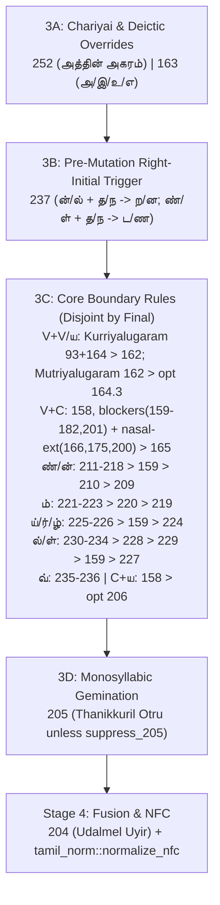

# Phase R3: Formal Precedence DAG, Pipeline Ordering Proof & Complete Forward→Inverse Matrix (`025-tamil-punarchi`)

**Synthesized from:** All **117 primary-witness-audited *Nannūl* sūtras** extracted across:
- [00-prerequisites-eluttiyal-padaviyal.md](00-prerequisites-eluttiyal-padaviyal.md) (`93–94`, `102–108`, `136`)
- [01a-uyireeru-151-177.md](01a-uyireeru-151-177.md) (`151–177`)
- [01b-uyireeru-178-203.md](01b-uyireeru-178-203.md) (`178–203`)
- [02-meyyeeru-204-239.md](02-meyyeeru-204-239.md) (`204–239`)
- [03-urupu-240-257.md](03-urupu-240-257.md) (`240–257`)
- [04-cross-book-and-edge-cases.md](04-cross-book-and-edge-cases.md) (Cross-witness & computational audit)

---

## 1. Complete 117-Sūtra Accounting & Witness Discrepancy Ledger

`nannool-v1` accounts for **117 *Nannūl Eḻuttatikāram* sūtras**: **10 mandatory prerequisites** (*Eḻuttiyal* `93–94`, `102–108` + *Padaviyal* `136`) plus all **107 Puṇariyal sūtras** (`151–257`).

| Chapter | Sūtras | Count | Role in `crates/tamil-punarchi` |
| --- | --- | ---: | --- |
| `ezhuttiyal` | `93, 94, 102–108` | 9 | `phonology.rs` (*Kurriyaligaram* 93, 6-class *Kurriyalugaram* vs *Mutriyalugaram* 94) + `split.rs` phonotactic filter (*Mozhi-muthal*/*Mozhi-eetru* 102–108) |
| `padaviyal` | `136` | 1 | Stage 1A *Panpuppeyar* (`-மை`) 8-operation cascade (explicitly extended to *padappuṇarcci* in both *Viruttiyurai* p. 199 and *Kāṇṭikaiyurai* 136) |
| `uyireeru` | `151–203` | 53 | General Puṇarchi definitions (`151–157`), common boundary rules (`158–161`), vowel-final & *Kurriyalugaram* morphophonemics, directions, numerals, special stems (`162–203`) |
| `meyyeeru` | `204–239` | 36 | Consonant-final + vowel fusion/doubling (`204–205`), contested `இ` (`206`), `ண்/ன்` (`207–218`), `ம்` (`219–223`), `ய்/ர்/ழ்` (`224–226`), `ல்/ள்` (`227–234`), `வ்` (`235–236`), `த/ந` mutation (`237`), *Urupu* delegation (`238`), usage catch-all (`239`) |
| `urupu` | `240–257` | 18 | Case matrix (`240–242`), 17 *Chariyais* (`243–244`), `எல்லாம்`/`எல்லாரும்`/`எல்லீரும்` (`245–246`), pronouns (`247`), `ஆ/மா/கோ` (`248`), decade numerals (`249`), demonstratives (`250–251`), `அத்தின் அகரம்` (`252`), meta/constraint filters & closing analogy (`253–257`) |
| **Total** | **`93–94, 102–108, 136, 151–257`** | **117** | **100% mapped across TVA 1999 *Viruttiyurai*, TVA *Kāṇṭikaiyurai*, and `pmuni0147.html`** |

### Verified Edition Discrepancies (for `edition_note` in `lexicon/punarchi-nannool-inventory.toml`)

1. **Sūtra `104–106`**: TVA *Kāṇṭikaiyurai* portal pages `pno=104..106` display mis-indexed pages (showing 103/93); TVA 1999 *Viruttiyurai* (`pno=175–177`) and `pmuni0147.html` carry the authoritative root text.
2. **Sūtra `179–180`**: *Viruttiyurai* fn. 180 notes Mayilaināthar merges 179+180; TVA 1999, *Kāṇṭikaiyurai*, and `pmuni0147` keep them separate.
3. **Sūtra `195`**: TVA 1999 reads `முதலிறு நான்காம்` vs `pmuni0147` & *Kāṇṭikaiyurai* `முதல் இரு நான்காம்` (both denote numerals `1..8`).
4. **Sūtra `206`**: Minority/contested reading (`துணிநரு முளரே`, *iḻivu-siṟappummai*); majority follows `158` *Iyalbu*. Encode `206` as `optional = true` alternative behind primary `158`.
5. **Sūtra `225`**: TVA *Kāṇṭikaiyurai* prints typo `தழிழவ்` for `தமிழவ்` in the root line.
6. **Sūtra `241`**: `pmuni0147.html` prints `| 242` (duplicate `242` numbering typo); TVA 1999 (`pno=286`) and *Kāṇṭikaiyurai* confirm `241`.
7. **Sūtra `242`**: TVA 1999 reads `புணர்பே` vs `pmuni0147` (`புணர்ப்பு ஏ`) & *Kāṇṭikaiyurai* (`புணர்ப்பே`).
8. **Sūtra `244`**: Root text across all three witnesses ends in `ன` (`ஐகுன`), while *Kāṇṭikaiyurai* gloss identifies it as pure consonant `ன்` (`ஆன்`).
9. **Sūtra `245`**: *Kāṇṭikaiyurai* prints typo `என்ய` (`என்ப`) and `எல்லாவற்றனையும்` vs *Viruttiyurai* `எல்லாவற்றினையும்`.
10. **Sūtra `247`**: `நான்` does not appear in root sūtra `247` (`தான்/தாம்/நாம்/யான்/யாம்/நீ/நீர்` only; `நீ→உன்`/`நீர்→உம்` enter via `பிற`). Support `நான்→என்` explicitly as an extended usage alias (`evidence_layer = "extended_usage"`).
11. **Sūtra `250`**: *Kāṇṭikaiyurai* prints `கற்றுறதல்` vs TVA 1999 `கற்றுறல்`.
12. **Sūtra `255`**: `pmuni0147.html` prints `விரிந்து உம் நின்று உம்` vs TVA 1999 & *Kāṇṭikaiyurai* `விரிந்து நின்றும்`.

---

## 2. Formal 4-Stage Pipeline & Acyclic Precedence Proof

To guarantee **termination**, **zero clobbered triggers**, and **exact sūtra traces**, forward synthesis executes a strict acyclic pipeline `Stage 0 → Stage 1 → Stage 2 (left-to-right segment fold) → Stage 3 (3A → 3B → 3C → 3D) → Stage 4`.

### Boundary State Metadata (`BoundaryFlags`)
Every segment boundary carries explicit transient flags so downstream general rules never clobber upstream exceptions:
- `is_derived_final: bool` — marks `விதியீறு` stems (e.g., `வட்டம்→வட்ட`, `ஆடு→ஆட்டு`, `சாவ→சா`, `வாழிய→வாழி`, `ஆ+பீ→ஆப்பி`) so `165` applies where permitted and skips where blocked.
- `block_165: bool` — set by `168` (`வாழி`), `173` (poetic `அன்று/இன்று`), `174` (`உரிய`), `177` (`ஆப்பி` in *Alvazhi*), `201` (`ஏ/ஓ`), `167`, `171`, `178`, `179`, `181`, `182`.
- `force_165: bool` — set by `165.2` (`நொ/து` imperatives overriding `161`), `183` (`டு/று` doubled stems unlocking `165` per `182`), `242.2` (4th-case `கு` after *Uyartinai* overriding `159`).
- `suppress_205: bool` — set by `247.5` (`நான்கா றிரட்டல`: blocks `205` doubling on `தன்/தம்/நம்/என்/எம்/நின்/நும்/உன்/உம்` before 4th-case `+அ` and 6th-case `அது/ஆது/அ`) and `250.3` (blocks `205` doubling on `அவ்/இவ்/உவ்/எவ்` before `அற்று`).
- `is_chariyai_attu: bool` — marks `அத்து` *Chariyai* segment so `252` triggers strictly before `162`.
- `triggered_237: Option<(char, char)>` — records pre-mutation `(left_final ∈ {ன்,ல்,ண்,ள்}, orig_right_initial ∈ {த,ந})` from Sub-Phase `3B` for Sub-Phase `3C` (`209/210/227/228/229`).

### Stage-by-Stage Execution Order & Invariants

#### Stage 0 — Input Validation, Barrier Preservation & Phonological Analysis
1. Validate `first` and `second` non-empty/non-whitespace, valid `profile`, compatible `context.relation` + `context.subtype`, valid `lexical_class`.
2. Inspect boundary written units via `tamil_core::Letters`: if the right edge of `first` or left edge of `second` is non-Tamil or an explicit `ZWJ`/`ZWNJ` barrier, return verbatim concatenation (`sutra: 153`, `rule_id: "nannool_153_iyalbu_passthrough"`).
3. Normalize working view to NFC (`tamil_norm::normalize_nfc`) and compute:
   - `classify_ugaram(first)` per **Sūtra 94** (`NedilThodar`, `AythathThodar`, `UyirThodar`, `Vanthodar`, `Menthodar`, `Idaithodar`, `Mutriyalugaram`, `NonU`).
   - `is_thanikkuril_otru(first)` per **Sūtra 205** (`(C)V_short + single pure consonant`).

#### Stage 1 — Stem & Closed-Class Pre-Transform (Strictly Before Boundary Sandhi)
- **Sub-Stage 1A (`136`) — *Panpuppeyar* `-மை` Cascade**:
  - Active when `first` ends in `மை` and (`lexical_class == QualityNoun` or `subtype == Panputhogai`).
  - Internal order: `Op1 (ஈறு போதல்: -மை drop)` → `Op8 (medial syllable drop, e.g. பசு→ப)` / `Op2 (உ→இ: கரு→கரி)` → `Op3 (ஆதி நீடல்: பசு→பாசு, செம்→சேம், முது→மூது)` / `Op4 (அ→ஐ: ப→பை)` → `Op5 (தன்னொற்று இரட்டல்: வெறு→வெற்று, சிறு→சிற்று, நெடு→நெட்டு)` / `Op6 (மெய்திரிதல்: சேம்→சேத்)` / `Op7 (இனமிகல்: பை→பைங்/பைந்)`.
  - Optional retention (`செம்மையன்`, `கருமையன்`) emitted as alternative when attested.
- **Sub-Stage 1B — Closed-Class Stem Reductions (Priority Ordered)**:
  1. **Numerals (`188–199`)**: `199` (distributive `N+N`, `N ≠ ஒன்பது`) > `194` (`ஒன்பது+பத்து→தொண்ணூறு`, `ஒன்பது+நூறு→தொள்ளாயிரம்`) > `198` (`பத்து+இரண்டு→பன்னிரண்டு` in *Ummaithogai*) > `196` (`ஒருபது/ஒருபஃது..எண்பது/எண்பஃது + 1..9`) > `197` (`பத்து/ஒன்பது` + `இன்`/`இற்று`) > `195` (`1..8 + பத்து → -பது/-பஃது`) > `188–193` (`1..8` base stems).
  2. **Cardinal Directions & `தெங்கு` (`186–187`)**: `வடக்கு→வட`, `குடக்கு→குட`, `குணக்கு→குண`, `தெற்கு→தென்`, `மேற்கு→மேல்` before non-`த` (`மேல்பால்`, `மேல்+நாடு→மேனாடு`) and `மேற்கு→மேற்` before `த`-initial (`மேற்கு+திசை→மேற்றிசை`, retaining `ற்` and **blocking** `229` deletion so `*மேறிசை` is never emitted), `கிழக்கு→கீழ்` (plus `-ஐ` variants `மேலை`/`கீழை`); `தெங்கு+காய்→தேங்காய்` (`187`).
  3. **Pronoun Oblique Stems (`247` & `238`)**: Active when `second` is an overt oblique case suffix (`ஐ, ஆல், கு, இன், அது, கண்`) OR `relation == Vetrumai` (`238` meaning-compounds): `தான்→தன்`, `தாம்→தம்`, `நாம்→நம்`, `யான்→என்`, `யாம்→எம்`, `நீ→நின்`/`உன்`, `நீர்→நும்`/`உம்` (plus extended usage `நான்→என்`). Set `suppress_205 = true` when `second` is 4th-case `கு` or 6th-case `அது/ஆது/அ` (`247.5`).
  4. **Named Lexical & Closed-Form Poetic Stems**: `வாழிய→வாழி` (`168`, `block_165 = true`), `சாவ→சா` (`169`), `பல/சில` (`170` — self-compounds `பல+பல`/`சில+சில` emit all 4 variants `பலபல/பலப்பல/பற்பல/பல்பல` directly bypassing `227`; before other words optional `பல்/சில்` feeds Stage 3), `ஆ` short-base alternation (`172`, bare short `அ` poetic-only), `அன்றி/இன்றி→அன்று/இன்று` (`173`, poetic-only, `block_165 = true`), `நாழி+உரி→நாடுரி` & `உரி→உரிய` (`174`), `ஆ+பீ→ஆப்பி` (`177`, `block_165 = true` in *Alvazhi*), `அது+அன்று→அதான்று` (`180`, poetic-only), `பனை` (`203`), `அகம்+செவி/கை/சிறை` (`222`, `அஞ்சிறை` poetic-optional), `இல்` negation (`233`).
- **Sub-Stage 1C (`183–185`) — Pre-Elision *Kurriyalugaram* Stem Mutations**:
  - **PROOF (Fixes Bug #1 — `183` vs `164`/`165`)**: Must run BEFORE Stage 3 (`164` elision & `165` doubling).
  - `183`: If `classify_ugaram(first) ∈ {NedilThodar, UyirThodar}` and `first` ends in `டு`/`று` and `relation == Vetrumai` (plus attested *Alvazhi* list `காட்டரண்`, `களிற்றுயானை`, `ஏற்றேனம்`, `வரட்டாடு`, `குருட்டுக்கோழி`, `வெளிற்றுப்பனை`; excluding attested non-doublers `நாடுகிழவோன்`, `காடகம்`, `மிடறணியல்`): `டு → ட்டு`, `று → ற்று` and set `force_165 = true` (per `182`!). Thus `காடு + எருமை` becomes `காட்டு + எருமை` in 1C, then `164` elides `உ` → `காட்டெருமை`, and `ஆடு + கால்` becomes `ஆட்டு + கால்` in 1C, then `165` doubles `க்` → `ஆட்டுக்கால்`!
  - `184`: Lexicon-gated *Menthodar* → *Vanthodar* (`மருந்து→மருத்து`, `சுரும்பு→சுருப்பு`, `கரும்பு→கருப்பு`, `கன்று→கற்று`; *Alvazhi* `என்பு→எற்பு`, `அன்பு→அற்பு`, `குரங்கு→குரக்கு`).
  - `185`: `ஐ` increment stems (`பண்டு→பண்டை`, `இன்று→இற்றை`, `அன்று→அற்றை`, `நேற்று→நேற்றை`).

#### Stage 2 — *Chariyai* Staging, `உம்` Post-Positioning & Left-to-Right Multi-Segment Folding (`240–257`, `238`)
Expands `(stem', second)` into a bounded segment chain `Segs` (`2 <= len <= 5`) and folds left-to-right through Stages 3–4. Per **Sūtra `238`**, items `1–7` trigger **both** when `second` is an overt oblique case suffix (`ஐ, ஆல், கு, இன், அது, கண்`) **and** when `relation == Vetrumai` with a content-word `second` (`எல்லாவற்றுக்கோடும்`, `எல்லாநங்கையும்`, `எல்லார்தங்கையும்`, `ஆன்கோடு`, `அவற்றுக்கோடு`, `அதன்கோடு`):
1. **`245` (`எல்லாம்`)**:
   - `NonRationalNoun` (or default unmarked): `[எல்லா, அற்று, second, உம்]` (plus optional `[எல்லா, அற்று, இன், second, உம்]` → `எல்லாவற்றையும்`, `எல்லாவற்றினையும்`, and `238` `எல்லாவற்றுக்கோடும்`).
   - `RationalNoun`: `[எல்லா, நம், second, உம்]` → `எல்லாநம்மையும்` (and `238` `எல்லாநங்கையும்`).
2. **`246` (`எல்லாரும்`, `எல்லீரும்`)**:
   - Strip trailing `உம்`, optionally insert `தம்`/`நும்`, attach `second`, append `உம்`: `[எல்லார், (தம்), second, உம்]` → `எல்லார்தம்மையும்` / `எல்லாரையும்`; `[எல்லீர், (நும்), second, உம்]` → `எல்லீர்நும்மையும்` / `எல்லீரையும்`.
3. **`247.4` (Oblique Pronoun + `கு`)**: `[stem', அ, கு]` with `suppress_205 = true` (`தனக்கு`, `எனக்கு`, `நினக்கு`, `உனக்கு`, `தமக்கு`, `நமக்கு`, `எமக்கு`, `நுமக்கு`, `உமக்கு`).
4. **`248` (`ஆ, மா, கோ, ஆமா`)**: Optional `ன்` / `வ்` / `இன்` (blocked before 5th-case `இன்` per `254`), plus `உ` before `கு` (`ஆனை`, `ஆவை`, `ஆவினை`, `ஆனுக்கு`, `ஆவுக்கு`, `ஆவினுக்கு`; `238` `ஆன்கோடு`).
5. **`249` (`ஒருபது..எண்பது, ஒன்பது` + `ஆன்`)**: Truncate `பது/பஃது → ப்`, `[Nப், ஆன், second]` (`ஒருபானை`, `ஒன்பானை`) alongside non-`ஆன்` (`ஒருபதை`/`ஒருபஃதை`).
6. **`250` & `257` (`அவ், இவ், உவ், எவ்`)**: `[stem, அற்று (+ optional இன்), second]` with `suppress_205 = true` (`அவற்றை`, `இவற்றை`, `உவற்றை`, `எவற்றை`, `அவற்றினை`; `238` `அவற்றுக்கோடு`).
7. **`251` (`அஃது, இஃது, உஃது`, `அது, இது, உது`)**: Optional `அன்` (+ `உ` before `கு`); when `அன்` is selected, delete `ஃ` (`அதனை`/`அஃதை`, `அதற்கு`/`அதனுக்கு`; `238` `அதன்கோடு`).
8. **`219` + `243–244` + `252` (`ம்`-final neuter nouns & natural `அ`-final `மக` + `அத்து`)**: `மரம் → மர` (`219`), or natural `அ`-final `மக` (`252.1`), expand to `[stem, அத்து (is_chariyai_attu=true), (optional இன்), (optional உ before கு), second]` (`மரத்தை`, `மரத்தினை`, `மரத்துக்கு`, `மரத்தினுக்கு`, `மரத்திலை`, `மகத்துக்கை`).
9. **Stem-level *Chariyai* increments**: `202` (`ஐ` + `அம்`), `207–208` (`உ`/`அ` on verbal nouns/imperatives), `212` (`கிளைப்பெயர் + அ`), `215` (`எகின் + அ`), `217` (`மின்/பின்/பன்/கன் + உ`, `கன் + அ`), `223` (`ஈம்/கம்/உரும் + உ/அ`), `225` (`தமிழ்/தாழ் + அ`), `231` (`வல் + உ/அ`), `234` (`புள்/வள் + உ`), `236` (`தெவ் + உ`).
10. **`254` & `242.2` Hard Filters**:
    - NEVER insert `இன்` *Chariyai* immediately before 5th-case `இன்` *urupu* (`நாட்டின்`, never `*நாட்டினின்`).
    - When `second == "கு"` (4th case), set `force_165 = true` even after *Uyartinai*/*Poduppeyar* (`நம்பிக்கு`, `சாத்திக்கு`); when `second == "கண்"` (7th case), keep `159` (`நம்பிகண்` vs *Ahrinai* `உறிக்கண்`).

**Folding Rule**: Fold `Segs` strictly left-to-right: `acc = fold(s_0, s_1) → fold(acc, s_2) → ... → fold(acc, s_k)`, running Stages 3–4 at each fold boundary. Example trace for `மரம் + ஐ` (`Case2`):
- Stage 1/2: `மரம்` → `மர` (`219`), stage `[மர, அத்து (is_chariyai_attu), ஐ]` (`244`).
- Fold 1 (`மர + அத்து`): Sub-Phase `3A` fires **`252`** (`அத்தின் அகரம்`: `அத்து → த்து`, bypassing `162`!) → `மரத்து`.
- Fold 2 (`மரத்து + ஐ`): Sub-Phase `3C` fires **`164`** (`மரத்து → மரத்த்`), Stage 4 fires **`204`** → **`மரத்தை`**!

#### Stage 3 — Boundary Morphophonemics (Strict Intra-Stage Sub-Order `3A → 3B → 3C → 3D`)

- **PROOF (Fixes Bug #2 — `252` vs `162`)**: `3A` runs `252` before `3C` runs `162`, guaranteeing `மர + அத்து → மரத்து` (never `*மரவத்து`). Similarly, `163` runs in `3A` before `162`/`158`, guaranteeing `இ + அணி → இவ்வணி` (never `*இயணி`) and `எ + ஞாலம் → எஞ்ஞாலம்`.
- **PROOF (Fixes Bug #3 — `237` vs `209/210/227/228/229`)**: `3B` runs `237` while the **original** `left` final `{ன், ல், ண், ள்}` is intact. Then `3C` executes the `left`-final transformation (`209`, `210`, `227`, `228`, `229`) using `triggered_237`, producing all **12 exact attested surface patterns** (`ற்ற, ட்ட, ன்ற, ண்ட, ன்ன, ண்ண, ஃற, ஃட`, single `ற, ட, ன, ண`) and NEVER emitting forbidden `*ல்த` / `*ள்த` (enforcing `117` *ēṟpuḻikkōṭal* in `227`)!
- **PROOF (Fixes Bug #4 — `205` anti-gemination)**: `3D` checks `!suppress_205`, so `205` doubles `கல்+அடி→கல்லடி`, `நொவ்+அழகிது→நொவ்வழகிது`, `பல்+அணி→பல்லணி`, `எண்+ஐந்து→எண்ணைந்து`, `பன்+இரண்டு→பன்னிரண்டு`, `தன்+ஐ→தன்னை`, while cleanly NOT doubling `தன்+அ+கு→தனக்கு` (`247.5`), `தன்+அது→தனது` (`247.5`), and `அவ்+அற்று+ஐ→அவற்றை` (`250.3`).

#### Stage 4 — Orthographic Fusion & Deterministic Ranking
1. Apply **Sūtra `204`** (*Udalmel Uyir*): fuse trailing `Mei` + leading `Uyir` via `tamil_core::compose_uyirmei`.
2. Normalize output to canonical NFC (`tamil_norm::normalize_nfc`).
3. Deduplicate branches by `(surface, rule_ids)`.
4. Sort canonically: primary result prefers unmarked / *Alvazhi* general rules (non-poetic, non-minority) first, then ascending primary sūtra number; every other valid branch is emitted in `alternatives` with its `required_context`, `optional_variant`, and `poetic` flags.

---

## 3. Complete Mechanically Derived Forward → Surface Cluster → Inverse Matrix (`split.rs`)

Every reversible rule across all 117 sūtras maps to an explicit inverse rule in `split.rs`. All candidates pass **dual pruning**:
1. **Phonotactic Filter (`102–108`)**: Reject any candidate where `first` fails `is_valid_mozhi_eetru` (e.g., ends in `க்/ச்/ட்/த்/ப்/ற்`, `ங்`, `ஃ`, `C+எ`, invalid `C+ஒ`/`C+ஔ`) or `second` fails `is_valid_mozhi_muthal` (e.g., starts with pure consonant, `ஃ`, `ட/ண/ர/ல/ழ/ள/ற/ன`, `வு/வூ/வொ/வோ`, `யி/யீ/யெ/யே/யை/யொ`, `ஞி..ஞௌ`, standalone `ங` outside `அ/இ/உ/எ/யா/ஆ/ஈ/ஊ + ஙனம்`).
2. **Forward-Verification Pruning**: Re-run forward `punarchi_join` on `(cand.first, cand.second)` under the candidate's inferred context; retain ONLY candidates that reproduce `surface` verbatim!

| # | Surface Pattern at Split Point | Forward Source Sūtras | Reconstructed `(first, second)` Candidates | Notes / Disambiguation |
| ---: | --- | --- | --- | --- |
| 1 | `<unit><unit>` (direct boundary) | `153, 158–161, 167, 171, 176, 178–179, 181–182, 201, 209, 211–216, 224, 226–227, 230, 235` | `(prefix, suffix)` (*Iyalbu*) | Direct written-unit boundary |
| 2 | `C + V` (*Uyirmei*, non-geminate) | `204` | `(prefix + C், V + rest)` | Only if `C்` ∈ 11 legal *mozhi-eetru* (`107`) |
| 3 | `(C)V_short + C் + C + V` (geminate) | `205 + 204` (also `162/163/170/193/194/198/199` feeding `205`) | `(prefix + C், V + rest)` | Only when `prefix + C்` is *Thanikkuril* (`205`) |
| 4 | `V1 + ய் + V2` or `V1 + வ் + V2` (or `வ்வ் + V2`) | `162` (*Udambadumei*), `163` (`அ/இ/உ/எ + V`), `190/192` | `(prefix_V1, V2 + rest)` | `ய்` after `இ/ஈ/ஐ/ஏ`; `வ்` after other vowels/`ஏ`; `வ்வ்` after short monosyllable (`நொ`, `அ/இ/உ/எ`) |
| 5 | `C_v + V2` (`C_v ∈ {க,ச,ட,த,ப,ற}`) | `164` (*Kurriyalugaram* + rare *Mutriyalugaram*) | `(prefix + C_v + உ, V2 + rest)` | Verify `classify_ugaram(first)` (`94`); `Mutriyalugaram` gated to attested `164.3` stems (`கதவு`, `அது`, `இது`) |
| 6 | `C_v + இ + ய...` (`கி/சி/டி/தி/பி/றி + ய`) & `-C(C)இ + ய` | `93 + 164` (*Kurriyaligaram*), `206` (optional `இ` before `ய`) | `(prefix + C_v + உ, ய + rest)`, `(prefix + C், ய + rest)` (`206`, degeminating `CC→C` if *Thanikkuril*) | Verify `classify_ugaram(first) != Mutriyalugaram` (`94`); `206` emits contested minority candidate (`வேளியாவன்`, `மண்ணியாது`) |
| 7 | `V + க்க / ச்ச / த்த / ப்ப` | `165, 163, 170, 175, 178, 200, 203, 219, 220` | `(prefix_V, C_stop + rest)`, `(prefix_V + ம், C_stop + rest)` (`219`), `(அ/இ/உ/எ, C_stop + rest)` (`163`) | Also check `பூ`, `புளி`, `பனை`, `தேன்`, `மரம்`-class stems |
| 8 | `(ய்/ர்/ழ்) + (க்/ச்/த்/ப்) + C_stop` | `224, 226` | `(prefix + {ய்,ர்,ழ்}, C_stop + rest)` | Strip doubled stop |
| 9 | `(மெய்/கை/நொ/து/அ/இ/உ/எ) + (ஞ்ஞ/ந்ந/ம்ம/ய்ய/வ்வ/ங்ங)` | `158, 163, 106, 221, 235` | `(first_stem, {ஞ,ந,ம,ய,வ,ங} + rest)` | `106` handles bound `ஙனம்` |
| 10 | `V + ங்க / ஞ்ச / ந்த / ம்ப` | `166` (trees), `175` (`புளி`), `178` (`மீ`), `200` (`பூ`), `202/203` (`ஐ+அம்`), `214` (`தேன்`), `219/220` (`ம்`), `136` (`-மை`) | `(prefix_V, C_stop + rest)`, `(prefix_V + ம், C_stop + rest)`, `(பனை/தேன்/பசுமை/செம்மை, ...)` | Nasal assimilation vs nasal insertion |
| 11 | **`ற்ற`** (`ற் + ற`) | `227 + 237` (`ல் + த`), `209 + 237` (*Vetrumai* `ன் + த`), `183` (`று` doubling + V), `136` (`வெறுமை/சிறுமை`), `244/245/250` (`அற்று`/`இற்று`) | `(prefix + ல், த + rest)`, `(prefix + ன், த + rest)`, `(prefix + று, V/C + rest)`, *Chariyai*/*Panpuppeyar* inversions | **Critical cluster** (previously missing from `research.md`) |
| 12 | **`ட்ட`** (`ட் + ட`) | `227 + 237` (`ள் + த`), `209 + 237` (*Vetrumai* `ண் + த`), `183` (`டு` doubling + V), `136` (`நெடுமை`) | `(prefix + ள், த + rest)`, `(prefix + ண், த + rest)`, `(prefix + டு, V/C + rest)`, *Panpuppeyar* inversion | **Critical cluster** (previously missing) |
| 13 | **`ன்ற`** (`ன் + ற`) | `209 + 237` (*Alvazhi* `ன் + த`) | `(prefix + ன், த + rest)` | **Critical cluster** (`பொன் + தீது → பொன்றீது`) |
| 14 | **`ண்ட`** (`ண் + ட`) | `209 + 237` (*Alvazhi* `ண் + த`) | `(prefix + ண், த + rest)` | **Critical cluster** (`மண் + தீது → மண்டீது`; `மண்டலம்` pruned cleanly if `தலம்` verified) |
| 15 | **`ன்ன` / `ண்ண`** | `209 + 237` (*Thanikkuril* `ன்/ண் + ந`), `227 + 237` (*Thanikkuril* `ல்/ள் + ந`), `205` (`ன்/ண் + V`) | `(prefix + {ன்,ல்}, ந + rest)`, `(prefix + {ண்,ள்}, ந + rest)`, `(prefix + {ன்,ண்}, V + rest)` | **Critical cluster** (`பொன்னன்று`, `கன்னன்று`, `மண்ணன்று`, `முண்ணன்று`) |
| 16 | **Single `ற` / `ட`** (after non-*Thanikkuril*) | `229 + 237` (non-*Thanikkuril* `ல்/ள் + த`) | `(prefix + ல், த + rest)` (`ற`), `(prefix + ள், த + rest)` (`ட`) | **Critical deletion output** (`வேல்+தீது→வேறீது`, `வாள்+தீது→வாடீது`, `தோன்றறீயன்`, `வேடீயன்`) |
| 17 | **Single `ன` / `ண`** (after non-*Thanikkuril*) | `210 + 237` (`ன்/ண் + ந`), `229 + 237` (`ல்/ள் + ந`) | `(prefix + {ன்,ல்}, ந + rest)` (`ன`), `(prefix + {ண்,ள்}, ந + rest)` (`ண`) | **Critical deletion output** (`தூண்+நன்று→தூணன்று`, `அரசனல்லன்`, `தோன்றனல்லன்`, `வேணல்லன்`) |
| 18 | `ற்(க/ச/ப)` / `ட்(க/ச/ப)` | `209` (`ன்/ண்`), `227/232` (`ல்/ள்`), `191` (`நான்கு`) | `(prefix + {ன்,ல்}, {க,ச,ப} + rest)`, `(prefix + {ண்,ள்}, {க,ச,ப} + rest)` | Covers `கற்சிலை`, `முட்செடி`, `பொற்கலம்`, `மட்குடம்`, `நெற்கடிது` |
| 19 | `ன்(ஞ/ம)` / `ண்(ஞ/ம)` | `227` (`ல்/ள் + {ஞ,ம}`), `209` (`ன்/ண்`) | `(prefix + {ல்,ன்}, {ஞ,ம} + rest)`, `(prefix + {ள்,ண்}, {ஞ,ம} + rest)` | Covers `கன்மாண்டது`, `முண்மாண்டது` |
| 20 | **`ஃற` / `ஃட`** | `228 + 237` (*Thanikkuril* *Alvazhi* `ல்/ள் + த`), `170` (`பஃறாழிசை`) | `(prefix + ல், த + rest)` (`ஃற`), `(prefix + ள், த + rest)` (`ஃட`), `(பல/சில, த + rest)` | Covers `கஃறீது`, `முஃடீது`, `அஃறிணை`, `பஃறாழிசை` |
| 21 | **`ஃ(க/ச/த/ப)`** | `235` (`அவ்/இவ்/உவ் + Vallinam` in *Alvazhi*) | `(அவ்/இவ்/உவ், {க,ச,த,ப} + rest)` | Covers `அஃகடிய`, `இஃகடிய`, `உஃகடிய` |
| 22 | `V + வ்/ந/ம/ல/ர/ய` (post-`ம்` deletion) | `219` (`மரம் + வேர் → மரவேர்`, `மரம் + நார் → மரநார்`) | `(prefix_V + ம், rest)` | Requires `prefix_V` ending in `அ` (most `ம்`-final nouns) |
| 23 | `-த்து-` / `-த்த்-` + case/word | `219 + 244 + 252 (+ 164 + 204)` | `(prefix + ம், suffix)` or `(மக, suffix)` | Covers `மரத்தை`, `மரத்தினை`, `மரத்துக்கு`, `மரத்தினுக்கு`, `மரத்திலை` |
| 24 | `-அற்று-` / `-அன்-` / `-இன்-` / `-ஆன்-` / `-தம்-` / `-நம்-` / `-நும்-` / `-உ-` + case (`+ உம்`) | `243–253, 257` | `(base_stem, case_suffix)` | Covers `பலவற்றை`, `அவற்றை`, `எவற்றை`, `எல்லாவற்றையும்`, `எல்லாநம்மையும்`, `எல்லார்தம்மையும்`, `எல்லீர்நும்மையும்`, `ஒருபானை`, `ஒன்பானை`, `அதனை`, `அதற்கு`, `ஆனை`/`ஆவினுக்கு` |
| 25 | Oblique pronoun prefixes (`தன்/தம்/நம்/என்/எம்/நின்/நும்/உன்/உம்`) | `247, 238, 218, 221` | `({தான்,தாம்,நாம்,யான்,நான்,யாம்,நீ,நீர்}, case/noun)` | Handles `தனக்கு`, `தன்னை`, `தனது`, `எனக்கு`, `நின்னை`, `உன்னை`, `நங்கை`, `தந்நூல்` |
| 26 | Closed-class compound & poetic stems | `136, 168–170, 172–174, 177, 184–199, 202–203, 214, 222, 233, 236` | Exact table-backed inverse map | Directions (`வட/தென்/மேல்/கீழ்`), numerals (`ஒரு/ஓர்..தொண்ணூறு/தொள்ளாயிரம்/பன்னிரண்டு/ஒவ்வொன்று..`), `தேங்காய்`, `நாடுரி`/`உரிய-`, `ஆப்பி`, `பனாட்டு`, `அங்கை`, `வாழி`, `சா`, `நிலவு`/`நில` (`172`), poetic `அன்று/இன்று` (`173`), `தேமொழி` (`214`), `புன்னையம்`/`தாழம்` (`202`), `பைந்தமிழ்`/`சிற்றூர்`/`சேதாம்பல்` (`136`) |
| 27 | `-Cஉ` / `-CCஉ` / `-Cஅ` stem-increment forms | `207, 208, 212, 215, 217, 223, 225, 231, 234, 236` | `(prefix + C், second)` (degeminating `CC→C` if *Thanikkuril* `205`) | Covers `உண்ணுக் கடிது`, `பொருநக்கடுமை`, `எயினக்குடி`, `எகினக்கால்`, `மின்னுக் கடிது`, `கம்முக் கடிது`, `தமிழப்பிள்ளை`, `தாழக்கோல்`, `வல்லப்பலகை`, `புள்ளுக் கடிது`, `தெவ்வுக்கடிது` |
| 28 | Non-*Thanikkuril* `ய்` deletion (`-ஆ/ஓ + ய-`) | `224` (`மேல்`) | `(prefix + ய், ய + rest)` | Covers `காய் + யாது → காயாது`, `நோய் + யானை → நோயானை` |

---

## 4. Minimal Exact Enum Audit for `PunarchiContext` (`data-model.md` & `contracts/punarchi.md`)

Auditing all 117 sūtras confirms the exact minimal enums needed (avoiding both missing distinctions and unnecessary bloat):

1. **`PunarchiChapter`** (5 chapters for `punarchi_rules` and `lexicon/punarchi-nannool-inventory.toml`):
   - `ezhuttiyal` (`93–94, 102–108`), `padaviyal` (`136`), `uyireeru` (`151–203`), `meyyeeru` (`204–239`), `urupu` (`240–257`).
2. **`GrammaticalRelation`**:
   - `unspecified`, `vetrumai`, `alvazhi`.
3. **`ContextSubtype`** (aligned to *Nannūl* 152 + specific verbal/compound contexts):
   - *Vetrumai* (6): `case_2`, `case_3`, `case_4`, `case_5`, `case_6`, `case_7`. *(Overt `Viri` vs elided `Thogai` is inferred directly from whether `second` is an overt case suffix `{ஐ, ஆல், கு, இன், அது, கண்}` vs a content word!)*
   - *Alvazhi* (14 *Nannūl* 152 subtypes + 5 fine verb/compound subtypes required by `161, 167, 168, 178, 199, 207, 222, 239`):
     - *Thogainilai* (5): `vinaithogai`, `panputhogai`, `uvamaithogai`, `ummaithogai`, `anmozhi`
     - *Thogaanilai* (9): `ezhuvai`, `vili`, `peyarecham`, `vinaiyecham`, `vinai_mutru`, `kurippu_vinai_mutru`, `idaiccol`, `uriccol`, `adukkuthodar`
     - Specific verb/compound triggers (5): `imperative` (`161, 207`), `second_person_verb` (`161`), `viyankol` (`167, 168`), `distributive` (`199`), `ilakkanappoli` (`178, 222, 239`).
4. **`LexicalClass`** (only classes explicitly gated by audited sūtra conditions):
   - `rational_noun` (`159, 242, 245`), `non_rational_noun` (`167, 176, 245`), `common_noun` (`159`), `tree_name` (`166`), `taste_puli` (`175`), `measure_word` (`174, 188, 211`), `quantity_word` (`188`), `number_word` (`188–199`), `direction_word` (`186`), `pronoun` (`218, 247`), `demonstrative` (`163, 179, 235, 250–251`), `interrogative` (`160, 163, 257`), `branch_name` (`சாதி/குழூஉ/கிளைப்பெயர்`, `211, 212`), `quality_noun` (`136`), `verbal_noun_root` (`207, 208`), `verbal_noun_derived` (`230`), `negation_stem` (`233`), `clitic_particle` (`167, 171, 201`), `locative_particle` (`அங்கு..யாண்டு`, `181`), `temporal_particle` (`அன்று..முந்து`, `181`), `negative_plural_verb` (`171`), `passive_action_compound` (`256`), `food_sesame` (`உணவு எண்`, `211`), `swan_ekin` (`மரமல் எகின்`, `215`), `dice_val` (`வல்`, `231`), `cloud_sel` (`செல்`, `232`), `smith_kol` (`கொல்`, `232`).
5. **Boolean flag**: `poetic: bool` (default `false`; gates closed-form verse-only rules `163.3`, `172.1`, `173`, `180`, `222` `அஞ்சிறை`, `243.3`. Note: `177`, `228`, `235`, `255` are active in default `nannool-v1` with `poetic = false`, and `206` is a contested `optional = true` alternative behind `158`, not a poetic-only rule).
